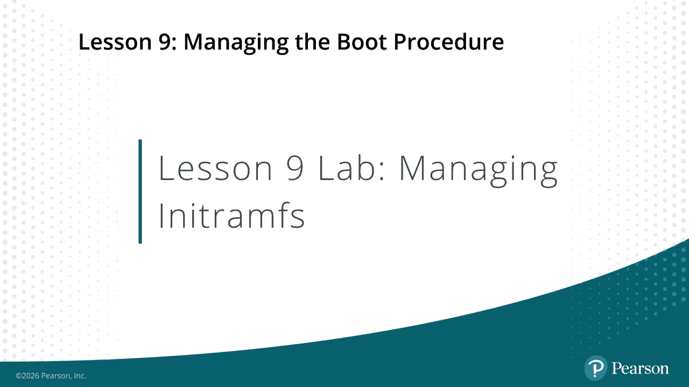

# CompTIA Linux+ V8：Lesson 9：管理 Initramfs 🐧


在本节课中我们将要学习 Linux 启动过程中的一个重要组件，即 initramfs 和 initrd 镜像。这些镜像在系统启动时负责加载必要的驱动程序和模块，确保内核能够找到真正的根文件系统。如果你是 Linux 新手，不用担心，下面我们会用大白话把每一个概念都讲清楚，让你明白这个文件到底是做什么用的，以及在日常维护中什么时候需要重新生成它。


本节我们先来看看今天的实验任务到底要做什么。课程的理论部分已经讲完，接下来我们进入实操环节，在这个实验中，你需要管理系统中的 initramfs 镜像。管理 initramfs 主要包括查看当前镜像、理解它的组成，以及在必要时重新生成它，以确保系统能够正常启动。




以下是本节实验的核心任务清单：

- 查看当前系统中已有的 initramfs 或 initrd 文件
- 确认当前运行的内核版本
- 为指定内核版本生成新的 initramfs 镜像
- 验证生成后的镜像文件是否存在


刚才列出的任务看起来可能比较多，但实际上每一步都很简单，不需要你写复杂的代码。initramfs 就是一个临时的根文件系统镜像，内核在启动的时候先加载这个镜像，里面包含一些必要的驱动和工具，帮助系统找到真正的硬盘分区。如果你更换了硬件、升级了内核，或者修改了存储控制器驱动，通常就需要重新生成这个镜像，否则系统可能会开机失败，陷入内核恐慌。


接下来我们看看如何用命令生成新的 initramfs 或 initrd。在不同的 Linux 发行版中，生成命令略有不同，但原理是一样的，就是把当前内核需要的模块打包成一个镜像文件。以下是几种常见发行版的操作命令：


```bash
# Debian / Ubuntu 系列
sudo update-initramfs -u -k $(uname -r)

# RHEL / CentOS / Fedora 系列（使用 dracut）
sudo dracut -f /boot/initramfs-$(uname -r).img $(uname -r)

# 较旧的系统（使用 mkinitrd）
sudo mkinitrd /boot/initrd-$(uname -r).img $(uname -r)
```


上面的代码中，`$(uname -r)` 会自动获取你当前正在使用的内核版本号，这样生成的镜像文件名就会和内核版本对应上，避免搞混。执行完命令后，系统会在 `/boot` 目录下生成新的镜像文件，引导加载程序下次启动时就会读取这个新文件。


到此我们就完成了 initramfs 管理的基本操作。生成新镜像的过程并不复杂，核心就是让内核在启动时拥有正确的驱动模块，这样系统才能顺利找到根分区并进入正常的运行状态。如果你在实际操作中遇到报错，通常检查一下内核版本和命令参数就能解决问题。


本节课中我们一起学习了如何管理 Linux 系统中的 initramfs 和 initrd 镜像，了解了实验任务的具体内容，并掌握了在不同发行版上重新生成启动镜像的命令方法。希望这些内容能帮助你更好地理解系统启动流程，并在日常维护中灵活应用。

