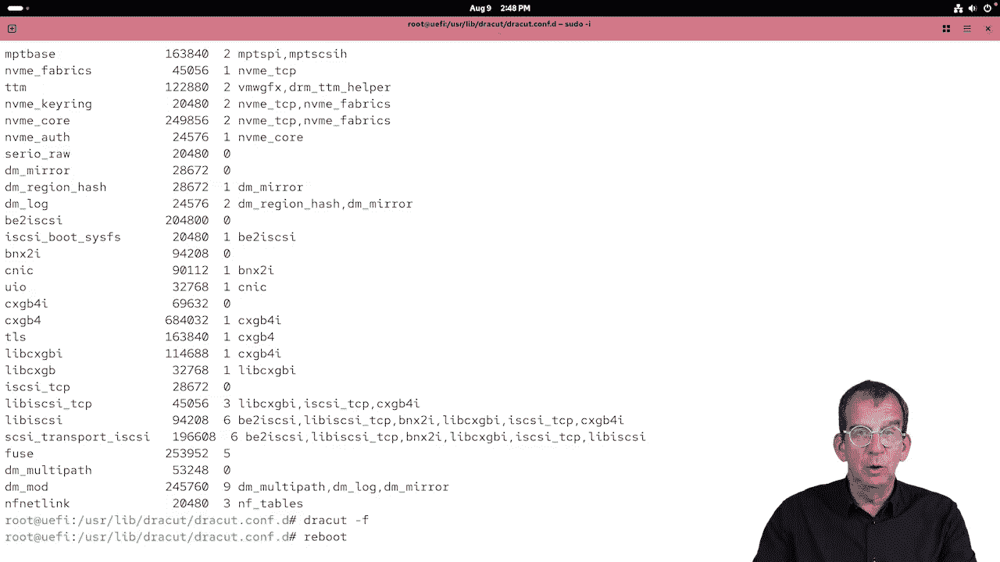
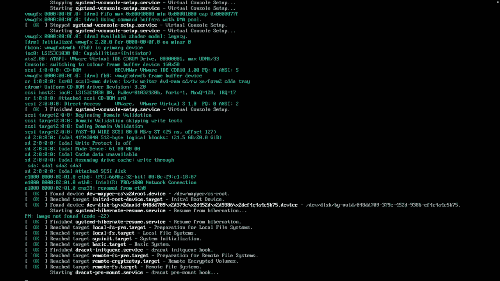

# CompTIA Linux+ V8：第9章：🛠️ 管理 Initramfs 实验解答

在本节课中我们将要学习如何管理 Linux 系统的 Initramfs。Initramfs 是内核启动时使用的临时根文件系统，里面包含了启动所必需的驱动和模块。通过本节的实验解答，你会了解到如何查看 dracut 的配置目录，如何确认当前加载的内核驱动，如何重新生成 initramfs，以及如何重启系统验证新配置是否正常工作。这些操作对系统管理员来说非常基础，也是处理启动失败问题时必须掌握的技能。


首先，我们来看看系统里 dracut 的配置文件都放在哪里，这是整个实验的起点。

以下是你需要检查的路径和相关说明：

```bash
/etc/dracut.conf.d/
```

你真的需要进入 /etc/dracut.conf.d。所以让我们查看 /etc/dracut.conf.d 下的所有不同脱落文件，看看怎么样。这个目录里存放了 dracut 的各种配置片段。你可以进入目录，看看里面有哪些文件，这些文件会影响 initramfs 的生成过程。不过要注意，有些旧的配置方式已经不再使用了，我们主要关注当前系统中实际生效的部分。你可以看到 dracut.conf 已经不再使用了。


进入目录之后，我们会看到一个默认的发行版配置文件，下面我们就来看看它里面写了什么。

以下是标准配置文件的示例路径：

```bash
cat /etc/dracut.conf.d/01_disk_conf
```

在 /etc/dracut.conf.d 那里我们有标准配置，这里你可以看到发生了什么，所以我们有一个 01 disk conf。好吧，我可以告诉你 01 disk conf 就是你的发行版配置，这里你可以看到里面的所有内容，大量参数告诉一切运行在哪里，这里没太多要做的。01 disk conf 是你的发行版配置文件。打开它之后，你能看到里面包含很多参数，这些参数决定了各个组件在启动时的位置和行为。虽然里面内容看起来很多，但通常情况下这里不需要你做太多调整，因为大部分设置已经由发行版预先配置好了。


配置文件的核心作用，就是检测当前系统中已经加载的内核驱动，这一步非常关键。

以下是相关命令和操作说明：

```bash
lsmod
```

如有需要，还可以使用 modprobe 将特定驱动加入：

```bash
sudo modprobe <驱动名称>
```

但这就是 dracut 配置的精髓，它检测当前加载的内核驱动。所以更好的主意是使用 lsmod，如果需要使用 modprobe 将你的内核驱动包含进去，然后你可以使用 dracut -f 来生成你的新 initramfs。dracut 配置的本质，就是去侦测当前内核里已经加载了哪些驱动程序。比起直接修改配置文件，更推荐的做法是先用 lsmod 查看已加载的模块，如果发现缺少某个重要驱动，就用 modprobe 把它加进去。这样做能确保新生成的 initramfs 里包含了所有必要的驱动，避免启动时找不到硬件。


确认驱动没问题之后，就可以用 dracut 工具重新生成 initramfs 了，这是本实验最核心的操作。

以下是重新生成的关键命令：

```bash
sudo dracut -f
```



在生成之前，如果你想看看，可以先查看 dracut 的配置。然后你可以使用 dracut -f 来生成你的新 initramfs。生成新的 initramfs 是一件比较严肃的事情，因为它直接关系到系统能否正常启动。执行 dracut -f 之后，系统会根据当前的配置和已加载的驱动，创建一个新的 initramfs 镜像文件。这个过程可能需要花一点时间，你需要耐心等待命令执行完成。




生成新的 initramfs 之后，必须重启系统才能让新配置生效，同时也是验证是否成功的唯一方式。

以下是验证步骤和应对异常的方法：

```bash
sudo reboot
```


现在生成新的 initramfs 是严肃的事情，所以生成后别忘了重启，以确保新的 initramfs 工作正常，如果不行，你从引导菜单选择救援选项，救援选项总是有效，如你所见花了一段时间，所以我要确保它仍然工作，这就是我重启的原因。现在在引导过程中，我们刚才看到很多绿色启动信息和没有错误，我又看到了我的登录提示符。这意味着我们确认了刚才重新创建的 dracut 配置是工作的。重启完成后，你会在引导过程中看到大量绿色的启动信息，并且没有出现错误提示。如果系统顺利进入登录界面，并且你再次看到了登录提示符，那就说明刚才重新创建的 dracut 配置已经正常工作了。如果重启后系统无法正常启动，不要慌张，可以从引导菜单中选择救援选项，救援模式通常总是能工作，它会帮助你进入系统进行修复。


本节课中我们一起学习了如何查看 /etc/dracut.conf.d 下的 dracut 配置，如何查看标准发行版配置文件 01 disk conf，如何使用 lsmod 和 modprobe 检查并加载内核驱动，如何用 dracut -f 重新生成 initramfs，以及如何通过重启系统并观察登录提示符来验证新配置是否生效。希望这些内容能帮助你更好地理解和管理 Linux 的 initramfs。
