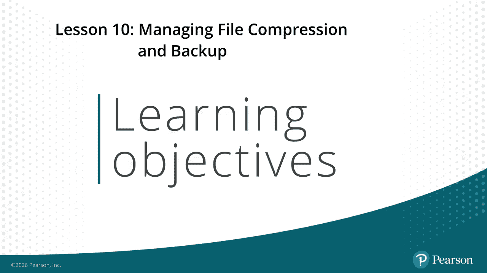
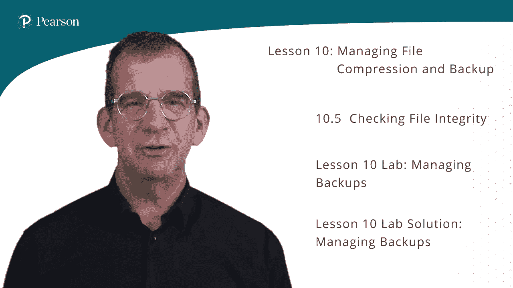

CompTIA Linux+：第36节：压缩与备份学习目标 📦


在本节课中，我们将要学习 Linux 系统中的压缩与备份知识。这部分内容主要围绕数据安全展开，告诉你怎么防止重要文件丢失，以及出了问题该怎么找回来。无论你是刚接触 Linux 的新手，还是已经有一点基础的学习者，掌握备份和恢复都是非常实用的技能。下面我们就一起来看看这一节具体包含哪些内容。


第一小节：备份策略 💾




上一节我们介绍了课程的整体背景，本节中我们来看看备份策略。

备份策略简单来说就是你准备怎么把重要数据复制一份保存起来，以防电脑坏掉或者文件被误删的时候还能找回。这不是随便拷贝几个文件那么简单，而是需要提前规划好备份的时间、位置和方式。下面是备份策略中常见的几个核心要点：

- 确定需要备份哪些文件和目录，不要把所有东西都备份，那样太浪费空间。
- 选择备份的存储位置，可以是本地硬盘，也可以是远程服务器或者云端。
- 设定备份执行的频率，比如每天一次，或者每周一次，根据数据变化的频率来决定。
- 选择合适的备份工具，Linux 系统里有很多成熟的命令行工具可供使用。


第二小节：CPIO 与 DD 命令 🔧


刚才我们了解了备份策略的基本思路，本节中我们来看看 CPIO 和 DD 这两个实用工具。

在 Linux 中，CPIO 和 DD 是两个非常经典的命令行工具，分别用于打包文件和复制数据。CPIO 常用于创建和提取归档文件，而 DD 则以其强大的磁盘克隆能力闻名，常被用来制作系统镜像或备份整个硬盘。下面是这两个命令的基本用法示例：

```
# 使用 cpio 创建归档文件
find /etc -type f | cpio -ov > /backup/etc.cpio

# 使用 dd 克隆整个磁盘
dd if=/dev/sda of=/backup/disk.img bs=4M
```

在上面的代码中，find 命令会列出 /etc 目录下的所有文件，然后通过管道传给 cpio 打包成 etc.cpio 文件；dd 命令则把 /dev/sda 磁盘的内容完整复制到 disk.img 镜像文件中，bs=4M 表示每次读写 4 兆字节，可以提高速度。


第三小节：备份存储与文件完整性检查 🔍


学会了如何用工具制作备份，本节中我们来看看备份应该存放在哪里，以及如何确保备份文件本身没有损坏。

备份做好了之后，不能随便扔在一个地方就完事了，你需要考虑存储位置的安全性，还要定期检查备份文件是否完整，万一备份文件本身坏了，那恢复的时候就会很麻烦。下面是存储备份和检查文件完整性时需要注意的几个方面：

- 备份存储位置要与原始数据分开，不要把备份和源数据放在同一块硬盘上。
- 可以使用远程服务器、网络存储或者移动硬盘来保存备份副本。
- 检查文件完整性通常使用校验和工具，比如 md5sum 或 sha256sum，对比生成的哈希值是否一致。
- 定期进行恢复演练，确保备份真的可以在紧急情况下使用。


第四小节：实验与解答 🧪


理论知识学得差不多了，本节中我们来看看实验环节以及对应的解答。



课程安排了实验环节，让你在实际操作中巩固刚才学到的备份命令和策略。实验通常会模拟真实的系统场景，让你动手运行备份命令，检查生成的文件，甚至尝试从备份中恢复数据。实验结束后，会有详细的解答讲解，帮助你了解哪些步骤做对了，哪些地方需要注意，避免在实际工作中踩坑。


本节课中我们一起学习了压缩与备份的学习目标，包括备份策略的规划方法，CPIO 和 DD 命令的具体使用方式，备份数据的存储位置选择，以及文件完整性检查的基本思路，最后还介绍了实验环节和对应的解答内容。希望通过这节课，你能对 Linux 下的数据备份有一个清晰的认识，并在实际操作中能够熟练应用这些工具。

