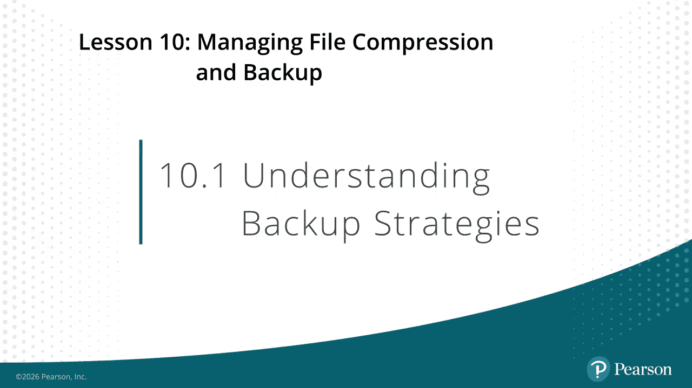
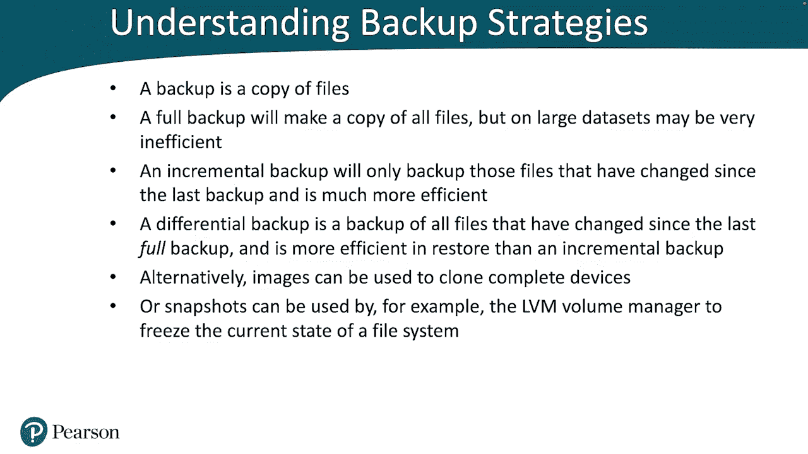

# CompTIA Linux+ V8：337：101 理解备份策略 🛡️


在本节课中，我们将一起学习什么是备份，以及 Linux 系统中常见的几种备份策略。无论你是刚接触 Linux 的新手，还是已经有一点基础的学习者，掌握备份的基本原理都非常重要。因为数据一旦丢失，没有备份就很难找回来，所以这节课的内容对保护你的系统和文件非常有帮助。



## 什么是备份

备份简单来说就是把文件复制一份，放在安全的地方。你应该养成定期做备份的习惯，以防万一系统出问题或者数据不小心丢了，你还有办法找回来。备份的核心思想就是“多留一份副本”，这样即使原件损坏，副本还能用。

备份的基本定义可以用下面的公式来表示：

```text
备份 = 原始文件的副本
```

以下是备份的主要作用：
- 防止数据意外丢失
- 系统出错时快速恢复
- 保护重要文件不被损坏

## 完全备份

上一节我们介绍了备份的基本概念，本节中我们来看看完全备份是怎么工作的。完全备份是一种最直接的策略，也就是把系统里所有的文件都复制一份。这种方法概念简单，做起来也很直观，但如果文件特别多，就会变得很低效。

完全备份的定义可以用公式表示：

```text
完全备份 = 所有文件的完整副本
```

比如你有一百个千兆字节的数据，完全备份可能需要好几天才能完成。因为每次都要拷贝所有内容，哪怕大部分文件根本没有变化。这就是完全备份的主要缺点，也就是备份时间长，占用的存储空间也大。

以下是完全备份的优缺点：
- 优点：恢复时只需要这一套备份即可，步骤简单
- 缺点：备份速度慢，占用空间大，效率低

## 增量备份

在了解了完全备份之后，我们继续看看增量备份。增量备份是为了解决完全备份效率低的问题而出现的一种策略。它不会每次都把所有东西都复制一遍，只会备份自上一次备份以来发生变化的那些文件。这样做可以节省大量时间和存储空间。

增量备份的核心定义如下：

```text
增量备份 = 自上次备份以来变更的文件
```

增量备份的好处很明显，备份速度快，不占太多空间。但恢复数据时会稍微麻烦一点，因为你需要把之前的所有增量备份都一起用上，才能把数据恢复到最新状态。

## 差异备份

前面我们介绍了增量备份，本节中我们来看看另一种常见策略，也就是差异备份。差异备份和增量备份有点像，但不完全一样。它备份的是自上一次完全备份以来，所有发生变化的文件。与增量备份相比，差异备份在恢复数据时通常更快一些。

差异备份的公式如下：

```text
差异备份 = 自上次完全备份以来变更的文件
```

为了让你更清楚两者的区别，假设你在周日做了一次完全备份，之后每天分别做增量备份。如果周五需要把数据恢复到周四的状态，使用增量备份的话，你需要周日的完全备份，再加上周一、周二、周三、周四的每一次增量备份，才能完整恢复。而如果使用差异备份，周四的那份差异备份里包含了自周日以来所有的变更，恢复时只需要周日的完全备份和周四的差异备份这两份就够了，步骤更简单。

以下是差异备份与增量备份的对比：
- 增量备份：只备份上次备份后的变更，恢复时需要多份文件配合
- 差异备份：备份上次完全备份后的所有变更，恢复时只需要完全备份和最新的差异备份

## 克隆镜像与快照

除了传统的文件备份之外，还有克隆镜像和快照这两种方式。克隆镜像会把一台完整的设备一比一地复制下来，虽然它不完全算是传统意义上的备份，但出了问题也能帮你把系统找回来。快照则是像 LVM 卷管理器这样的工具可以使用的功能，它可以把文件系统的当前状态“冻结”住，方便你以后回到那个时间点。

快照的关键特点可以用下面的表达式说明：

```text
快照 ≠ 备份
快照依赖于原始卷
```

这里需要特别注意，千万不要把快照当成备份来用。因为快照总是依赖于原始卷，如果原始卷本身出了严重问题，快照也无法帮你恢复数据。所以快照更适合做短期的状态保存，而不是长期的数据保护方案。

以下是克隆镜像和快照的简单说明：
- 克隆镜像：完整设备的一比一副本，适合系统整体还原
- 快照：文件系统当前状态的冻结副本，依赖原始卷，不可独立使用



本节课中我们一起学习了备份的基本概念，以及完全备份、增量备份、差异备份、克隆镜像和快照这几种常见策略。希望通过这节课，你能明白不同备份方式的区别，并在实际工作中根据情况选择合适的方案，保护好你的 Linux 系统数据。
