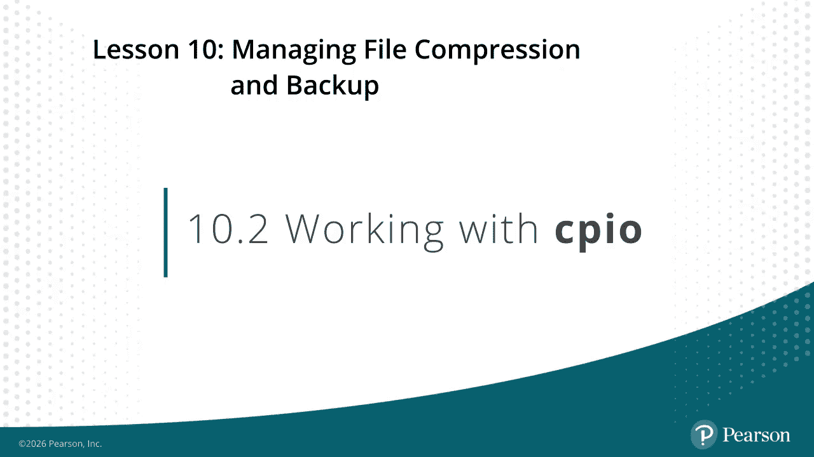
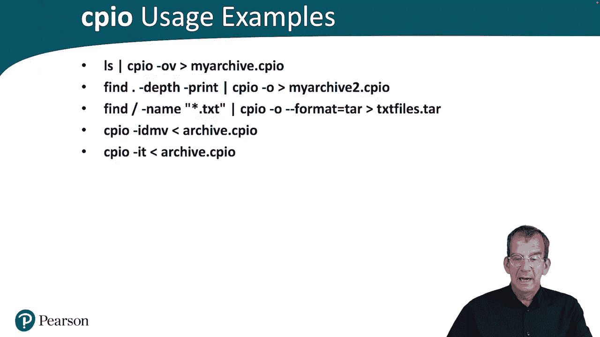
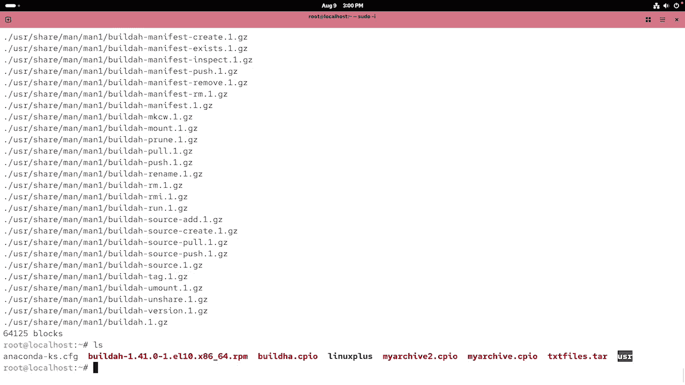

# CompTIA Linux+ V8：102：使用 CPIO 进行归档 📦




在本节课中我们将要学习 CPIO 归档工具的基础用法。CPIO 是一个比较古老的归档工具，和 TAR 比较相似。虽然现在不怎么常用了，但因为它的格式很常见，所以还是有必要了解一些。我们会先看看 CPIO 是什么，再了解它的工作原理，之后会通过一些实际示例来展示如何使用，最后还会看看怎么从 RPM 包里提取文件。内容比较基础，适合刚接触 Linux 归档的同学慢慢阅读，不用着急，跟着步骤一步步来就好。


## 什么是 CPIO


CPIO 是一个老旧的归档工具，和 TAR 很像。现在大家用它的场景已经不多了，不过它的格式在系统里还是很常见，正因为这个原因，你还是得对它有点了解。CPIO 的全称不重要，重点是要知道它是干什么用的。简单来说，它就是用来把多个文件打包成一个归档文件的工具，和 TAR 的目的差不多，只是使用方式上有一些不同。在 Linux 的日常运维中，你可能不需要每天都用 CPIO，但遇到老系统或者某些特殊格式的时候，了解它会帮上大忙。


## CPIO 的工作原理


CPIO 的工作方式和 TAR 不太一样。TAR 可以直接接受文件名作为参数，而 CPIO 不能直接收文件名，它需要先由另一个工具生成一个文件列表，然后把这个列表传给 CPIO。常见的生成文件列表的工具包括 find 和 ls。也就是说，CPIO 本身不负责找文件，它只负责把别人给它的文件列表打包。上一节我们介绍了 TAR 的基本用法，本节中我们来看看 CPIO 怎么配合其他命令来使用。




## 常见用法示例


以下是几个比较常见的 CPIO 用法示例，你可以直接复制到终端里尝试。

首先是用 ls 配合 CPIO。ls 是一个非常常用的命令，你应该天天都在用。我们可以把 ls 的输出通过管道符传给 CPIO，命令格式大致如下：

```bash
ls | cpio -ov > 备份文件.cpio
```

这条命令的意思是先列出当前目录的文件，然后把文件列表交给 CPIO 打包，最终把结果重定向到一个归档文件里。如果直接在屏幕上显示备份结果并不方便，所以我们通常会把输出重定向到文件中，这样就得到了一个可以保存的归档文件。

其次是用 find 配合 CPIO。find 命令可以在目录树中查找文件，把找到的文件列表传给 CPIO 进行打包。下面是一个示例命令：

```bash
find . -print | cpio -0 > 备份2.cpio
```

这里 find 命令会查找当前目录下的文件，然后通过管道传给 CPIO，-0 参数表示使用空字符分隔文件名，最后把输出重定向到 backup2.cpio 文件中。

再来看一个稍微有趣一点的例子。假设你想找出所有的文本文件并打包，可以使用 find 命令配合 -name 参数，查找所有以 .txt 结尾的文件，然后用 CPIO 创建一个兼容 TAR 格式的归档文件。命令如下：

```bash
find / -name "*.txt" | cpio -o --format=ustar > 文本文件.tar
```

这条命令会在整个系统中查找所有的 .txt 文件，然后把结果打包成一个 tar 格式的文件。这样一来，你就得到了一个可以被 TAR 工具识别的归档文件，兼容性更好。

接下来是提取归档文件。如果你想把 CPIO 归档文件解包，可以使用下面这组选项：

```bash
cpio -idmv < 归档文件.cpio
```

这里的 -i 表示提取，-d 表示自动创建目录，-m 表示保留修改时间，-v 表示显示详细过程。这看起来选项挺多的，但平时解包 CPIO 归档文件基本上就会用到这些。如果你输入的时候没有拼写错误，通常都能正常工作。

需要注意的是，解包时可能会出现一些提示信息，比如提示用户不存在，或者文件版本较新，这通常是因为归档文件里使用了绝对路径，CPIO 试图把文件写回绝对路径位置。这种情况你需要小心，不过幸运的是 CPIO 默认不会覆盖现有文件，所以就算出现提示，通常也不会造成数据丢失。


## 从 RPM 包中提取文件


在 Red Hat 系统上，CPIO 有一个比较有趣的用法。Red Hat 系统使用 RPM 包管理器，而 RPM 文件本质上就是一个带有额外元数据的 CPIO 归档文件。也就是说，如果你想从 RPM 包里提取某个文件，不一定非得用 rpm 命令，也可以借助 CPIO 来完成。

以下是具体操作步骤。首先你可以在系统里搜索一下 RPM 文件，看看有哪些可用的包：

```bash
find / -name "*.rpm"
```

你会发现系统里可能有非常多的 RPM 文件。接下来挑一个你感兴趣的 RPM 包，把它复制到当前目录。然后使用 rpm2cpio 命令把 RPM 包转换成 CPIO 格式：

```bash
rpm2cpio 构建包.rpm > 构建包.cpio
```

不过这里有个小坑，如果你直接把输出重定向到终端，系统会拒绝写入，所以最好把结果保存到一个以 .cpio 结尾的文件里。拿到 CPIO 文件之后，就可以用前面提到的提取命令来解包了：

```bash
cpio -idmv < 构建包.cpio
```

执行完成后，你会发现当前目录下多出了一些子目录结构。比如你可能会看到一个用户目录，里面包含了来自 RPM 包的所有文件。这样一来，如果你需要直接从 RPM 包里提取某个文件，这种方法就非常方便了，不需要完整安装整个 RPM 包，就可以拿到里面的文件。


## 总结




本节课中我们一起学习了 CPIO 归档工具的基本知识。我们了解了 CPIO 是一个和 TAR 类似的老旧归档工具，虽然使用频率不高，但格式常见，值得了解。我们学习了 CPIO 需要配合 find 或 ls 等命令生成文件列表，不能直接像 TAR 那样接受文件名参数。我们也演示了用 ls 和 find 配合 CPIO 创建归档文件的方法，包括创建兼容 TAR 格式的归档文件。最后我们还学习了如何从 RPM 包中提取文件，因为 RPM 本质上就是带元数据的 CPIO 归档。希望这些内容能帮助你初步掌握 CPIO 的使用，以后在实际工作中用到的时候可以回来查阅。

