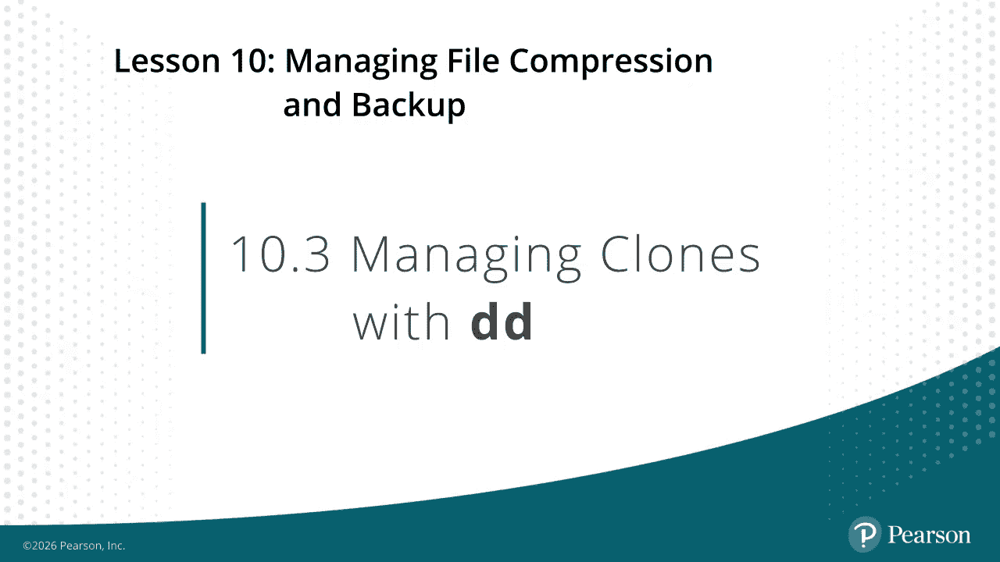
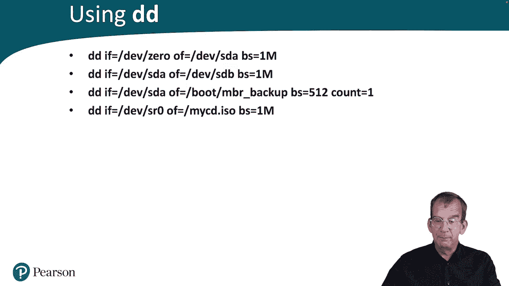
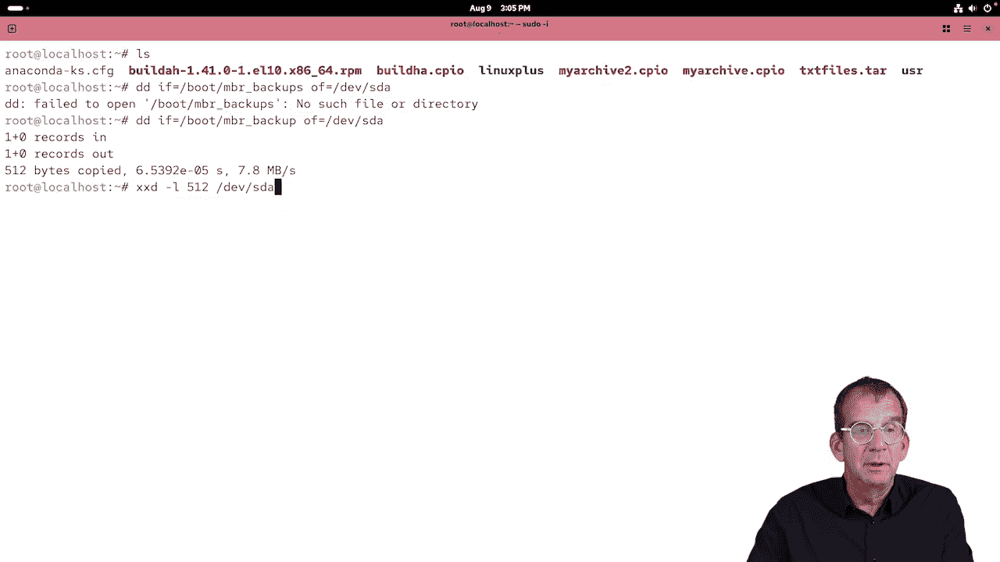

CompTIA Linux+：103：使用 dd 管理克隆 🖥️


在本节课中我们将要学习 dd 工具的基本用法。dd 是 Linux 系统中一个非常经典的命令行实用程序，主要用于在不同的设备之间复制数据块。很多初学者刚开始接触 dd 的时候可能会觉得它很神秘，其实它的核心作用就是把一个设备上的数据原封不动地搬到另一个设备上。我们会一起看看 dd 是如何工作的，它适合处理什么样的任务，以及在使用的时候需要特别注意哪些安全问题，以免误操作导致数据丢失。




## 什么是 dd 工具 🔧

首先，我们来认识一下 dd 是什么。

dd 是一个在 Linux 系统里非常经典的命令行工具。它的主要职责是在不同的设备之间移动数据块。你可以把它理解成一种“搬砖工具”，只不过搬的不是砖头，而是硬盘、光盘或者分区里的原始数据块。dd 不适合用来复制单个文件，也不适合用来打包归档，如果你只是想把几个文档从一个文件夹拷贝到另一个文件夹，用 cp 命令就够了。dd 的强项在于直接操作块设备，也就是说，它可以直接读写整个硬盘或者整个分区，而不需要关心上面的文件系统结构。这使得 dd 非常适合用于制作光盘镜像，或者把一块完整的硬盘克隆到另一块硬盘上。


### dd 的核心用法 📋

为了让你更直观地理解 dd 怎么用，下面是几条最常见的命令形式。

以下是 dd 命令的几种典型使用方式：

- 整个设备克隆：`dd if=/dev/sda of=/dev/sdb bs=1M`
- 制作光盘镜像：`dd if=/dev/cdrom of=~/cdrom.iso bs=1M`
- 擦除整块硬盘（极其危险）：`dd if=/dev/zero of=/dev/sda bs=1M`



上面这些命令里，if 代表输入文件，of 代表输出文件，bs 代表每次读写的块大小。当你把 if 指向一个硬盘设备，把 of 指向另一个硬盘设备时，dd 就会把源设备上的所有数据原样复制到目标设备上。这种操作不关心文件是什么，也不关心分区怎么划分，它只是按块来读写，所以速度很快，但也非常粗暴。使用 dd 的时候一定要仔细检查设备名称，否则很容易把数据写错位置。


## 克隆整个硬盘设备 💾

上一节我们介绍了 dd 的基本概念，本节中我们来看看如何用 dd 克隆整个硬盘。

假设你有一块物理硬盘，设备名是 /dev/sda，你想把它完整地复制到另一块硬盘 /dev/sdb 上，比如说你要把这块硬盘拿去另一台电脑里使用。这时候就可以用 dd 来完成。你需要确保目标硬盘的容量足够大，能够装下源硬盘的所有数据。执行克隆操作后，目标硬盘上的内容会和源硬盘完全一样，包括分区表、引导区和所有文件。不过在操作之前，请务必再确认一遍设备名，因为一旦搞错，后果可能比较严重。


### 克隆命令示例 🖥️

下面给出一个具体的克隆命令示例，供你参考。

以下是克隆整块硬盘的命令：

```bash
dd if=/dev/sda of=/dev/sdb bs=1M
```

这条命令的意思是，从 /dev/sda 读取数据，写入到 /dev/sdb，每次读写 1 兆字节的块。如果不指定 bs 参数，dd 默认会按每个字节来复制，速度会很慢。加上 bs=1M 之后，它每次处理 1 兆的数据块，效率就高多少。等命令执行完成之后，/dev/sdb 就会变成 /dev/sda 的一模一样的副本。这时候你可以把这块硬盘拔下来，接到另一台电脑上去启动或者读取数据。


## 备份主引导记录（MBR）🛡️

除了整块硬盘克隆，dd 还可以用来备份硬盘最关键的开头部分，本节中我们来看看怎么操作。

硬盘的前 512 字节存放着主引导记录，也就是 MBR。MBR 里面包含了分区表和引导代码，如果这一部分损坏了，电脑可能就无法正常启动了。dd 可以非常方便地把这 512 字节备份到一个普通文件里，万一将来出了问题，还可以把备份恢复回去。这种操作非常适合用于系统维护和故障排除。


### MBR 备份命令 💾

具体的备份命令如下所示，你可以直接参考使用。

以下是备份主引导记录的命令：

```bash
dd if=/dev/sda of=/boot/mbr-backup bs=512 count=1
```

这条命令表示从 /dev/sda 读取 1 个块，每个块 512 字节，也就是总共读取 512 字节，然后保存到 /boot/mbr-backup 文件中。这里的 count=1 表示只复制一次，不再继续读取后面的数据。备份完成之后，你就拥有了这块硬盘引导区的精确副本。


## 使用 xxd 查看 MBR 内容 🔍

备份完成之后，我们需要知道备份里面到底是什么，本节中我们来看看如何用 xxd 查看这些原始数据。

MBR 里面的内容是二进制数据，用普通的文本编辑器打开基本上是乱码，看不出任何名堂。这时候就需要用到十六进制查看器，比如 xxd 命令。它可以把二进制数据以十六进制的形式显示出来，让你能够看到分区表和引导代码的具体样子。虽然对初学者来说这些数据看起来很难读懂，但只要懂得怎么查看，在排查启动问题的时候就会很有帮助。


### xxd 查看命令 🔍

查看 MBR 的命令如下，供你操作时参考。

以下是使用 xxd 查看主引导记录的命令：

```bash
xxd -l 512 /dev/sda
```

这条命令会显示 /dev/sda 前 512 字节的十六进制内容。你可以看到分区表等信息以十六进制形式排列。虽然这些字符看起来非常晦涩，但对系统管理员来说，这就是硬盘最底层的结构信息。


## dd 的危险性与恢复操作 ⚠️

dd 是一个非常强大的工具，但与此同时它也非常危险，本节中我们来看看误操作会导致什么后果，以及如何恢复。

因为 dd 直接操作底层数据块，所以一旦参数写错，很容易把重要数据覆盖掉。最典型的危险操作就是把 /dev/zero 的内容写入到硬盘的引导区，这会把主引导记录全部变成零，导致分区表丢失，系统无法启动。不过好在如果你之前做过 MBR 备份，就可以用 dd 把备份文件重新写回硬盘，恢复对硬盘的访问。


### 危险操作与恢复示例 🚨

下面分别展示危险操作命令和恢复命令，供你了解原理，切勿在生产环境中随意尝试。

以下是危险操作和对应的恢复命令：



危险操作（将零写入 MBR）：
```bash
dd if=/dev/zero of=/dev/sda bs=512 count=1
```

恢复操作（从备份写回 MBR）：
```bash
dd if=/boot/mbr-backup of=/dev/sda
```

第一条命令会把 /dev/sda 的前 512 字节全部覆盖成零，这就相当于把硬盘的“身份证”毁掉了，电脑重启后可能找不到分区，无法进入系统。第二条命令则是把之前保存在 /boot/mbr-backup 里的备份重新写回 /dev/sda，这样分区表就能恢复，硬盘也能正常使用了。这正是 dd 既危险又强大的地方，它能破坏数据，也能在你有备份的情况下把数据救回来。


## 总结 📚

本节课我们学习了 dd 工具的核心用法，现在来做一个简单的总结。

在本节课中我们一起学习了使用 dd 管理克隆的方法。我们了解到 dd 是一个用于在块设备之间复制数据的强大工具，不适合复制单个文件，但非常适合克隆整块硬盘、制作光盘镜像以及备份主引导记录。我们演示了如何克隆整个硬盘设备，如何备份和恢复 512 字节的 MBR，也学习了如何用 xxd 查看二进制引导区内容。同时我们也看到了 dd 的危险性，错误的设备名称或参数可能导致数据丢失，所以在使用前务必仔细核对 if 和 of 的值。希望这节课能帮助你初步掌握 dd 的使用，在以后的 Linux 学习中更加自信地处理底层数据操作。
