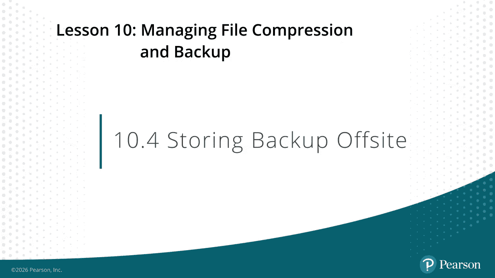
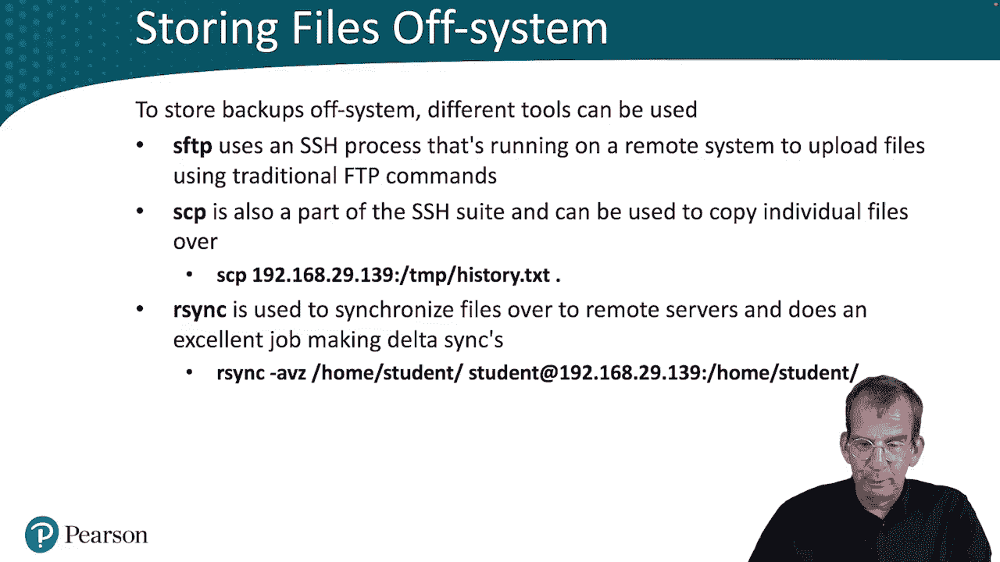
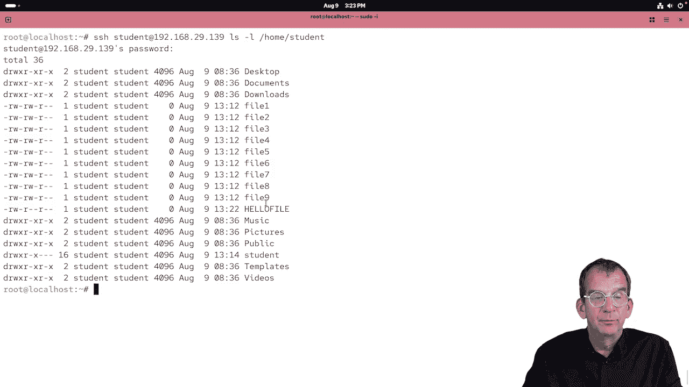

CompTIA Linux+ 学习指南：04：异地备份存储 📦


 在本节课中，我们将学习为什么备份必须保存在异地，以及 Linux 系统中常用的几种远程文件传输工具。我们会先解释异地备份的必要性，再介绍 SFTP、SCP 和 Rsync 这三种工具的基本用法，最后通过实际命令演示，教你如何把本地文件安全地传输到远程服务器上。内容会尽量用大白话讲解，即使你是初学者也能轻松看懂。


 ## 为什么备份要存放在异地


 当你为服务器创建备份时，最好把备份文件存放在异地，而不是和原始数据放在同一台机器上。如果服务器发生故障或宕机，存放在本地的备份也会一起丢失，到时候你就无法恢复数据了。异地存储能确保即使主服务器损坏，你仍然有副本可用，从而保障业务的连续性和数据的安全性。


 ## Linux 中常用的远程文件传输工具


 Linux 系统内置了好几个可以用来在远程系统之间传输文件的工具，每种工具适合的场景略有不同。以下是常见的三种工具及其特点。

 - **SFTP**：它利用远程系统上运行的 SSH 进程，通过传统的 FTP 命令上传文件。如果你以前非常频繁地使用过传统 FTP，那么 SFTP 可能会让你感到比较熟悉。不过在今天，传统 FTP 已经不再常见，所以这个工具的使用场景也相对有限。
 - **SCP**：它同样属于 SSH 套件的一部分，可以用来逐个复制文件。在只需要传输一两个文件时，SCP 非常方便，操作也比较简单。
 - **Rsync**：如果你需要更强大的功能，Rsync 是更好的选择。它可以在远程服务器之间同步文件，并且擅长做增量同步，也就是说，它只会同步发生变化的部分，而不会把所有文件都重新传输一遍。


 ## Rsync 命令的基本语法与常用选项


 Rsync 的命令格式比较灵活，掌握几个常用选项就能满足大部分同步需求。以下是经常用到的参数说明。

 - `-a`：归档模式，会保留文件的权限、时间戳等属性。
 - `-v`：详细模式，显示传输过程中的详细信息。
 - `-z`：启用压缩，在传输过程中对数据进行压缩，节省带宽。
 - `-n`：试运行模式，只显示将要执行的操作，而不真正修改任何文件，适合先预览效果。
 - `--delete`：如果源目录中不存在但目标目录中存在的文件，会将其删除。这个选项比较危险，使用前请三思。

 一个典型的 Rsync 命令示例如下：

 ```bash
 rsync -avz /home/student/ student@192.168.29.139:/home/student/
 ```

 在这条命令中，源路径和目标路径末尾的斜杠非常重要，不能漏掉，否则可能会导致目录结构出现意外变化。执行命令后，系统会提示你输入远程用户的密码，输入正确后文件就会开始同步。


 ## 实际操作演示：使用 SCP 复制文件


 现在我们来看一个具体的 SCP 使用示例。假设你想要从远程机器上把 hosts 文件复制到本地当前目录，可以使用如下命令：

 ```bash
 scp student@192.168.29.139:/etc/hosts .
 ```

 命令执行完成后，使用 `ls -l hosts` 查看文件，你就能看到来自远程机器的 hosts 文件已经出现在本地了。这样你就成功地把远程服务器上的文件下载到了自己的机器上。


 ## 实际操作演示：使用 Rsync 同步目录


 接下来我们演示如何使用 Rsync 进行目录同步。为了方便观察效果，我们先在本地创建一个测试文件：

 ```bash
 touch /home/student/hello_file
 ```

 然后执行 Rsync 命令，把本地的 `/home/student/` 目录同步到远程服务器：

 ```bash
 rsync -avz /home/student/ student@192.168.29.139:/home/student/
 ```

 这里的 `-a` 表示归档模式，`-v` 表示显示详细输出，`-z` 表示启用压缩。系统会提示输入用户 student 的密码，输入完成后，文件会被传输到远程服务器。为了验证结果，你可以通过 SSH 登录远程机器，执行 `ls -l /home/student`，你应该能看到刚才同步过去的文件。这就是 Rsync 同步文件的基本工作流程。


 ## 需要特别注意的危险选项


 在使用 Rsync 时，有一个选项需要格外小心，那就是 `--delete`。这个选项的作用是：如果某个文件在源目录中不存在，但在目标目录中存在，那么它会被删除。在我看来，这是一个相当危险的选项，因为一旦操作失误，可能会不小心删掉重要数据。因此，除非你非常确定自己在做什么，否则建议不要轻易使用 `--delete`。在执行任何同步操作之前，建议先用 `-n` 选项进行试运行，确认命令的行为符合预期后再正式执行。


 ## 本节总结


 本节课中，我们一起学习了异地备份的重要性，了解了 SFTP、SCP 和 Rsync 三种远程文件传输工具的基本用法，并通过实际命令演示了如何使用 SCP 复制文件，以及如何使用 Rsync 同步目录。同时，我们也重点强调了 `--delete` 选项的潜在风险，提醒大家在实际操作中要谨慎使用。希望这些内容能帮助你更好地掌握 Linux 系统中的备份与文件传输技能。






