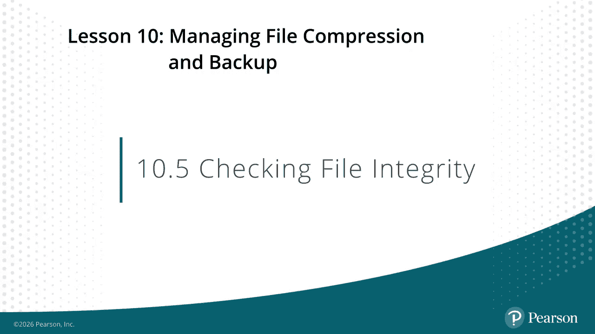
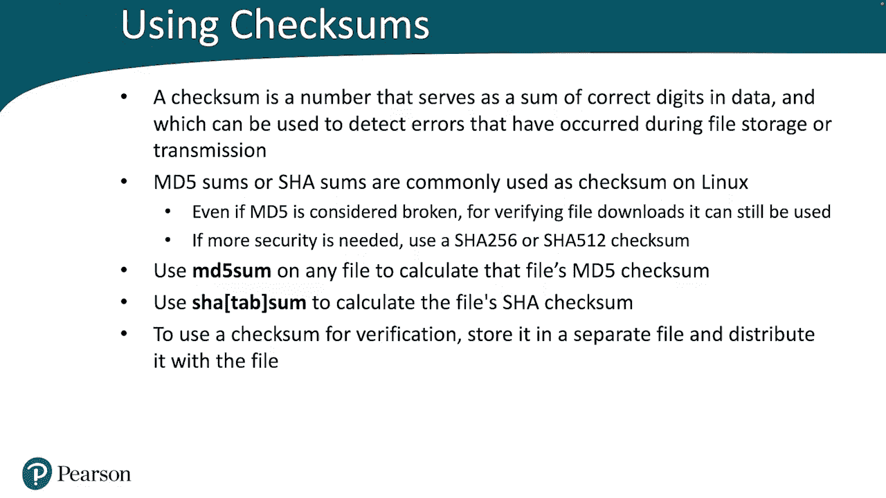
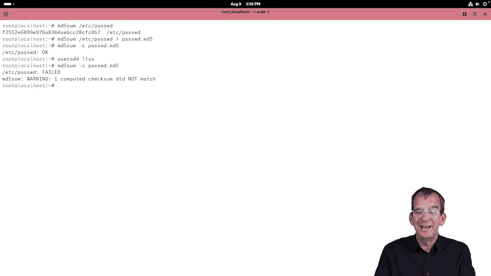
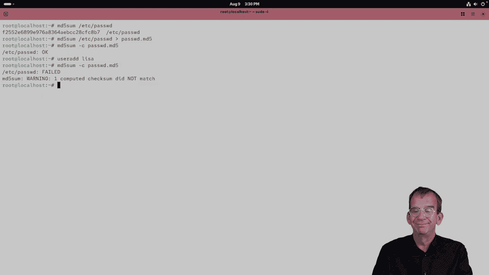

CompTIA Linux+ V8：341.105：检查文件完整性 🔍

在本节课中，我们将要学习如何检查文件的完整性。当你在处理远程文件的时候，经常需要确认文件没有在传输或者存储过程中被意外修改。这就像你收到一个快递包裹，想确认里面的东西没有被拆开或者损坏一样。在Linux系统里，我们有一套专门的方法来完成这件事情，下面我们就一起来看看具体是怎么回事。

上一节我们简单介绍了基本的文件操作，本节中我们来看看如何确保文件没有被篡改。

当你处理远程文件的时候，你很可能会想检查文件的完整性。校验和就是解决这个问题的办法。校验和是一个数字，它代表了数据中正确数字的总和，并且可以用来检测文件在存储或传输过程中出现的错误。

这里的核心思路是这样的：基于你文件的内容，你总是能够计算出完全相同的校验值。

这个关系可以用下面的公式来表示：

校验和 = 计算函数(文件内容)

也就是说，只要文件内容没有变化，算出来的校验和就应该一直保持不变。

在Linux系统中，有一些常用的算法可以用来生成校验和。以下是这些算法的介绍：

- MD5：这是Linux上最常见的校验和算法之一。即使有人认为它对于单纯验证下载的文件已经不够安全，但在很多场景下它仍然可以使用。
- SHA-256：当你需要更高的安全性时，会使用这个算法，它比MD5更安全。
- SHA-512：这个算法提供比SHA-256更好的安全性，适合对安全要求非常高的场景。

你可以直接在终端里对任意文件计算校验和。以下是常用的命令示例：

md5sum 文件名
sha256sum 文件名
sha512sum 文件名

运行这些命令时，命令中的数字部分代表你想在命令中使用的算法类型。执行完这些命令之后，系统会显示出对应的校验和数值，你可以把它记下来，留着以后做对比用。

除了计算校验和，你还可以把计算好的结果保存在一个单独的文件里，然后和原始文件一起分发出去。接收到文件的人就可以使用这个校验和文件，来验证手里的文件是否完整，有没有在传输过程中被改动。

下面我们来看一个实际的操作演示，帮助你更好地理解整个流程。

首先，我对 /etc/passwd 使用 md5sum 命令，这会显示出该文件的校验和。然后，我把这个校验和写入到 passwd.md5 这个文件中。

接下来，我使用验证命令来检查文件是否正确：

md5sum -c passwd.md5

执行完这个命令之后，我可以看到系统提示 /etc/passwd 状态正常，这说明文件没有被修改过。

然后，我使用文本编辑器修改了某个系统配置文件，比如改了一下 /etc/shadow 里面的内容。

我再次运行 md5sum 命令，这时候屏幕上会显示一个校验和不匹配的提示。为什么会出现这种情况呢？这是因为文件的内容已经发生了改变，而这就是校验和的作用所在，它能够精准地观察到内容的变化，并告诉你文件已经不一样了。

本节课中我们一起学习了如何检查文件的完整性。我们了解了什么是校验和，常用的算法包括MD5、SHA-256和SHA-512，还学会了如何使用md5sum命令来计算和验证文件的校验和。希望这些内容能帮助你在日常工作中更好地保护文件的安全。

