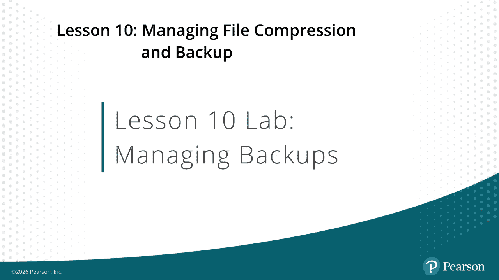
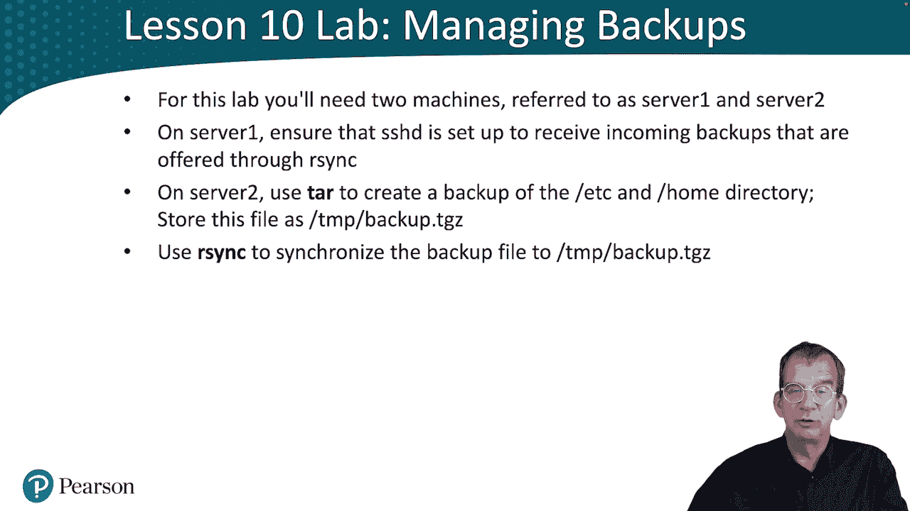
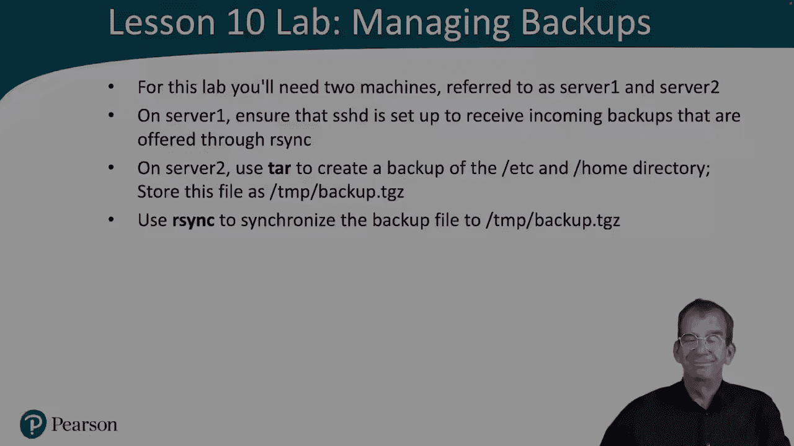

# Oreilly - CompTIA Linux+ V8 - Pearson Cert Prep (Video)：Lesson 10：管理备份实验 💾



在本节课中我们将要学习备份管理的实验操作。这是本章的最后一节课，主要目的是通过动手实践帮助你把之前学到的备份知识变成实际操作能力。我们不只停留在理论层面，而是会亲自动手配置两台机器，完成一次完整的备份传输过程。这个实验对初学者来说非常友好，因为它涵盖了备份中最常见的几个步骤，也能让你了解在真实的服务器环境中数据是如何被安全搬运的。


既然本课即将结束，让我们来做一个实验。因此，针对本次实验，你需要准备两台机器。我在这篇教程中把它们称为 Server 1 和 Server 2，你完全可以根据自己的实际环境替换成任意主机名或 IP 地址，不必照搬示例中的名称。两台机器之间需要能够通过网络互相访问，这样才能进行后续的备份数据传输。


以下是本次实验需要准备的环境和条件：

- 两台 Linux 机器，分别称为 Server 1 和 Server 2。
- 每台机器上的 IP 地址，请根据你的实际环境自行替换。


在 Server 1 上我们需要做一些准备工作，确保它能够正常接收从另一台机器发送过来的备份数据。Server 1 在这里扮演的是备份服务器的角色，也就是接收方，它需要提前把相关服务配置好才能正常工作。


以下是 Server 1 上需要完成的具体设置：

- 确保 SSHD 服务已经启动并正常运行。
- 配置 SSHD，使其能够通过 rsync 接收传入的备份文件。

SSHD 是安全外壳守护进程，它允许远程机器通过加密通道连接过来。rsync 是一个常用的文件同步工具，可以高效地传输和同步文件。两者配合使用，就可以安全地把备份从 Server 2 传输到 Server 1。下面是 rsync 同步命令的基本形式，你可以参考这个结构来理解数据是如何传输的：

```bash
rsync -avz /path/to/backup.tgz user@server1_ip:/path/to/destination/
```


接下来我们来看 Server 2 上需要做的操作。Server 2 是备份的发起方，也就是源机器，上面保存着我们要备份的原始数据。我们需要先把重要目录打包成压缩文件，然后再把它发送到 Server 1 上保存。


以下是 Server 2 上需要执行的备份步骤：

- 创建 /etc 目录和家目录的备份。
- 将备份文件保存为 tmp_backup.tgz。
- 使用 rsync 将该备份文件同步到 Server 1 上的 tmp_backup.tgz。




这里的 /etc 目录通常存放系统的配置文件，而家目录则存放普通用户的个人数据。把它们打包成一个 .tgz 文件，可以方便地传输和存储。然后利用 rsync 工具，通过刚才在 Server 1 上配置好的 SSHD 通道，把备份文件安全地传过去。整个过程就像是把一台电脑上的重要文件复制到另一台电脑上保存，只是这里是通过网络和命令行完成的。




备份操作完成后，Server 1 上就会收到来自 Server 2 的备份文件。此时你可以登录到 Server 1 检查文件是否已经到达，并验证备份的完整性。如果文件已经正确出现在指定路径中，说明整个备份流程已经打通。以后你可以按照同样的思路，定期执行类似的操作来保护服务器上的重要数据，避免系统故障导致信息丢失。


本节课中我们一起学习了管理备份的实验方法。我们准备了两台机器 Server 1 和 Server 2，在 Server 1 上配置了 SSHD 以接收备份，在 Server 2 上创建了 /etc 和家目录的备份并将其压缩为 tmp_backup.tgz，最后使用 rsync 将备份文件同步到 Server 1 上。通过这个实验，你掌握了 Linux 环境下基础备份传输的核心流程。

