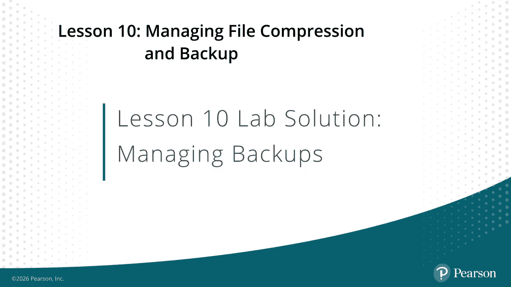
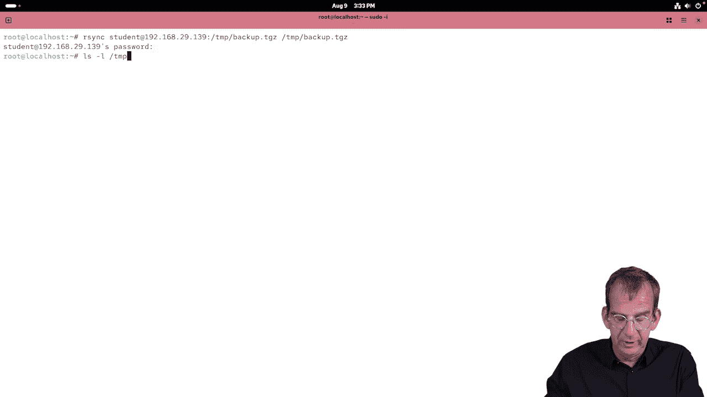

# CompTIA Linux+ 备份管理：Lesson 10：管理备份实验解析 📦

在本节课中我们将要学习如何在 Linux 系统中管理备份文件。备份是系统管理员的日常工作，主要目的是防止数据丢失，以便在系统出现故障时能够快速恢复。本节课的内容围绕一个具体的实验展示，我们会登录一台远程 Ubuntu 机器，把重要的系统目录打包成一个压缩文件，然后再把这个文件复制回自己的本地计算机，最后检查文件是否完整。整个过程涉及远程登录、打包压缩、文件同步和文件验证四个关键环节。即使你是第一次接触 Linux 备份操作，也可以跟着这个教程一步步完成。

首先，我们要建立与远程主机的连接。在开始制作备份之前，必须先登录到存放数据的那台机器上，否则无法对那里的文件进行任何操作。


以下是远程登录使用的命令：



```bash
ssh student@192.168.29.1 -p 39
```

登录成功之后，你会进入到远程 Ubuntu 机器的命令行界面。这里的 student 是用户名，192.168.29.1 是远程机器的 IP 地址，39 是 SSH 服务监听的端口号。连接建立后，后续的所有操作都将在远程机器上执行。

连接上远程主机以后，下一步就是在远程机器上制作备份包。我们需要把系统中比较重要的两个目录打包起来，一个是存放配置文件的 /etc 目录，另一个是存放用户个人数据的 /home 目录。

以下是打包备份所使用的 tar 命令：

```bash
sudo tar -cf /tmp/backup.tar.gz /etc /home
```

这条命令的作用是使用 sudo 权限调用 tar 程序，创建一个名为 backup.tar.gz 的存档文件，保存位置是 /tmp 目录，并把 /etc 和 /home 两个目录全部加入到这个存档中。生成之后，备份文件就会出现在远程机器的 /tmp/backup.tar.gz 路径下，等待后续传输。

远程机器上的备份文件准备好之后，我们需要把它转移回本地计算机。此时要切换回自己的本地主机，使用 rsync 工具把远程的备份档案拉取下来。

以下是本地执行的 rsync 命令：

```bash
rsync student@192.168.29.1:39/tmp/backup.tar.gz /tmp/backup.tar.gz
```

这条命令表示从远程地址 192.168.29.1 的 39 端口下，下载 /tmp/backup.tar.gz 文件，并把它保存到本地的 /tmp/backup.tar.gz 路径中。传输完成之后，本地硬盘上也会有一份完全相同的备份文件副本。

文件传输完成之后，最后一步是确认本地备份文件是否正常。我们不能只假设文件传输成功了，最好用命令查看一下文件的实际大小和属性，确保没有出错。

以下是查看本地备份文件详细信息的命令：

```bash
ls -l /tmp/backup.tar.gz
```



运行 ls -l 之后，终端会显示 /tmp/backup.tar.gz 的文件权限、所有者、大小和修改时间等信息。如果能正常显示这些内容，就说明备份文件已经完整地出现在本地目录中，整个备份管理流程就算完成了。

本节课中我们一起学习了如何通过 SSH 登录远程机器，使用 tar 命令把 /etc 和 /home 目录打包成备份文件，再用 rsync 把备份文件从远程机器同步到本地计算机，最后用 ls -l 验证文件是否成功下载。希望这个实验能帮助你掌握 Linux 中基础备份管理的完整流程。
