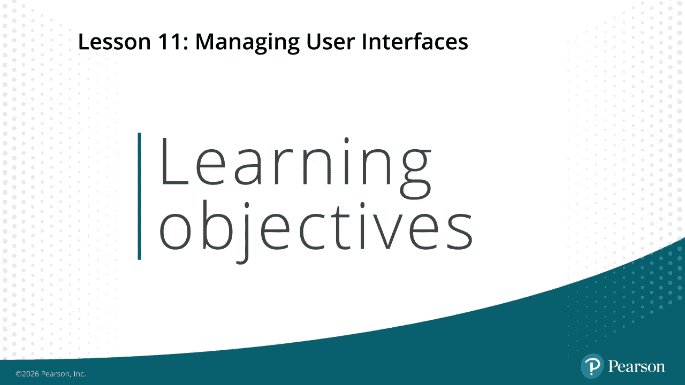
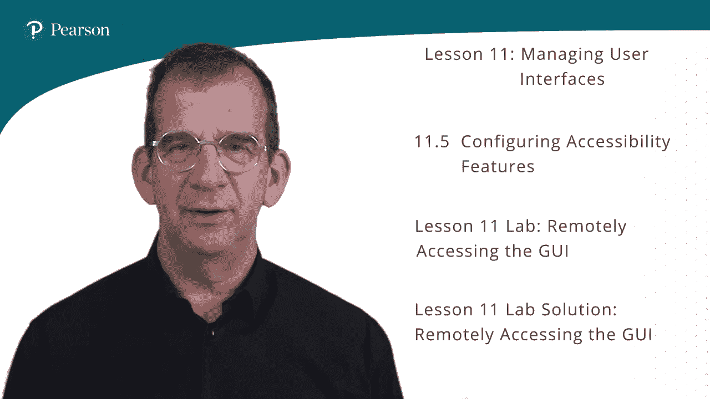

# CompTIA Linux+ V8：344：图形用户界面学习目标 🖥️

在本节课中，我们将一起学习 Linux 系统中的图形用户界面相关知识。这一节的内容围绕图形界面的构成方式展开，会告诉你图形程序是怎么跑起来的，桌面环境到底是干什么的，远程访问协议又是用来干嘛的，最后还会讲怎么设置辅助功能，并且给你安排一个实验和对应的参考答案，帮助你把所学内容动手练一遍。

本节课我们会先从图形应用程序栈说起，搞清楚图形服务器该怎么配置，然后接着聊聊桌面环境和远程访问协议，最后讲辅助功能设置，并告诉你实验在哪里。下面我们逐步展开。



## 图形应用程序栈与图形服务器配置 🖼️

上一节我们大概聊过一些 Linux 基础概念，本节中我们先来看看图形应用程序栈是怎么组织的。

图形应用程序栈就是一层一层叠起来的结构，最上面是你看到的应用程序，中间是各种图形库，最下面是负责把画面显示出来的图形服务器。你可以把它想象成盖房子，地基是内核驱动，中间是显示服务器，上面才是各种窗口和按钮。

核心结构可以用下面这段伪代码来描述：

```
用户应用程序 (浏览器、文件管理器等)
        ↓
图形工具包 (GTK、Qt 等)
        ↓
显示服务器 (X11 或 Wayland)
        ↓
内核图形驱动程序
```

配置图形服务器其实就是告诉系统用哪个显示服务器，怎么启动它，以及让它和你的显卡驱动好好配合。虽然具体命令因发行版而异，但大体思路是一样的：先安装显示服务器，再写配置文件，最后重启服务让设置生效。

## 桌面环境与远程访问协议 🖥️

刚才我们介绍了图形应用程序栈和图形服务器的基本组成，本节中我们来看看桌面环境，以及和它紧密相关的远程访问协议。

桌面环境就是给用户提供一个可以直接点点点的图形界面，它把窗口管理器、面板、菜单、设置工具都打包在一起，让你不需要全程敲命令就能操作电脑。常见的桌面环境有下面这些：

- GNOME：比较现代，操作逻辑和手机有点像
- KDE Plasma：可以高度定制，喜欢折腾的人通常比较喜欢
- XFCE：比较轻量，适合老电脑或者不想占太多资源的场景

远程访问协议则是让你在一台电脑上控制另一台电脑图形界面的技术。简单说，你坐在家里的笔记本上，通过网络操作公司里那台装着 Linux 的服务器，屏幕上显示的就是服务器的桌面。常见的远程访问协议包括：

- VNC：比较老牌，兼容性不错，但安全性需要额外配置
- RDP：微软推出的协议，Windows 自带支持，Linux 上也可以用
- X11 转发：利用 X 窗口系统本身的特性，把单个窗口显示在本地

## 辅助功能配置与实验室 🔧

学完了桌面环境和远程协议，本节中我们继续来看看怎么配置辅助功能。

辅助功能是指帮助有特殊需求的用户更方便地使用电脑的设置，比如把屏幕放大、把颜色对比度调高、或者让键盘对单手操作更友好。在 Linux 里，这些选项通常藏在系统设置里，不同桌面环境的位置不太一样，但大体都能找到。

你可以尝试在自己的系统里打开“设置”应用，找到“辅助功能”或“无障碍”选项，然后逐项看看有什么可用。如果你想更深入地了解，也可以查看对应的配置文件或者命令行工具。

本节课的最后部分，我们会提供一个实验环境和实验解答。实验的目的是让你亲自动手配置图形服务器、尝试不同的桌面环境，或者设置一下辅助功能，把刚才讲的理论知识变成实际操作经验。如果在实验过程中卡住了，可以直接参考附带的实验解答，看看标准的操作步骤是怎样的。



## 总结 📚

本节课中，我们一起学习了 Linux 图形用户界面的几个核心主题。首先，我们解释了图形应用程序栈的分层结构，并学习了如何配置图形服务器；接着，我们介绍了常见的桌面环境，并说明了远程访问协议的基本作用；随后，我们讲解了辅助功能的配置思路，并指出了实验和实验解答的位置。希望这些内容能帮助你建立对 Linux 图形界面的直观认识，并为后续的动手实践打下基础。

