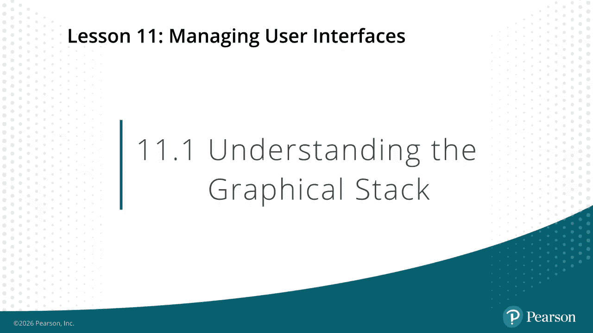
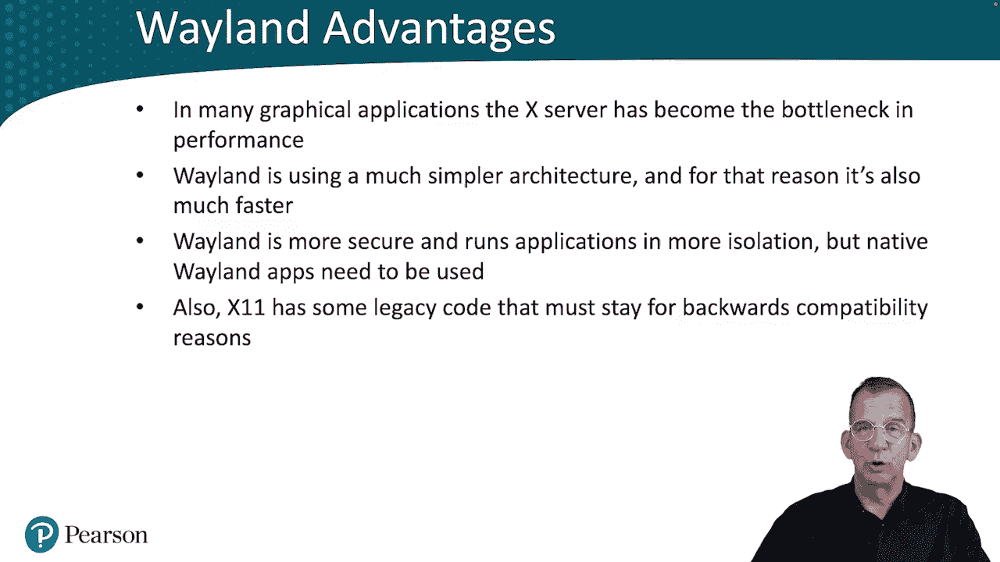

# Linux图形栈教程：01：理解图形栈 🖥️



## 本节概述 📖

在本节课中，我们将一起学习Linux系统中的图形栈是怎么回事。图形栈这个词听起来很专业，其实它无非就是一组组件，合起来让你在电脑上看到窗口、图标和鼠标指针。不管你每天使用的是哪个发行版，图形栈都在后台默默运行，让你不用只盯着黑色的命令行界面。我们会聊聊现在主流的Wayland协议，也会回顾一下老旧的X11系统，顺便解释清楚合成器和桌面环境到底在干什么。内容会尽量用大白话讲解，哪怕你是第一次接触Linux图形界面，也能听得懂。

## 什么是图形栈？ 🧩

首先，我们得搞清楚图形栈到底指什么。简单来说，图形栈就是让你可以在图形环境下工作的所有组件。如果没有这些组件，你的电脑屏幕可能只能显示字符，而没法弹出浏览器窗口或文件管理器。

从结构上看，我们可以把图形栈看作这样一个组合：

```text
图形栈 = 应用程序 + 显示协议 + 合成器 + 图形硬件
```

下面是图形栈中包含的主要部分：

- 应用程序：需要显示界面的软件，比如浏览器、终端。
- 显示协议：规定应用程序和系统之间怎么交流的规则。
- 合成器：负责接收窗口并把它们画在屏幕上的组件。
- 图形硬件：显卡和显示器等实体设备。

这些组件一起工作，才让你拥有完整的图形桌面体验。

## Wayland：现代显示协议 🚦

了解了图形栈的构成之后，接下来我们来看看现在的Linux发行版主要用什么协议来传输图形数据。在当前的Linux发行版中，Wayland被广泛用作显示协议。

Wayland是图形栈的核心部分。它的作用是定义一套规则，告诉应用程序该如何与系统其他部分进行通信。你可以把它想象成一种“交通规则”，所有图形程序都需要遵守这些规则，才能把画面送到屏幕上。

具体通信流程可以简化为下面这样：

```text
应用程序 --> Wayland协议 --> 合成器 --> 屏幕
```

有了这个协议，应用程序就不需要直接去操控显卡，而是通过Wayland定义的方式发送请求，这样系统会更加有序。

## 合成器与显示服务器 🎨

Wayland协议本身只是一套规则，真正把规则落到实处的是合成器。合成器实现了Wayland协议，它负责与图形硬件通信，接收应用程序发来的窗口，然后把这些窗口绘制在屏幕上。

在不同的桌面环境里，默认的合成器也不一样。以下是常见的例子：

- Mutter：GNOME桌面环境的默认合成器。
- Kwin：KDE桌面环境的默认合成器。

在Wayland体系中，合成器不仅仅是一个辅助组件，它本身就充当了显示服务器。这与旧的X11系统不同，在X11时代，显示服务器的工作是由窗口管理器来完成的。简单来说，Wayland把显示服务器和合成器合二为一了。

## 桌面环境：GNOME与KDE 🖼️

合成器把图形画在了屏幕上，但用户直接面对的还有一层，这就是桌面环境。桌面环境构建在Wayland之上，目的是为用户提供完整的图形界面，让你可以用鼠标点击菜单、拖动窗口、更换壁纸。

目前比较常见的两个桌面环境是GNOME和KDE。它们不仅包含前面说的所有图形组件，还自带一些图形应用程序，比如文件管理器、设置中心和图片查看器。有了桌面环境，普通用户就不需要去碰复杂的命令行，就能正常使用电脑了。

## X11：旧时代的显示服务器 🕰️

在Wayland成为主流之前，Linux图形界面长期依赖另一个系统，那就是X11。X11是一种旧的单体式显示服务器，它最早在1984年被引入，并且一直被使用到2020年代初期。

我们可以用简单的伪代码来描述X11的定位：

```text
X11 = 旧式单体式显示服务器
```

X11存在一些明显的问题。在很多图形应用程序中，X服务器已经变成了性能瓶颈，也就是说，图形显示的速度往往受限于X服务器本身，而不是电脑的硬件性能。此外，X11里还保留了一些为了向后兼容而必须保留的遗留代码，这些代码让系统变得臃肿。

## Wayland与X11的区别 ⚖️

既然Wayland要取代X11，那它们之间到底有什么不同呢？下面我们从几个关键点来对比。

首先是网络访问方面。Wayland没有原生网络访问功能，这与X11差别很大。在X11时代，你可以让一个远程X客户端在本地X服务器上绘制屏幕，也就是说，远程电脑上的程序可以把画面传输到你的本地显示器上。但在Wayland中，情况完全不同，不存在远程图形客户端在本地Wayland服务器上绘制屏幕的机制。从安全角度来看，这反而是一件好事，因为它减少了潜在的攻击面。

其次是性能和架构。Wayland使用了更简单的架构，因此运行速度也更快。它还以更隔离的方式运行应用程序，安全性更高。

不过，Wayland也有它的代价。因为Wayland是一个新标准，它要求使用原生Wayland应用程序。你那些经典的X11应用程序，除非做一些兼容性处理，否则在Wayland下无法正常运行。而且，X11里为了向后兼容保留的那些遗留代码，在Wayland中被一次性全部移除了。

Wayland的主要优势可以总结如下：

- 架构更简单，运行速度更快。
- 应用程序运行更隔离，安全性更高。
- 没有原生网络访问，从安全角度看是优点。

但它也有一个主要缺点：

- 经典X11应用程序不再直接工作，除非做兼容性适配，否则你在发行版的软件仓库里也找不到它们了。

## 本节总结 📚



本节课中，我们一起学习了Linux图形栈的基础知识。我们了解了图形栈是让你在图形环境下工作的所有组件，包括应用程序、显示协议、合成器和图形硬件。我们重点介绍了作为现代显示协议的Wayland，学习了合成器如何充当显示服务器，也了解了GNOME和KDE等桌面环境的作用。最后，我们回顾了老旧的X11系统，并对比了Wayland与X11在性能、安全性、网络访问和应用兼容性方面的区别。现在你应该已经明白，为什么现代Linux发行版正在从X11转向Wayland，以及这次转换带来的好处和不便。

