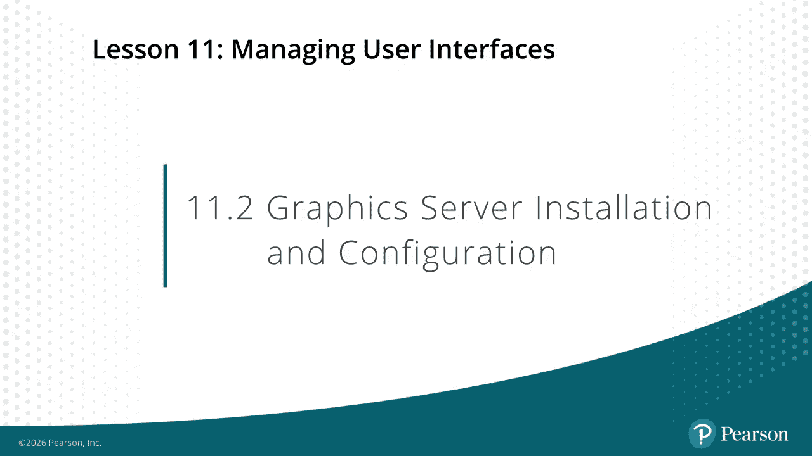
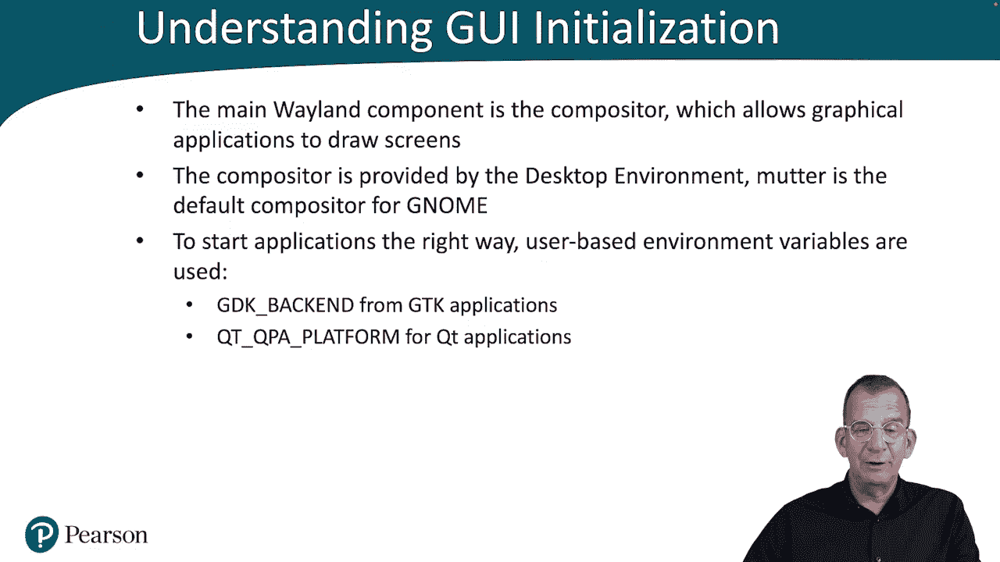

🖥️ CompTIA Linux+ V8：第46节：图形服务器安装与配置

在本节课中我们将要学习关于图形服务器配置的内容，首先会介绍初始化相关的基础知识，然后逐步讲解如何在Linux系统中安装图形界面，接着说明如何将非图形服务器转换为图形服务器，之后会介绍显示管理器的作用以及配置文件，最后会讲解Wayland初始化、合成器的作用，以及启动图形应用程序时所使用的环境变量。这些内容都是理解Linux图形服务器运行方式的基础，希望能帮助你建立起完整的知识框架。

首先我们来看看如何安装图形界面，这是整个配置过程的起点。如果你希望在安装Linux时就直接拥有图形显示界面，只需要在安装过程中选择对应的选项即可。这是最简单直接的方法，适合那些在系统安装阶段就已经确定需要图形桌面环境的用户。选择之后，安装程序会自动把相关的图形软件包放入系统，这样安装完成后重启就能看到图形登录界面。

如果你在安装时没有选择图形界面，也不必担心，因为还有另一种方法可以实现同样的目标。你可以稍后安装图形相关的软件包，这样原本没有图形界面的服务器也可以轻松变成支持图形界面的系统。这种方法特别适合那些最初只安装了命令行版本，后来又需要图形界面进行管理的场景。以下是稍后安装图形包时需要注意的步骤：

- 使用包管理器安装图形桌面环境相关的软件包
- 安装完成后检查图形服务是否正常启动
- 根据硬件和需求选择合适的桌面环境，例如GNOME或KDE

图形软件包安装完成之后，还需要告诉系统开机时默认进入图形模式，而不是停留在命令行界面。这时需要将系统的默认运行目标设置为图形模式目标，也就是graphical.target。具体的操作命令如下：

systemctl set-default graphical.target

执行这条命令之后，系统下次启动时就会直接进入图形模式，为用户提供图形化的交互界面。这是让服务器拥有图形登录界面的关键步骤。

当系统设置为图形模式后，还需要一个程序来负责显示登录界面并管理用户会话，这就是图形显示管理器的职责。GDM服务会自动启动，为用户提供标准的图形登录界面。这种界面在Ubuntu系统以及Red Hat系列系统中都非常常见。GDM是图形显示管理器，它是常见图形桌面环境的默认显示管理器，主要职责是管理图形登录会话，并决定使用哪个图形服务。GDM显示管理器可以使用配置文件/etc/gdm/custom.conf来指定应该启用哪个图形服务。以下是这个配置文件的常见用途：

- 指定默认的图形会话类型
- 配置自动登录选项
- 设置显示管理器的行为

除了传统的图形初始化方式，现代Linux系统中还有一种重要的初始化机制，那就是Wayland。Wayland初始化是通过Wayland会话来管理的，这些会话会在已知的图形环境中运行。Wayland的核心组件是合成器，合成器的作用是允许图形应用程序将画面绘制到屏幕上。合成器通常由桌面环境提供，是图形显示系统中不可或缺的一部分。

为了让图形应用程序能够正常启动并正确显示，系统还需要依赖一些基于用户的环境变量。这些环境变量告诉系统应该使用哪个后端来渲染图形界面，确保应用程序能按照预期的方式启动。例如，针对GDK应用程序使用GDK_BACKEND环境变量，针对Qt应用程序使用QT_QPA_PLATFORM环境变量。以下是常见的环境变量设置示例：

export GDK_BACKEND=wayland
export QT_QPA_PLATFORM=wayland

通过正确配置这些环境变量，图形应用程序就能正常启动并在图形界面中显示出来。

本节课中我们一起学习了图形服务器的安装与配置。首先介绍了在安装Linux时选择图形界面的方法，以及稍后安装图形包的替代方案，然后说明了如何使用systemctl set-default graphical.target命令设置默认图形目标，接着介绍了GDM显示管理器及其配置文件/etc/gdm/custom.conf的作用，最后讲解了Wayland合成器的功能，以及GDK_BACKEND和QT_QPA_PLATFORM等环境变量在启动图形应用时的应用。希望这些内容能让你对Linux图形服务器有一个清晰的认识。

