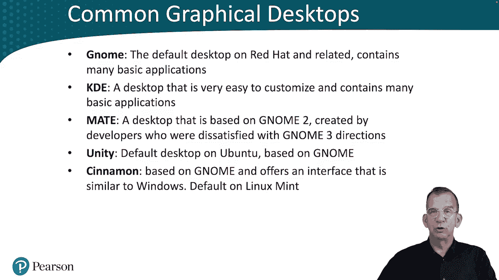

# CompTIA Linux+：第4节：理解图形桌面环境 🖥️

在本节课中，我们将一起学习什么是图形桌面环境，它在 Linux 系统中是如何工作的，以及目前市面上常见的几种主流桌面环境有哪些。无论你是刚接触 Linux 的新手，还是已经在使用命令行的一段时间，理解图形界面的组成都能帮助你更好地掌控系统。我们会把复杂的概念拆解成简单的部分，用大白话把每一层关系讲清楚，让你在安装和使用 Linux 时不再感到迷茫。


在 Linux 中，图形界面并不是一个单一的程序，而是由多层软件协作完成的。最底层通常由显示服务器负责把画面画在屏幕上，而桌面环境则在此基础上提供完整的用户体验。理解这种分层关系，是搞清楚图形桌面如何运行的第一步。

以下是图形界面的基本分层结构：

- 显示服务器：负责与硬件通信，把图像输出到显示器上。
- 合成器：管理窗口的叠加和画面刷新，确保显示流畅不撕裂。
- 图形桌面：在合成器之上绘制用户最终看到的屏幕内容。
- 桌面环境：包含窗口管理器、系统工具和常用应用程序的完整集合。

核心概念可以用下面这个简单的公式来描述：

```
图形桌面环境 = 窗口管理器 + 系统工具 + 常用应用程序
```


刚才我们介绍了图形桌面环境的基本组成，接下来我们看看显示服务器和桌面环境之间具体是如何协作的。

在早期的 Linux 系统中，显示服务器主要负责把图形用户界面显示在屏幕上。而图形桌面本身，则是在合成器的基础上绘制屏幕画面的。简单来说，显示服务器解决的是“能不能显示”的问题，而图形桌面解决的是“显示什么、怎么显示”的问题。

目前主流的图形桌面大多属于集成式桌面环境。在这种架构下，窗口管理器负责绘制屏幕上的窗口，同时环境中还内置了很多工具和应用程序，用户安装后即可直接使用，不需要额外去寻找配套软件。

以下是集成式桌面环境的主要特点：

- 窗口管理器负责画窗口和屏幕内容。
- 内置多种系统工具，方便日常配置。
- 预装常用应用程序，安装即可直接使用。
- 整体风格统一，用户体验比较连贯。


了解了集成式桌面环境的特点后，我们再来看看不同 Linux 发行版在选择桌面环境时，通常会考虑哪些因素。

当你安装 Linux 发行版时，有些发行版会让你在多种图形桌面之间选择，而很多发行版则不提供选择。这是因为统一只使用一种图形桌面，更容易进行标准化管理。图形桌面环境功能非常丰富，发行版维护团队如果只维护一种，可以把精力集中在优化和兼容性上，而不是分散到多个环境中。

以下是发行版选择统一桌面环境的常见原因：

- 标准化更容易，维护成本更低。
- 可以深度优化单一环境的性能和稳定性。
- 减少不同桌面环境之间的冲突和兼容问题。
- 新手用户不需要面对过多选择，上手更直接。


刚才讨论了发行版如何选择桌面环境，下面我们具体来看看目前最常见的几种图形桌面环境，以及它们各自的特点。

市面上存在很多图形桌面环境，每种都有自己的优势和不足。其中最常见的一种已经成为事实上的行业标准，Red Hat 系发行版以及 Ubuntu 都在使用它。除了这个主流选择之外，KDE 是另一个非常受欢迎的替代方案。KDE 起源于 SuSE Linux，最大的特点是非常容易自定义，并且内置了许多基础应用程序。

以下是几种主流桌面环境的简要介绍：

- GNOME：目前最常见的桌面环境，已成为行业标准，Red Hat 和 Ubuntu 默认采用。
- KDE：起源于 SuSE Linux，高度可定制，内置丰富的基础应用。
- MATE：基于 GNOME 2 开发，由一群不满意 GNOME 3 新方向的开发者创建。
- Unity：Ubuntu 曾经的默认桌面环境，基于 GNOME 开发。
- Cinnamon：基于 GNOME，界面风格类似 Windows，是 Linux Mint 的默认桌面环境，致力于提供与 Windows 很高的兼容性。




每种桌面环境都有自己的设计哲学和适用人群，选择哪一种主要取决于你的个人习惯和系统需求。如果你喜欢简洁现代的风格，GNOME 是不错的选择；如果你希望桌面可以随意调整，KDE 会更合适；如果你来自 Windows 并且希望找到类似的操作感觉，Cinnamon 可能是最舒服的过渡方案。


在本节课中，我们一起学习了图形桌面环境的基本概念，了解了显示服务器、合成器与桌面环境之间的分层关系，探讨了为什么很多发行版倾向于统一使用一种桌面环境，并介绍了 GNOME、KDE、MATE、Unity 和 Cinnamon 等主流桌面环境的特点。希望这些内容能帮助你在安装和使用 Linux 时，更清楚地选择适合自己的图形界面。

