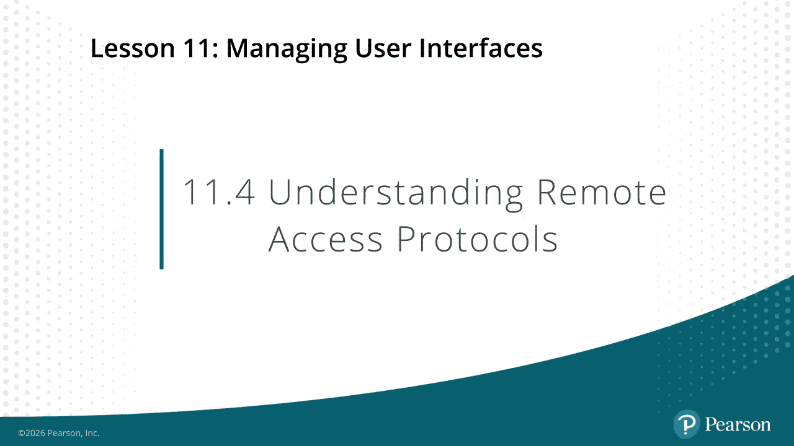
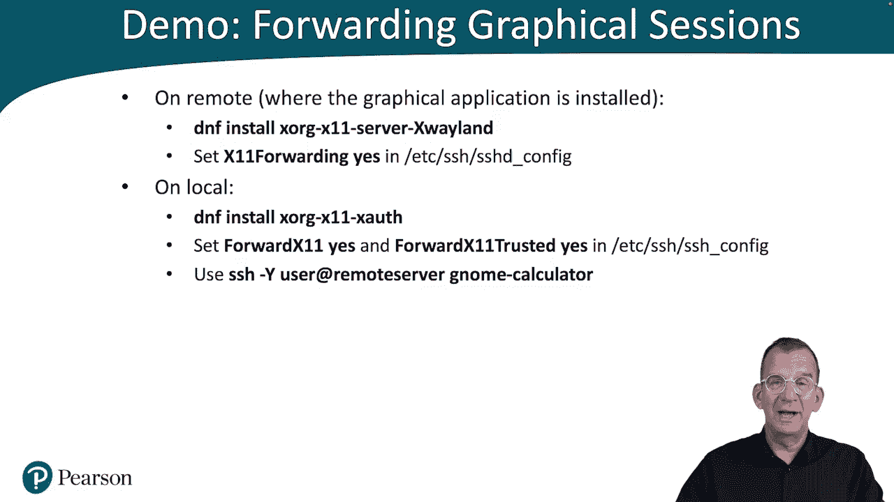
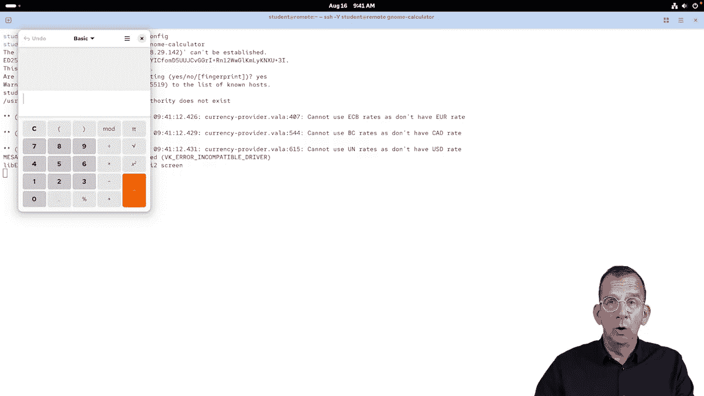

🖥️ CompTIA Linux+ V8：01：理解远程访问协议 🖥️


在本节课中我们将要学习远程访问协议，重点讲解 X11 转发技术。你将了解 X forwarding 是什么，为什么它在老系统里好用，而在新系统里会遇到问题，以及如何在 Linux 服务器上配置图形界面转发。本节课还会教你怎么在本地和远程主机上安装必要的软件包，修改 SSH 配置文件，最后用实际命令把远程计算器程序显示在本地屏幕上。




### 一、什么是 X11 转发

上一节我们简单聊过远程登录的基本概念，本节中我们来看看具体的图形远程访问协议。

X forwarding 是一种远程访问协议。它比较老了，因为 X forwarding 只在基于 X11 的环境里有用。在这些环境中，你可以把图形应用程序远程转发，并在当前主机的屏幕上显示它们的界面。使用 SSH 连接时，只需要加上特定的参数，再跟上远程服务器的 IP 地址和要运行的程序名称，就可以完成转发。

以下是常用的 SSH 转发命令示例：

```bash
ssh -X 用户名@远程服务器IP
ssh -Y 用户名@远程服务器
```

第一个参数是普通的 X11 转发，第二个参数是受信任的转发，权限更大一些。


### 二、X11 与 Wayland 的区别

刚才介绍了 X forwarding 的基本用法，但新系统里情况有所不同。接下来我们看看 Wayland 是怎么处理这个问题的。

在 Wayland 系统中，X forwarding 已经不能直接使用了。原因有两个。第一，Wayland 没有内置网络协议。第二，出于安全考虑，Wayland 默认不允许远程应用程序在它的显示器上绘制画面。这意味着如果你直接在 Wayland 上运行远程图形程序，屏幕上什么也看不到。

为了保持向后兼容，可以在本地机器上安装 Xorg X11 服务器相关的软件包，这样就在 Wayland 内部提供了一个本地 X server。如果没有 X server，图形应用程序就没有办法把自己的界面画出来。

在远程服务器上，也需要安装对应的 X11 转发支持包，才能正确处理图形数据的转发工作。

以下是核心原理的简化表示：

```
本地 X Server + 远程 X11 应用 + SSH 隧道 = 远程图形界面在本地显示
```


### 三、X11 转发的前提条件

讲完 Wayland 的限制，我们现在整理一下 X11 转发能正常工作必须满足的条件。

以下是需要检查的关键点：

1. 远程应用程序必须是为 X11 开发的，而不是 Wayland 应用。
2. 本地机器必须安装 X server，否则远程客户端无权在本地屏幕上绘图。
3. 远程服务器的 SSH 服务器配置中，X11 转发选项必须启用。
4. 客户端的 SSH 配置中，相关的转发选项也要设置为允许。

如果你的发行版当前配置比较新，可能默认使用 Wayland，这时候要找到一个兼容的 X11 应用程序会比较困难。经典的 X11 应用程序包括 xcalc 和 xeyes，以及 gnome-terminal 等，这些程序可以拿来测试。


### 四、远程服务器端的配置

知道了前提条件，下一步就是动手配置远程服务器了。我们需要在运行图形程序的那台机器上做一些设置。

首先，在远程服务器上安装 Xorg X11 服务器软件包，为 Wayland 提供 X11 兼容支持。命令大致如下：

```bash
sudo dnf install xorg-x11-server-Xwayland
```

安装完成后，需要修改 SSH 服务器的配置文件，打开 X11 转发功能。配置文件路径是 `/etc/ssh/sshd_config`，要确保里面有下面这两行：

```bash
X11Forwarding yes
X11UseLocalhost yes
```

注意，这里修改的是服务器端配置文件，以 d 结尾的 sshd_config。改完之后，不要忘记重启 SSH 服务，让配置生效：

```bash
systemctl restart sshd
```

重启之后，远程服务器就准备好接受图形转发请求了。


### 五、本地客户端的配置

远程服务器搞定之后，我们回到本地机器。本地也是客户端，需要安装一些软件并调整 SSH 客户端配置。



首先，在本地主机上安装 xauth 相关的 X11 认证软件包，否则远程客户端无法在本地机器上画出界面。命令示例：

```bash
sudo dnf install xorg-x11-xauth
```

接着，修改本地 SSH 客户端的配置文件。注意，这个文件和刚才服务器上的不一样，路径是 `/etc/ssh/ssh_config`，没有 d 结尾。在文件里确保设置如下：

```bash
ForwardX11 yes
ForwardX11Trusted yes
```

这两个选项都要设成 yes，这样本地 SSH 客户端才会同意接收远程发来的图形数据。


### 六、实际演示与连接测试

配置都完成之后，就可以进行实际操作了。我们假设有两台服务器，一台是远程主机，上面安装了图形应用程序；另一台是本地主机，用来显示界面。

在本地主机上，使用带有 X11 转发参数的 SSH 命令连接远程服务器：

```bash
ssh -Y student@远程服务器
```

连接后正常输入密码进行身份验证。登录成功以后，直接运行一个 X11 兼容的程序，比如计算器 xcalc：

```bash
xcalc
```

这时候，远程服务器上的计算器窗口就会出现在本地屏幕上。这说明我们成功以 X11 兼容的方式转发了图形应用程序。

需要特别注意的是，被运行的程序必须是 X11 应用程序，如果是 Wayland 原生应用，这种方法是不行的。


总结：



本节课中我们一起学习了远程访问协议中的 X11 转发技术。我们了解了 X forwarding 的基本概念和使用场景，学习了 Wayland 为什么不支持直接转发，掌握了在远程服务器和本地客户端上安装软件包、修改 SSH 配置文件的具体步骤，最后通过 ssh -Y 命令把远程计算器程序显示在本地屏幕上。希望这些内容能帮助你理解 Linux 图形远程访问的工作原理。
