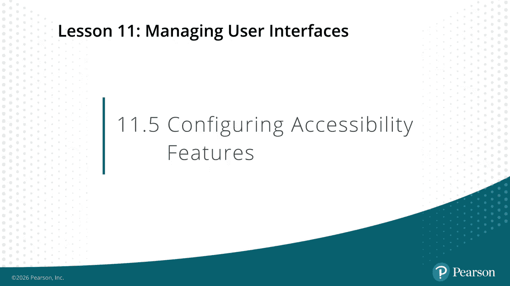
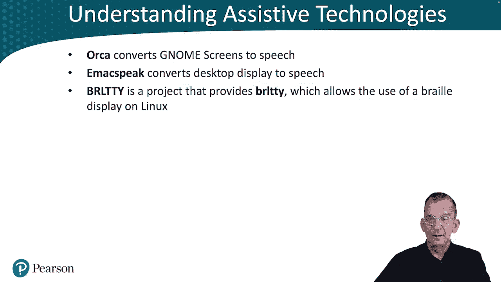

# 🖥️ CompTIA Linux+ 认证教程：349：配置辅助功能


## 📖 本节概述


在本节课中，我们将学习如何配置辅助功能。辅助功能的目的是让不同需求的用户也能更方便地使用计算机。无论是键盘操作、屏幕显示，还是语音输出，Linux 系统都提供了相应的设置和工具，帮助用户降低使用门槛，提高操作效率。通过本节的学习，你将掌握从键盘设置到屏幕阅读器的各种辅助功能配置方法。




## ⌨️ 键盘辅助功能设置

上一节我们简单介绍了系统设置的基础内容，本节中我们先来看看键盘辅助功能设置。

键盘辅助功能是从键盘设置开始的。X 工具是一个老旧的实用工具，它允许你配置键盘辅助功能。在现代桌面环境中，这些设置可以通过键盘设置界面进行配置。

以下是键盘设置中常见的可调整选项：

- 按键重复延迟（repeat key delay）：按住键不放后，开始重复输出前的等待时间。
- 按键重复速度（repeat key speed）：开始重复后，每秒输出字符的次数。
- 快捷方式（shortcuts）：通过组合键快速执行常见操作，让使用键盘变得更加容易。

你可以根据自己的习惯调整这些参数，让按键响应更符合个人需求。

关于键盘重复行为，可以用以下简单公式来理解：

```
键盘重复行为 = 重复延迟 + 重复速度
```


## 🖼️ 视觉设置与主题

刚才我们介绍了键盘方面的辅助功能，接下来我们看看视觉设置和主题。

除了键盘设置，系统还提供视觉设置和主题选项，帮助用户更清晰地看到屏幕内容。这些设置对视力不佳的用户尤其重要，因为合适的显示配置能显著降低视觉疲劳。

以下是常见的视觉辅助方式：

- 屏幕键盘：例如 `GOK`（GNOME 屏幕键盘），可以在屏幕上显示虚拟键盘，让无法使用物理键盘的用户也能进行输入。
- 桌面字体大小：调大系统字体，让文字更容易辨认，对视力不佳的用户非常有帮助。

通过合理调整字体大小和启用屏幕键盘，桌面环境的可访问性会得到明显提升。


## 🔍 放大工具与屏幕阅读器

在了解了视觉设置之后，我们继续看看放大工具和屏幕阅读器。

系统中还提供放大工具等实用程序，`KMag` 是 `KDE` 桌面环境中自带的放大工具。它也适用于 `GNOME` 桌面环境，甚至可以在 `XFCE` 这种较老的窗口管理器中使用。

此外，还有一些辅助技术可以进一步改善体验。

以下是这些辅助技术的简要介绍：

- `Orca`：将 `GNOME` 屏幕内容转换为语音，让盲人或低视力用户通过听觉了解屏幕信息。
- `Emacspeak`：将桌面显示内容转换为语音，提供另一种语音输出方案。
- `BRLTTY`：一个提供盲文显示支持的项目，允许在 Linux 系统上使用盲文显示设备。

以下是这些辅助技术的简要对比：

| 工具 | 作用 | 适用场景 |
|------|------|----------|
| `Orca` | 屏幕内容转语音 | `GNOME` 桌面环境 |
| `Emacspeak` | 桌面显示转语音 | 语音反馈需求 |
| `BRLTTY` | 盲文显示支持 | 配合盲文显示设备使用 |


## 📝 本节总结



本节课中，我们一起学习了配置辅助功能的相关内容。我们介绍了键盘辅助功能设置，包括按键重复延迟、速度和快捷方式；接着讨论了视觉设置和主题，如屏幕键盘和桌面字体大小；最后介绍了放大工具和辅助技术，包括 `KMag`、`Orca`、`Emacspeak` 以及 `BRLTTY`。希望这些知识能帮助你更好地设置 Linux 系统的无障碍访问功能。

