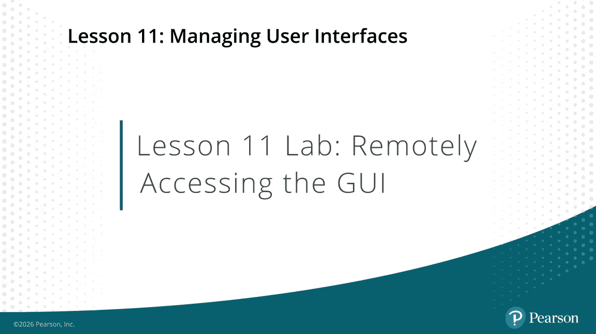
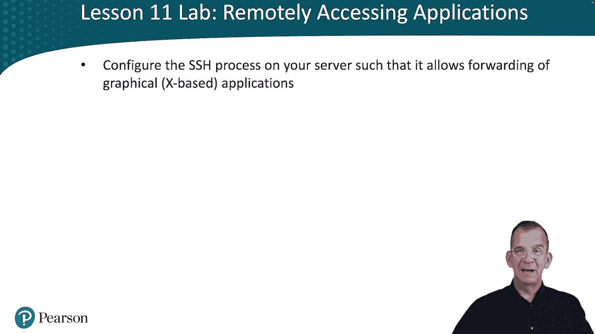

# CompTIA Linux+ V8：第11课：远程访问图形界面 🖥️

在本节课中，我们将一起学习如何在 Linux 服务器上配置远程访问图形应用程序的基础环境。具体来说，我们会把注意力集中在安全外壳协议上，让它支持把带有图形界面的 X11 应用程序从远程服务器转发到本地计算机上显示。这对于需要在远程机器上运行图形化工具，但又不想直接连接显示器的情况非常有用。

接下来我们先来看看本节实验的主要目标，了解我们要达成什么结果。

## 实验目标

本节实验的核心任务非常明确，就是配置服务器上的安全外壳进程，使其允许转发基于 X11 的图形应用程序。换句话说，我们要让 SSH 不仅能传输文字命令，还能把远程程序的图形界面画面传回本地，这样你在自己的电脑上就能看到远程运行的图形软件了。

以下是本节实验需要完成的关键点：


- 在服务器上启用 SSH 服务。
- 修改 SSH 配置文件，打开 X11 转发功能。
- 重启 SSH 服务使配置生效。
- 在客户端使用带有图形转发参数的命令连接服务器。

完成这些步骤后，你就具备了远程访问图形应用的基本能力。



然后我们进入配置细节部分，看看具体的设置应该怎么写。

## 核心配置概念

安全外壳协议通常缩写为 SSH，它是远程管理 Linux 服务器的标准工具。要把图形界面从远程传到本地，需要修改 SSH 服务器的配置文件，将与 X11 转发相关的选项打开。下面这个配置片段展示了最关键的一行设置。

```bash
X11Forwarding yes
```

这行配置的意思是，允许 SSH 服务器把 X11 图形协议的数据转发给连接进来的客户端。如果没有这一行，或者这一行被设置为 no，那么远程图形程序就无法在本地显示界面。

在客户端连接时，也需要使用特定的参数来启用图形转发，常用的命令格式如下：

```bash
ssh -X 用户名@服务器地址
```

这里的 -X 参数告诉 SSH 客户端，请求服务器开启 X11 转发功能，这样远程启动的图形应用才能把窗口画在你的本地屏幕上。

看完这些核心概念之后，我们来具体看看整个操作流程应该怎么进行。

## 操作步骤说明

以下是配置远程图形访问的完整步骤，请按顺序执行：

1. 使用管理员权限登录到 Linux 服务器。
2. 用文本编辑器打开 SSH 服务器配置文件，路径通常是 /etc/ssh/sshd_config。
3. 找到 X11Forwarding 这一行，确保它的值设置为 yes，如果前面有注释符号 # 则需要去掉。
4. 保存文件并退出编辑器。
5. 重启 SSH 服务，命令通常是 sudo systemctl restart ssh 或 sudo systemctl restart sshd，具体取决于你的发行版。
6. 在本地计算机上打开终端，输入带有 -X 参数的 SSH 连接命令，例如 ssh -X 用户名@服务器IP。
7. 登录成功后，在远程终端中启动任意图形应用程序，比如 xeyes 或 gedit，观察窗口是否出现在本地桌面上。



执行完这些步骤，如果配置正确，你就能在自己的电脑上看到远程服务器运行的图形界面了。

## 本节总结

本节课中我们一起学习了如何在 Linux 服务器上配置 SSH 以支持远程图形应用访问。我们先介绍了实验目标，然后讲解了 X11 转发的核心配置，最后列出了具体的操作步骤。希望这些内容能帮助你理解远程图形界面的基本原理，并成功在自己的环境中搭建起来。
