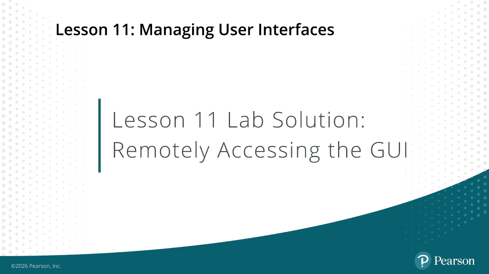
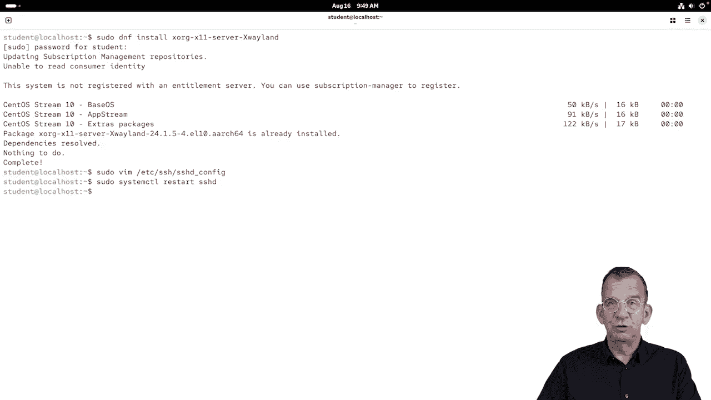

# CompTIA Linux+ V8：第11章：远程访问图形界面实验 🖥️

在本节课中，我们将一起学习如何配置服务器以支持远程图形界面访问。具体内容包括在远程主机上安装必要的显示组件，修改SSH配置以允许图形转发，重启服务使设置生效，以及在本地客户端准备接收远程画面的环境。整个实验围绕“远程应用程序图形转发”这个核心概念展开，适合刚接触Linux远程管理的初学者。


## 第一部分：理解实验的核心目标

在开始具体操作之前，我们需要先搞清楚这个实验到底想要达到什么效果。简单来说，实验的最重要一点是正确配置服务器，使其允许远程应用程序的图形界面被转发到本地显示。也就是说，当你在远程机器上运行一个带有图形界面的程序时，它的画面可以通过网络传输到你的电脑上，而不是只停留在服务器本身。




以下是本部分的核心要点：

- 远程服务器必须开启图形转发功能，否则本地客户端无法接收画面。
- 默认情况下，部分现代显示服务器并不自动支持远程程序转发，需要手动配置。
- SSH服务的配置文件决定了图形转发是否被允许，需要重点检查。
- 配置修改完成后，必须重启相关服务才能生效。


## 第二部分：在远程服务器上安装X11组件

上一部分我们介绍了实验的核心目标，本部分中我们来看看如何在远程服务器上准备必要的软件包。要让服务器支持远程图形程序转发，首先需要安装与X Window系统相关的组件。


在远程服务器上执行以下命令：

```bash
dnf install xorg-x11-server-Xorg xorg-x11-server-Xwayland
```

这条命令的作用是安装Xorg服务器和Xwayland组件。这里有一个需要注意的细节：Wayland是目前很多Linux发行版默认使用的显示协议，但它默认不支持远程应用程序的图形转发。因此，如果系统主要依赖Wayland，而没有额外安装和配置Xorg，远程图形界面访问是无法正常工作的。安装完成之后，远程服务器就具备了转发图形界面的基础能力。


## 第三部分：配置SSH开启X11转发

刚才我们完成了远程服务器上的软件安装，本部分中我们来看看第二个关键步骤，也就是修改SSH服务器的配置，确保允许X11转发。


SSH服务器的主配置文件位于以下路径：

```text
/etc/ssh/sshd_config
```

你需要在这个文件中找到与X11转发相关的设置项，并确保它的值被设置为yes：

```text
X11Forwarding yes
```

这个设置的意思是允许SSH客户端通过安全隧道接收来自服务器的图形界面数据。如果这一项被设置为no，或者被注释掉了，那么即使安装了Xorg组件，远程图形界面依然无法显示。在本实验的具体环境中，这个选项通常已经是yes，不需要额外修改。不过养成检查的习惯是非常重要的，因为在实际生产环境中，这个配置项经常被关闭出于安全考虑。


## 第四部分：重启SSH服务使配置生效

在第三部分中，我们介绍了如何修改sshd_config文件中的X11Forwarding设置，本部分中我们来看看如何让这些修改真正起作用。


如果你对配置文件做了任何更改，必须重启SSH守护进程，新的配置才会被加载：

```bash
systemctl restart sshd
```

这条命令会重新启动SSH服务，使刚才修改的X11Forwarding设置生效。如果你没有修改配置文件，这一步可以跳过，但建议始终确认服务正在运行。重启完成后，远程服务器端的准备工作就全部结束了，接下来我们需要把注意力转移到本地客户端。


## 第五部分：准备本地客户端接收画面

上一部分我们完成了远程服务器的配置与服务重启，本部分中我们来看看在你的本地电脑上需要做些什么，才能接收并显示远程的图形界面。


本地客户端需要满足的基本条件如下：

- 本地机器必须安装一个X服务器，用于接收和渲染远程传来的图形数据。
- 这个X服务器可以运行在Linux客户端上，也可以运行在Windows系统上。
- 如果你使用的是Linux客户端，通常自带或容易安装X服务组件。
- 如果你使用的是Windows客户端，则需要额外安装第三方X服务器软件，例如VcXsrv或Xming。

简单来说，远程服务器负责把图形界面“发”出来，而本地客户端负责把它“接”回来并显示在屏幕上。没有本地X服务器，你就算连接成功也只能看到命令行界面，无法看到图形程序的窗口。




## 课程总结

本节课中我们一起学习了如何配置远程访问图形界面。我们先了解了实验的核心目标，即让服务器支持远程应用程序的图形转发；接着学习了在远程服务器上安装Xorg和Xwayland组件的方法；然后重点介绍了如何在/etc/ssh/sshd_config中确保X11Forwarding被设置为yes，并在必要时使用systemctl restart sshd重启SSH服务；最后说明了本地客户端需要安装X服务器才能显示远程画面，无论是Linux还是Windows都可以实现。通过这些步骤，你就可以在本地电脑上安全地查看和操作远程服务器上的图形程序了。

