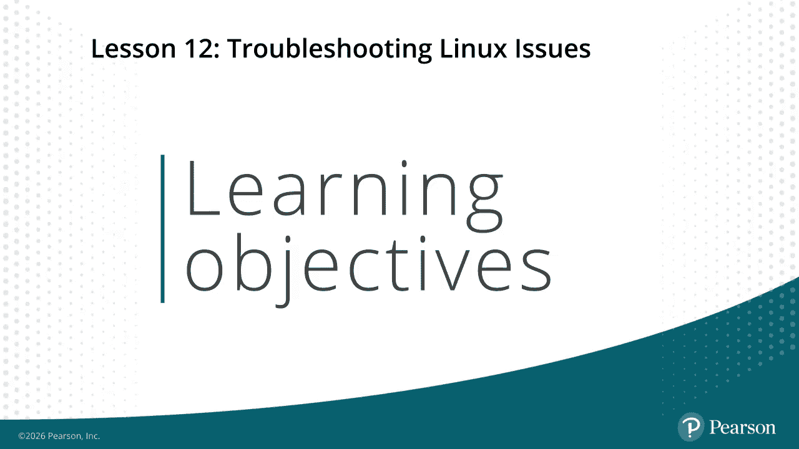

# CompTIA Linux+ V8：第12课：常见问题排查 🔧

在本节课中我们将要学习如何处理 Linux 系统中最常见的一些故障情况。系统运行起来总免不了遇到各种小问题，作为一名 Linux 运维人员或学习者，掌握排查思路是非常基础且必要的技能。本节课的内容比较丰富，我们会一步步来，从网络连接问题开始，然后逐步深入到存储、处理器、内存等硬件资源层面的故障，接着讲解当你忘记了 root 密码该如何找回，最后还会涉及逻辑卷管理器 LVM 的相关排查方法。无论你是准备考取 CompTIA Linux+ 证书，还是只是想提升日常维护能力，这些知识都能帮你在出问题时不至于手足无措。


首先，我们来看看网络故障排查。网络是服务器的生命线，一旦网络不通，远程连接、软件安装、数据同步全部会受到影响。如果你发现无法通过 SSH 连接服务器，或者网页打不开，通常首先要怀疑的就是网络配置或者物理连接出了问题。

以下是网络故障排查时常用的检查步骤和命令：



- 使用 `ip addr` 或 `ifconfig` 查看网卡是否有正确的 IP 地址配置。
- 使用 `ping` 测试本地回环地址和目标主机的连通性。
- 使用 `traceroute` 查看数据包经过的路由路径，找出断点所在。
- 检查防火墙状态，确保相关端口没有被阻止。

网络排查的核心思路可以简化为：先检查本机配置，再测试本地连通，最后逐步向外排查网络路径。


上一节我们介绍了网络故障的排查方法，本节中我们来看看存储和处理器相关的问题。存储空间满了或者 CPU 负载过高，都会导致系统运行缓慢，甚至服务无法响应。很多初学者在遇到系统卡顿时不知道从何下手，其实按照资源类型来分类排查是比较有效的办法。

以下是存储和 CPU 问题的常见排查方式：

- 使用 `df -h` 查看磁盘分区使用情况，确认是否有分区已满。
- 使用 `du -sh *` 查找占用空间较大的目录或文件。
- 使用 `top` 或 `htop` 观察 CPU 使用率和进程占用情况。
- 使用 `iostat` 检查磁盘 I/O 是否成为瓶颈。

存储和 CPU 故障排查可以用这个简单公式来理解：

系统卡顿 = 资源占用过高 或 资源耗尽

当系统出现运行缓慢现象时，可以优先检查这两个方面是否存在异常。


讲完了存储和 CPU，接下来我们重点介绍 Linux 内存的使用情况以及如何排查内存相关问题。内存不足会导致系统频繁使用交换分区，严重时会触发 OOM 杀死进程，造成服务中断。内存问题有时候不如磁盘满那么直观，需要通过命令行工具才能看清楚到底发生了什么。

以下是内存排查的常用命令和方法：

- 使用 `free -m` 查看内存总量、已用量和可用量，单位为兆字节。
- 使用 `cat /proc/meminfo` 查看更详细的内存统计信息。
- 使用 `vmstat` 观察内存页面交换和缓存情况。
- 检查日志中的 OOM Killer 记录，确认是否有进程被系统强制终止。

内存使用率的简单计算公式如下：

内存使用率 = (已用内存 ÷ 总内存) × 100%

当这个数值持续接近 100% 且交换分区频繁读写时，就需要考虑增加物理内存或优化应用程序了。


讲完了内存，接下来我们讲解当你丢失 root 密码时该如何重置。这是运维工作中偶尔会遇到的尴尬情况，如果没有物理机或虚拟机控制台访问权限，处理起来会比较麻烦。不过只要掌握了正确的引导参数和修改步骤，大多数情况下都能找回系统控制权。

以下是重置丢失 root 密码的一般操作流程：

- 重启系统并在引导菜单中编辑内核参数。
- 添加 `rd.break` 或 `init=/bin/sh` 等参数进入维护模式。
- 以只读方式挂载根文件系统，然后重新挂载为读写模式。
- 使用 `passwd` 命令为 root 设置新密码。
- 重启系统并用新密码正常登录。

这个过程的核心命令可以概括为：

```
mount -o remount,rw /
passwd root
```

操作完成后记得恢复引导参数，避免下次启动仍然进入维护模式，造成安全隐患。


上一节我们介绍了 root 密码重置方法，最后我们来看看逻辑卷管理器 LVM 的故障排查。LVM 提供了灵活的磁盘管理方式，但当逻辑卷损坏或卷组丢失时，数据访问就会出问题。LVM 的排查逻辑比普通分区稍微复杂一点，因为中间多了一层卷组的抽象。

以下是 LVM 故障排查时常用的命令：

- 使用 `pvdisplay` 查看物理卷状态。
- 使用 `vgdisplay` 查看卷组信息和是否激活。
- 使用 `lvdisplay` 查看逻辑卷大小和状态。
- 使用 `vgchange -ay` 激活所有卷组。
- 使用 `fsck` 检查并修复文件系统错误。

LVM 管理的基本关系可以用代码块表示：

```
物理卷 (PV) -> 卷组 (VG) -> 逻辑卷 (LV) -> 文件系统
```


如果某一层出现问题，上层都将无法正常使用，因此排查时需要从下往上逐层确认。


本节课的内容接近尾声，最后还有一个实验和实验解答环节。实验是巩固知识的最好方式，建议你在虚拟机中亲自操作一遍，遇到问题时对照实验解答进行分析。光看视频不够，动手实践才能真正掌握排查技巧。

本节课中我们一起学习了常见 Linux 故障的排查方法，包括网络连接问题、存储和 CPU 性能问题、内存使用诊断、丢失 root 密码的重置方法，以及 LVM 逻辑卷管理的故障处理。希望通过本节课的学习，你能在实际工作中更加从容地处理系统故障。

