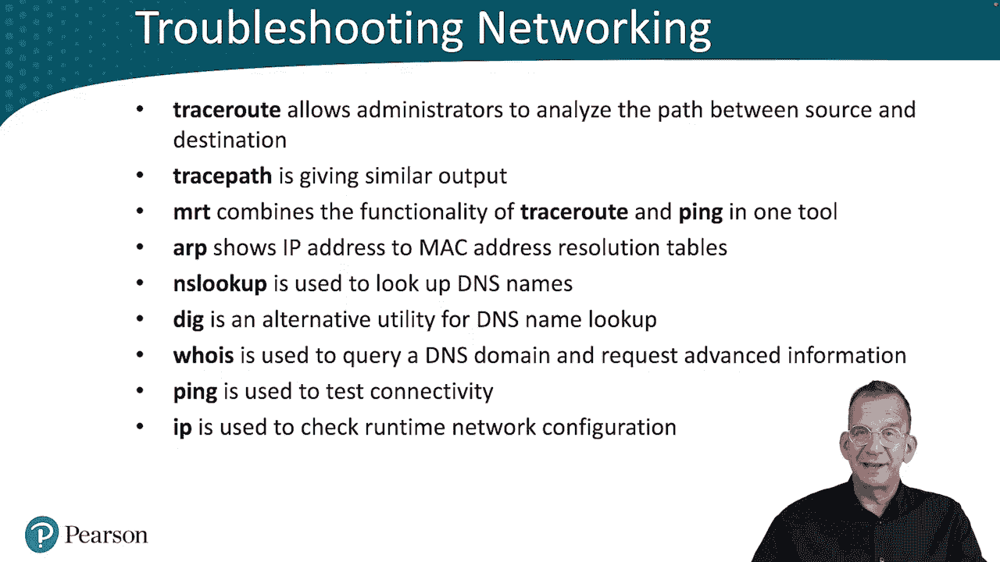
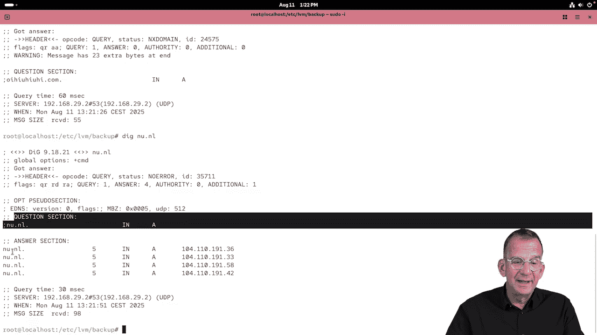

# CompTIA Linux+ V8：353.121：网络排障 🌐

在本节课中我们将要学习 Linux 系统下常见的网络排障工具。网络出问题时，首先要知道用什么命令去查，本节会把常用的排障命令逐一列出来，并用大白话解释每个工具的作用，适合初学者入门。内容不少，但只要跟着顺序看，就能掌握排查网络故障的基本思路。

## 工具清单

上一节我们简单聊了聊网络排障的整体思路，本节中我们来看看 Linux 里都有哪些实用的命令行工具。

以下是常用的网络排障工具及其用途：

- Nmap（原文也出现为 EnMap/EndMap）：用于分析开放端口。网络管理员有时会把它当成敌对工具，所以使用时要小心。
- netstat（原文作 Nettt）和 ss：netstat 是旧工具，ss 是它的现代替代品。它们能列出本地端口，帮你搞清楚哪个程序在监听哪个端口。
- iftop：提供所有本地网络接口上的实时流量概览，方便你一眼看出哪个网卡流量大。
- route：旧版路由表操作工具；现代 Linux 通常使用 `ip route` 代替。
- iperf：可安装在服务器和客户端上，用于测量网络吞吐量，看看带宽到底够不够用。
- tcpdump：用于分析网络流量，抓到的数据会直接打印在屏幕上，也可以重定向到 `pcap` 文件，也就是数据包捕获文件。
- Wireshark：图形化工具，用于分析数据包捕获文件，或者基于特定输入过滤器监控实时流量。
- netcat（nc）：又名网络瑞士军刀，包含很多小工具，主命令是 `nc`，常用于测试某个端口是否可用。
- traceroute：允许管理员分析数据包从源到目标走过了哪条路径。
- mtr：输出与 traceroute 类似，并且把 traceroute 和 ping 的功能合并在一个工具里。
- arp：显示 IP 地址到 MAC 地址的解析表。
- nslookup 和 dig：nslookup 是旧工具，dig 是现代替代品，两者都用于 DNS 名称查询，以及检查 DNS 解析是否正常。
- whois：查询 DNS 域名并请求高级信息。
- ping：用于检测网络活动，也就是常说的存活探测。
- ip：整体管理工具，允许你运行时配置网络，并检查网络栈当前设置。

工具介绍完了，下面我们进入实际操作演示部分，看看这些命令在真实终端里是怎么使用的。

## 实际操作演示

先来演示几个最常用的命令，方便你建立直观感受。

首先，我们可以 `ping NU.nl` 来检查基本连通性，验证最基础的工具是否好用。我比较喜欢用 `ping`，因为它输入简短、很方便。执行之后，我们能看到 ICMP 数据包。这些是发送出去的数据包，其中 `TTL` 表示本地到目标之间的最大跳数，`time` 表示往返时间。比如显示 18.9 毫秒，对于基于互联网的流量来说，这个速度一点都不差。

接下来，如果我想查看到这里 NU.nl 的当前路由，可以尝试 `tracepath` 之类的工具，在那里可以看到我主机与远程主机之间经过的所有节点信息。但令人失望的是，中间很多主机出于安全目的会隐藏自己的响应，不愿暴露身份，这导致 `tracepath` 和 `traceroute` 如今的用处越来越有限。

换一个工具，我们来看看 `arp`。使用 `arp -a` 可以获取 ARP 表概览。ARP 表本质上是 IP 地址和 MAC 地址的对应关系。有时候可能会出现重复 MAC 地址的问题，也就是说两个节点使用了同一个 MAC 地址，这会把网络搞混乱，而 ARP 能帮你找出这个问题。如果想删除表中的某条记录，可以使用 `arp -d`，它会删除选中的条目，例如 `arp -d 192.168.29.145` 会把这一条去掉。删除之后，当我再次 ping 这个 IP 地址时，为了获得响应，我们需要再次获取 MAC 地址。幕后，`ping` 命令会触发一个 who 请求，用来查明这个 IP 地址背后对应的 MAC 地址。

最后，我们来看看 `dig` 工具。对 `notexisting.com` 执行 `dig`，我想它应该不存在，如果不存在，我们应该能看到 `NXDOMAIN` 输出来确认。如果你看到 `NXDOMAIN`，代表不存在该域名，这意味着我的朋友，你正在尝试连接一个不存在的主机。但如果使用 `dig NU.nl`，我们可以看到 `no error` 状态，并且能看到问题部分，即我们在询问 NU.nl 的 IP 地址，同时也能看到答案部分，答案部分揭示了几个 IP 地址。这应该能证明你想连接的主机可以通过 DNS 到达。

演示部分到此结束，下面我们来做一个总结。

## 总结

本节课中我们一起学习了 Linux 下的网络排障工具，包括 Nmap、netstat/ss、iftop、ip route、iperf、tcpdump、Wireshark、netcat、traceroute、mtr、arp、nslookup/dig、whois、ping 以及 ip 工具，并通过 `ping`、`tracepath`、`arp` 和 `dig` 等命令进行了实际操作，掌握了检查端口、路由、ARP 表和 DNS 解析的基本方法。

