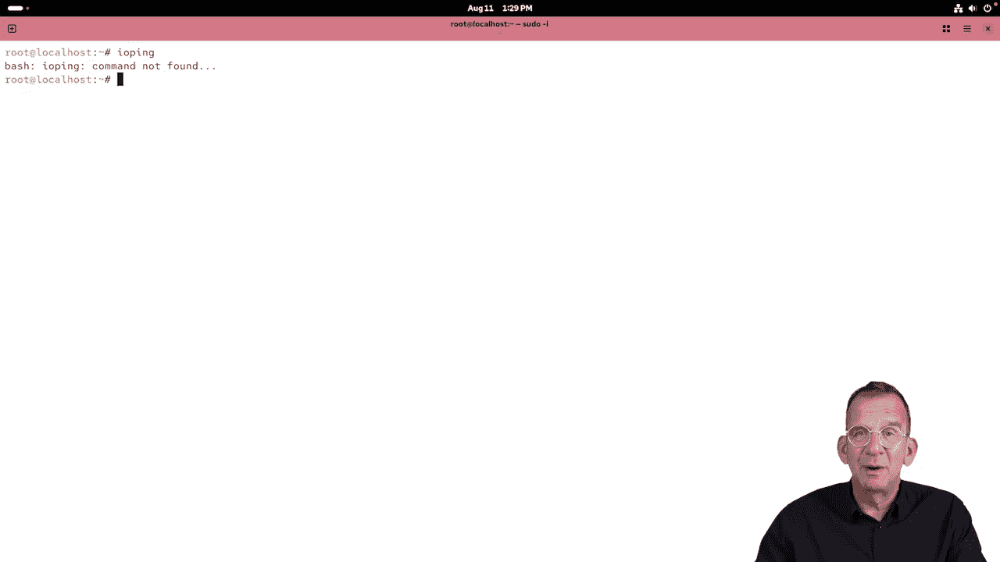

# CompTIA Linux+ V8：122：存储故障排除 🛠️

在本节课中我们将要学习如何在 Linux 系统中排查和解决存储相关的问题。存储故障排除是系统管理员的基础技能之一，涉及文件系统完整性检查、分区表更新、磁盘空间查看以及 I/O 性能优化等多个方面。我们会用大白话逐一介绍常用命令和工具，帮助你快速定位存储故障，并恢复系统的正常运行。


首先，我们来看看如何检查文件系统的完整性。这是排查存储问题时通常要做的第一件事，因为文件系统一旦损坏，数据就可能无法正常读写。

`fsck`（File System Check）是用来检查和修复文件系统完整性的工具。你可以在任何存储设备上手动运行它，从而判断文件系统是否出现了故障。

**公式/命令示例：**
```bash
fsck /dev/sda1
```


接下来，我们继续看分区表相关的操作。有时候内核识别到的分区信息和实际存储设备的情况不一致，这时候就需要手动让内核重新读取分区表。

`partprobe` 是一个很有意思的命令，它可以用真实的存储信息来更新内核的分区表。如果你觉得内核没有正确显示存储设备的分区信息，使用这个命令很可能就能解决问题。

**公式/命令示例：**
```bash
partprobe
```


然后，我们需要了解如何查看磁盘空间的使用情况。这能帮助你判断是整个磁盘满了，还是某个具体目录占用了过多空间。

以下是几个常用的磁盘空间查看工具：
- `du`（Disk Usage）：用来查看每个目录的可用磁盘空间概览。
- `df`：用来显示每个存储设备的可用磁盘空间。

**公式/命令示例：**
```bash
du -h /home
df -h
```


接着，我们进入存储统计信息和 I/O 性能测试的部分。了解设备当前的活动情况，有助于你找出性能瓶颈所在。

以下是几个与存储统计相关的工具：
- `iostat`：可以生成大量与存储相关的统计信息，让你查看设备活动的概览。
- `iop`：是一个可选的工具，用于测试 I/O 性能，不过在很多系统中默认没有安装。

**公式/命令示例：**
```bash
iostat 2 5
```


接下来，我们来讨论如何优化 I/O 性能。Linux 允许通过调整 I/O 调度器来优化磁盘的读写行为。

在 `/sys` 目录下，你可以找到所有设备的接口。进入 `block` 子目录，可以找到块设备的子目录，例如 `nvme0n1` 和 `nvme0n2`。在这些目录中，`queue` 目录下有一个名为 `scheduler` 的文件，里面列出了可用的调度器，例如 `none`、`mq-deadline`、`kyber` 和 `bfq`。

如果你觉得磁盘表现不佳，可以尝试更换调度器。由于 `/sys` 下的文件不能直接编辑，需要使用 `echo` 命令将想要的值写入 `scheduler` 文件。

**公式/命令示例：**
```bash
echo bfq > /sys/block/nvme0n1/queue/scheduler
```

修改完成后，可以测试系统表现是否改善。如果改善了，可以通过 systemd 的启动单元使配置持久化；如果没有改善，可以通过 `echo` 恢复原来的值，或者直接重启系统，重启总会恢复到默认值。


对于 NVMe 设备，也就是俗称的“SSD 加强版”，速度非常快。通常情况下，你不需要对 I/O 调度器做任何优化，它本来就能正常工作。


接下来，我们介绍一个实用的 I/O 监控工具。可以使用 `iostat` 来观察设备活动，不过有时候系统中没有预装相关软件包，需要先行安装。

例如，运行 `iostat 2 5` 表示每 2 秒采样一次，共采样 5 次。输出中会列出所有设备，你可以轻松找到最繁忙的设备。在这个例子中，最繁忙的设备似乎是 `nvme0n1` 和 `nvme0n3`。可以忽略 `dm-0`，因为它是设备映射器，被 LVM 使用，实际上是由 NVMe 设备托管的，所以数值差不多。

`iostat` 会显示每秒事务数、每秒读取的千字节数、每秒写入的千字节数、每秒丢弃的千字节数、总千字节速率以及写入和丢弃的总千字节数，这是一份不错的 I/O 性能概览。

**公式/命令示例：**
```bash
iostat 2 5
```


另外，还有一个我个人很喜欢的工具叫 `iotop`。使用 `iotop` 时，你可以看到当前的 I/O 活动。和 `top` 命令类似，`iotop` 会把最繁忙的进程显示在列表顶部。在这个例子中，最繁忙的似乎是与现代系统终端相关的进程。

**公式/命令示例：**
```bash
dnf install -y iotop
iotop
```


最后，我们提一下 `ionice`。这是一个不错的工具，可以用来检查 I/O 设备并获取更多性能信息。不过它并不总是在默认的发行版仓库中提供。虽然默认仓库可能没有，但你还是应该记住它，因为考试大纲里包含这个命令，考试中可能会出现相关题目。

**公式/命令示例：**
```bash
ionice -c 3 -p 1234
```





在本节课中我们一起学习了存储故障排除的常用命令和方法。我们介绍了用于检查文件系统完整性的 `fsck`，用于更新内核分区表的 `partprobe`，用于查看磁盘空间的 `du` 和 `df`，用于生成存储统计信息的 `iostat` 和 `iop`，以及用于测试 I/O 性能的 `iotop` 和 `ionice`。此外，我们还学习了如何通过修改 `/sys/block/.../queue/scheduler` 来调整 I/O 调度器，优化 NVMe 等快速存储设备的性能。希望这些内容能帮助你在实际工作和考试中更好地处理 Linux 存储问题。

