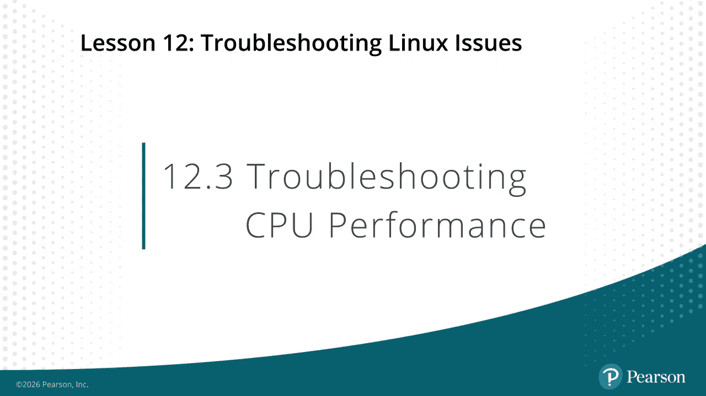
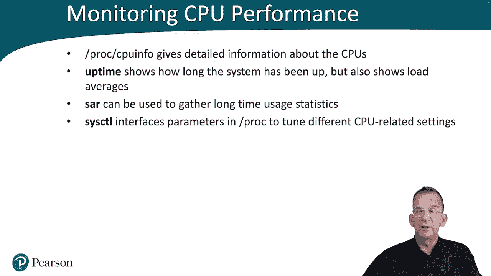
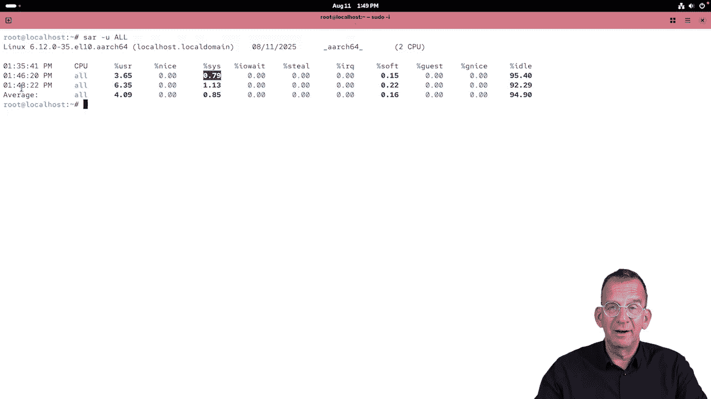

# 🖥️ CompTIA Linux+ V8：355.123：排查CPU性能




在本节课中我们将要学习如何在Linux系统中排查CPU性能问题。你会了解到哪些命令可以用来查看CPU状态，如何开启长期性能数据采集，以及如何调整内核参数来改变CPU的调度行为。内容适合初学者，会用大白话把每一步讲清楚。下一步要调查的是CPU性能，监控CPU性能可以使用哪些方法？除了top命令这样显而易见的工具之外，还有其他几种方法可以帮助你分析处理器的繁忙程度。


## CPU性能监控的常用工具 🔍


首先我们来看看可以用来观察CPU性能的基础工具。

当你怀疑系统CPU出现瓶颈时，第一件事就是查看当前的CPU使用情况。top命令能揭示关于CPU的大量信息，是查看CPU占用最直观的工具。当然，除了top命令之外，还有其他几种方法可以帮助你分析处理器的繁忙程度。

以下是几个最常用的CPU监控命令及其作用：
- `top`：显示实时的CPU和进程信息。
- `/proc/cpuinfo`：提供CPU的详细硬件信息，包括支持的特性标志。如果你想使用硬件虚拟化，需要确认是否存在SVM或VMX标志，这个文件会告诉你答案。
- `uptime`：显示系统已经运行了多久，同时也会输出负载平均值，而这些输出内容也集成在top命令中。
- `sar`：一种非常方便的命令，用于收集长时间的系统使用统计信息。
- `/proc`中的sysctl接口参数：用于调整不同的CPU相关设置。



sar的好处是它每隔X分钟收集一次性能数据，数据收集完成后，你可以使用sar命令来分析这些历史数据。不过默认情况下这个功能是关闭的，需要你手动启用才能开始工作。


## 检查系统定时器与数据采集 ⏱️


上一节我们介绍了用于监控CPU的常用命令，本节中我们来看看系统是如何自动收集这些性能数据的。

很多性能数据的收集依赖于系统定时器。如果定时器没有正常工作，你可能会发现没有任何历史数据可供分析。让我来演示如何检查定时器状态。

以下是检查数据采集定时器的步骤：
- 使用`systemctl list-timers`查看所有定时器，寻找名为sysstat-collect.timer的任务。
- 使用`systemctl status sysstat-collect.timer`查看该定时器的详细状态，确认它是否处于启用和激活状态。
- 检查`/var/log/sa`子目录，这是sadc收集工具通常填充数据的地方。如果该目录为空，说明数据收集还没有发生。
- 尝试运行`sar -A`，如果系统提示无法打开`/var/log/sa/sa11`这类文件，也说明相关数据文件不存在。

关键问题是定时器是否真的开始工作了。即使定时器显示已启用，它也可能处于非活动状态并触发sysstat-collect.service，看起来还没有启动。这时候你可以手动启动服务，使用`systemctl start sysstat-collect.service`来让系统立即执行一次数据收集进程。启动后需要等待一小段时间，让采集工作完成。


## 手动触发数据采集 🛠️


本节我们介绍了如何检查和启动数据采集定时器，下一节我们来看看如何直接修改内核的CPU调度参数。

有时候等待定时器每十分钟跑一次太慢了。sysstat-collect.service是一个一次性服务，它内部调用类似`/usr/lib64/sa/sa1`的命令。如果你不想等待，可以把这个命令复制下来并在终端手动执行，就可以立即采集一份当前的系统信息。这样做可以让你快速开始，而不必一直等着定时器触发。

以下是手动采集的关键点：
- 手动执行采集命令后，系统会立即收集当前的CPU和系统指标。
- 定时器默认每十分钟运行一次，如果你不想等待，手动执行是一个快速启动的方法。
- 采集完成后，就可以使用`sar`命令来查看随时间变化的CPU利用率统计信息。


## 调整内核CPU调度参数 ⚙️


我们已经知道了如何收集CPU数据，接下来我们来看看如何调整系统对CPU时间的分配方式。

Linux内核决定了每个进程能够使用CPU多长时间。所有的内核可调参数都存放在`/proc/sys`目录下，与CPU相关的调度选项通常位于`/proc/sys/kernel`中。这里可以找到调度器选项，调度器决定每个想要在CPU上做事的进程能获得多少时间。

**公式**：实时进程运行时间 = `sched_rt_runtime_us` 微秒；剩余时间 = 1秒 − 实时进程运行时间，留给其他普通进程。

假设你想更改`sched_rt_runtime_us`的微秒数，先查看里面的内容。这个参数用于实时进程，每个实时进程获得这个微秒数作为运行时间，意味着一秒钟中剩下的微秒数留给其他所有进程。如果你觉得这个时间太多或太少，可以把新值直接写入对应文件。

**代码**：
```bash
echo 900000 > /proc/sys/kernel/sched_rt_runtime_us
```

这样修改会立即生效，但系统重启后会恢复默认。如果你希望设置永久生效，可以使用`sysctl`工具。具体做法是把参数名复制下来，因为这个名字比较难记，进入`/etc/sysctl.d`目录，编辑类似`99-ctl.conf`的文件，添加一行配置。

**代码**：
```ini
kernel.sched_rt_runtime_us = 900000
```

这里的参数名是相对路径，点号用作分隔符，相对于`/proc/sys`目录。配置保存后，下次系统启动时`sysctl`服务会自动读取这个值，使设置持久化生效。这样就确保了下次你的系统启动时，设置依然有效。


## 使用SAR查看CPU利用率 📊


上一节我们介绍了如何修改内核CPU调度参数，本节中我们来看看如何使用已收集的数据来分析CPU使用情况。

当sar工具已经收集了一段时间的数据后，你可以查看具体的CPU利用率统计。使用`sar --help`可以看到所有可用的命令行选项，其中与CPU相关的选项是`-u`。既然我们谈论CPU利用率，`sar -u all`应该显示所有CPU已收集的信息。

以下是查看CPU利用率的常用命令及其含义：
- `sar -u all`：显示所有CPU的利用率信息，包括用户空间、好队优先级进程和系统空间的使用比例。
- 数据默认每十分钟采集一次，适合用来分析每天的高峰时段和低峰时段。

通过这些统计信息，你可以清楚地知道在什么时刻CPU负载较重，在什么时刻比较空闲。如果发现某些时间段CPU持续处于高负载，就可以进一步排查是哪些进程导致了性能瓶颈。sar正是一款非常实用的性能分析工具。


## 总结




本节课中我们一起学习了如何排查Linux系统的CPU性能问题。我们介绍了`top`、`/proc/cpuinfo`、`uptime`和`sar`等监控工具，学习了如何检查和启动`sysstat`数据采集定时器，了解了如何手动触发数据收集，掌握了通过`/proc/sys/kernel`调整`sched_rt_runtime_us`等内核参数的方法，最后还学习了如何使用`sar -u all`查看历史CPU利用率数据。希望这些内容能帮助你更好地分析和优化系统的CPU性能。

