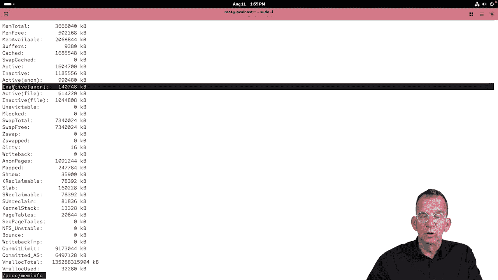

# 🖥️ CompTIA Linux+ V8：356.124：理解Linux内存使用


在本节课中，我们将会学习Linux系统是如何使用内存的。你将了解到缓存在内存管理中的作用，学会如何查看服务器当前的内存占用情况，还会认识到当物理内存不足时，系统会采取什么措施来保持运行。通过本节课的学习，你能够更直观地理解Linux内存的工作原理，并为后续的系统性能调优打下坚实的基础。


Linux内存缓存的工作原理


上一节我们介绍了本节课的学习目标，本节中我们来看看Linux内存缓存是如何工作的。在实际运行的Linux服务器上，系统会把从磁盘读取过的文件数据保留在内存当中，只要这些内存没有被其他更紧急的任务占用。简单来说，服务器读取磁盘文件后，会把数据留在RAM里，以便下次更快地访问。

这种机制带来的核心好处如下：

- 下次再次访问同一文件时，可以直接从RAM中读取，速度远快于从磁盘读取。
- 系统不需要每次都重新访问慢速的磁盘，从而显著提升整体响应速度。

作为一个非常粗略的参考标准，一台健康的系统应该至少保留20%的RAM作为空闲内存或者缓存内存。当然，实际生产环境中存在很多例外情况，具体数值并不绝对，需要根据服务器承担的工作负载来灵活调整。


如何查看当前内存使用情况


上一节我们介绍了Linux内存缓存的工作原理，本节中我们来看看如何查看系统当前的内存使用情况。要想了解服务器现在的内存占用状态，最直接的方法就是使用系统自带的free工具。这个命令可以让你快速看到多少内存是空闲的，多少被缓存占用，以及总的可用内存是多少。

如果你需要更详细的缓存使用信息，可以查看内核提供的`/proc/meminfo`文件。这个文件里记录了系统内存的详细统计参数，其中最重要的是inactive file参数，它代表当前处于非活跃状态的文件缓存，当系统需要更多内存时，这部分缓存可以被立即释放。


Swap空间与内存优化


上一节我们介绍了如何查看当前内存使用情况，本节中我们来看看Swap空间与内存优化。当物理内存不足以容纳所有活跃数据时，Linux可以使用交换空间，也就是通常所说的Swap，作为一种溢出缓冲区。那些暂时不活跃的内存页面，可以被移到Swap空间中暂时存放，这样就为活跃的应用程序腾出了宝贵的物理内存。

以下几类内存可以被移动到Swap：

- 不活跃的匿名内存，也就是不活跃的应用程序内存。
- 不再被频繁访问的缓存数据。

合理使用Swap可以让系统在内存紧张时依然保持运行，而不是直接崩溃或强制终止进程。


OOM Killer机制


上一节我们介绍了Swap空间与内存优化，本节中我们来看看OOM Killer机制。当系统内存严重不足，无法满足基本运行需求时，Linux内核会启动一个名为OOM Killer的进程。它的全称是Out of Memory Killer，属于内核的一部分，主要作用是在内存耗尽时终止一些进程，以便为系统保留最关键的运行空间。


这里有一个很多人容易误解的地方。如果你在系统日志中发现了OOM Killer的记录，那么这通常只有一种含义，那就是你的服务器物理内存不够了，需要增加内存条。OOM Killer的出现是内存不足的信号，而不是某个单个程序的bug。


内存可用量实例解读


上一节我们介绍了OOM Killer机制，本节中我们来看看内存可用量的实例解读。为了让你更直观地理解，我们来看一个实际的例子。假设系统显示还有513MB的空闲内存，同时还有2GB的可用内存。这里的可用内存不仅包含真正空闲的部分，还包括那些不活跃的缓存。也就是说，即使空闲内存看起来不多，只要还有足够的缓存可以被释放，系统依然可以正常运行。

可用内存的计算关系可以用下面这个简单的公式表示：

```
可用内存 = 空闲内存 + 不活跃文件缓存
```

具体的查看方法如下：

1. 执行free命令查看总的空闲和可用内存数值。
2. 查看`/proc/meminfo`文件中的inactive file参数，确认非活跃文件缓存的大小。
3. 判断当前不活跃的匿名内存是否已经成为Swap的候选对象。

通过这几个步骤，你就可以准确判断系统是否真的内存不足，还是只是缓存占用较多。


本节课总结




在本节课中，我们一起学习了Linux内存使用的基础知识。我们了解到大部分内存会被用于文件缓存，学会了使用free命令和`/proc/meminfo`查看内存状态，认识到Swap作为溢出缓冲区的作用，还了解到OOM Killer会在内存严重不足时终止进程，并且OOM Killer出现在日志中意味着需要增加物理内存。希望这些内容能帮助你更好地理解和管理Linux服务器的内存资源。

