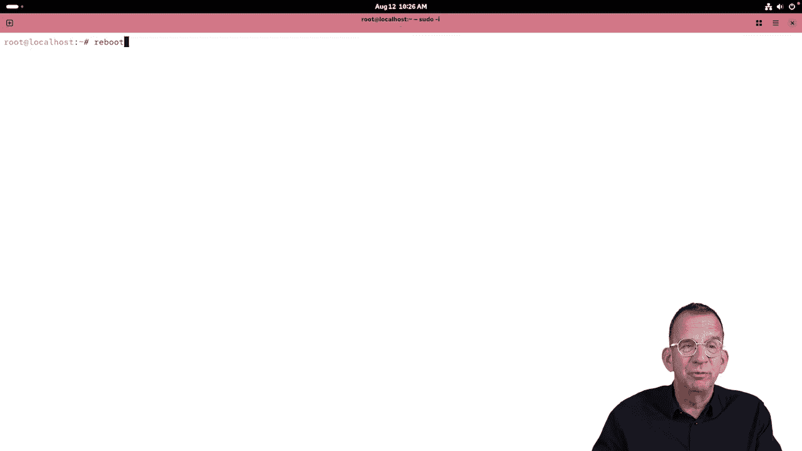
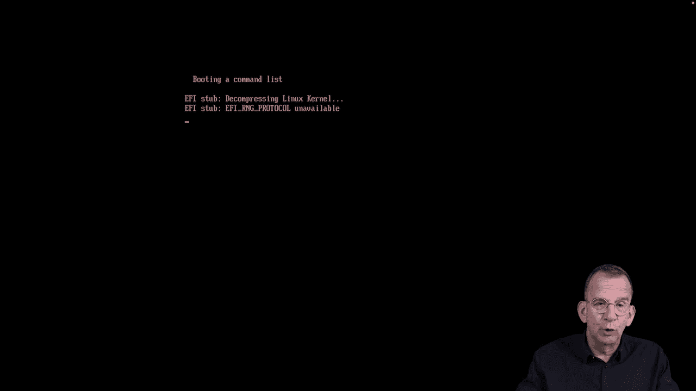
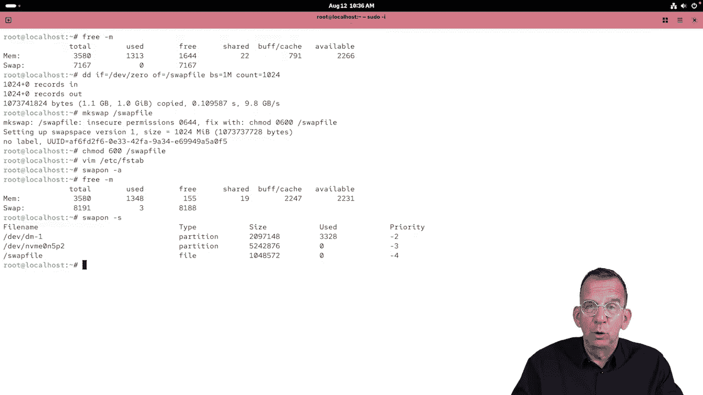

# 🖥️ CompTIA Linux+ V8：357.125：排查 Linux 内存问题

在本节课中，我们将一起学习如何在 Linux 系统中排查内存问题。你会了解到当系统内存出现异常时，应该使用哪些命令来查看当前状态，如何通过限制可用内存来模拟故障场景，以及如何识别系统是否真的陷入内存不足的困境。此外，我们还会讲解如何手动触发内核 OOM 杀手，在日志中查找相关记录，最后学习如何通过增加交换分区或交换文件来缓解内存压力。内容会尽量用大白话解释，即使你是 Linux 初学者，也能跟上节奏。

## 第一步：使用 free -m 查看内存使用概览

排查内存问题的第一步，是先搞清楚系统当前的内存使用情况。最简单直接的方法就是使用 `free -m` 命令，它会以兆字节为单位显示内存的总量、已用量、空闲量以及缓存情况。

以下是你需要关注的关键指标：

- 总内存（total）：系统物理内存的总大小。
- 已用内存（used）：当前被程序占用的内存。
- 空闲内存（free）：完全没有被使用的内存。
- 缓存内存（cached/buffers）：被系统用于文件缓存的内存，可以在需要时释放。

一般来说，你需要确认至少有 20% 的物理内存处于空闲状态或者被用作缓存。如果低于这个比例，就意味着系统内存比较紧张，需要进一步调查到底是哪些进程在占用内存。同时，你也要留意交换空间的使用情况：系统当前是否正在使用交换空间？是否甚至配置了交换空间？这些问题的答案将帮助你判断内存压力有多大。

## 第二步：通过 GRUB 菜单限制可用内存

为了让内存问题更容易观察，我们可以在启动时人为地限制系统可用的内存大小。这样即使在一台内存较大的机器上，也能模拟出内存不足的场景，方便我们演示排查过程。

具体操作步骤如下：

1. 重启系统，进入 GRUB 引导菜单。
2. 找到加载 Linux 内核的那一行。
3. 临时删除行尾的 `rhgb` 和 `quiet` 参数。
4. 在行尾添加 `mem=1G` 参数。

这会强制系统只使用 1 GB 的内存。启动完成后，按下 `Ctrl + X` 继续进入系统。此时系统可用内存大幅减少，内存紧张的情况会变得非常明显，非常适合用来演示排查步骤。

## 第三步：再次使用 free -m 确认内存状态

进入系统后，第一件事依然是运行 `free -m` 查看内存状况。因为之前限制了内存大小，你会看到可用内存明显减少。

例如，在演示系统中，启动时会有一部分内存被显卡占用，因此原本 1 GB 的内存实际只剩下约 708 MB 可用。命令输出会显示已用内存约为 529 MB，空闲内存只有 56 MB 左右，同时大约 770 KB 的内存已经放在交换空间中。

在这种情况下，交换空间中的数据量接近甚至超过可用物理内存，这对于排查来说是一个非常理想的场景，因为内存压力已经足够大，问题很明显。

## 第四步：使用 vmstat 观察交换活动

有了内存紧张的场景后，接下来需要更详细地观察内存和交换空间的动态变化。这里推荐使用 `vmstat` 命令，它可以定期报告系统的虚拟内存统计信息。

以下是常用的观察方式：

- `vmstat 2 5`：每 2 秒采集一次数据，共采集 5 次。

你需要重点关注的是交换区的读写活动（si 和 so 列）。如果系统没有在运行任何重负载任务，却持续出现交换读写操作，这就是内存状态不佳的明显信号。即便系统配置的交换空间是物理内存的 10 倍，未来还需要一段时间才会耗尽，但当前已经可以说系统严重缺乏可用内存。

## 第五步：查看活动内存和非活动内存

除了总体使用情况，你还可以深入查看哪些内存是活跃的，哪些是非活跃的。这有助于判断内存到底被什么占用了。

使用相关命令（例如 `vmstat -a` 或查看 `/proc/meminfo`）时，你可以看到活动内存和非活动内存。活动内存指正在被积极使用的内存，非活动内存指一段时间未被访问的内存，通常是应用程序的内存。

在示例系统中，非活动应用程序内存约为 104,244 KB，而放在交换空间中的内存量远高于这个数值。这说明系统已经把活跃内存也开始换出到交换区了。这里所谓的活跃和非活跃匿名内存，通常指的就是典型的应用程序内存，而内核的程序和例程占用的内存则属于另一类。无论如何，当交换空间中的数据量远远大于非活动内存时，可以断定系统已经严重内存不足。

## 第六步：手动触发 OOM 杀手并识别内存溢出

为了让你学会识别内存溢出（Out of Memory, OOM）的情况，我们可以手动触发内核的 OOM 杀手机制。

Linux 提供了一个名为 `/proc/sysrq-trigger` 的接口，可以用来向内核发送特殊控制指令。具体步骤如下：

1. 向该文件写入字母 `H`，可以获取帮助信息。注意，帮助信息只会显示在 `dmesg` 输出中。
2. 在帮助信息中找到你需要的操作，这里是内存满时触发 OOM 杀手，对应的字母是 `F`。
3. 向该文件写入字母 `F`，手动强制触发一次 OOM 杀手。

执行后，你会在终端看到类似“设备内存快满了”的提示，并且之前占用大量内存的终端程序可能会被杀掉。这时你可以重新启动终端，尝试查看日志中留下的记录。

## 第七步：在日志中查找 OOM 杀手记录

当系统发生 OOM 杀死进程的事件时，相关信息会被记录在系统日志中。你可以使用 `journalctl` 命令来查看这些记录。

操作方法是使用 `journalctl` 并按大写字母 `G` 跳转到日志末尾，然后稍微向上滚动一点，就能看到类似“out of memory”和“out of memory killed process”的条目。这就是你需要寻找的 OOM 杀手证据。

需要注意的是，手动触发的 OOM 杀手和系统在其他情况下自动触发的 OOM 杀手，在日志中看起来是一样的。如果日志中只出现了一次这样的记录，通常不是什么大问题；但如果系统多次出现 OOM 杀死进程的情况，那就说明你的系统存在严重的内存异常，必须尽快处理。

## 第八步：重启回到正常系统并添加交换空间

排查完毕后，我们可以重启回到正常系统。如果系统确实因为内存不足而出现问题，一个常见的解决方案是增加交换空间。

交换空间可以创建在块设备上，也可以创建为交换文件。如果你使用的是分区，需要将分区类型设置为 swap，使用 `mkswap` 命令将其格式化为交换分区，然后用 `swapon` 命令激活交换空间。

通常交换空间会通过 `/etc/fstab` 文件进行挂载，systemd 会自动识别并将其作为 swap 单元类型挂载。

以下是创建并启用交换文件的具体步骤：

1. 使用 `dd` 命令创建一个 1 GB 的交换文件，命令示例为 `dd if=/dev/zero of=/swapfile bs=1M count=1024`。
2. 使用 `mkswap /swapfile` 将该文件格式化为交换设备。
3. 修改权限，使用 `chmod 600 /swapfile`，确保只有 root 用户可以读写该文件，其他用户无权访问。
4. 将交换文件添加到 `/etc/fstab` 中，挂载点设为 `none`，类型设为 `swap`，选项设为 `defaults`，最后两个字段设为 `0` 和 `0`。
5. 使用 `swapon -a` 激活 `/etc/fstab` 中所有尚未初始化的交换空间，这相当于 `mount -a` 的作用。

激活完成后，再次运行 `free -m`，你会发现多出了 1 GB 的交换空间。你也可以使用 `swapon -s` 查看所有当前的交换设备，其中会包含交换逻辑卷、交换分区和新创建的交换文件。

## 第九步：理解交换空间优先级

当系统中存在多个交换设备时，内核会按照优先级决定优先使用哪一个。优先级数值越小，优先级越高。

在示例中，你可以看到优先级分别为 -2、-3、-4。其中优先级为 -2 的交换设备会被优先使用。通过合理添加交换空间并设置优先级，可以给系统更多缓冲时间，在物理内存即将耗尽时让系统有机会“冷静”下来，避免立即崩溃或频繁触发 OOM 杀手。

本节课中，我们一起学习了如何排查 Linux 内存问题。我们首先使用 `free -m` 查看内存使用概览，并确认是否有足够的空闲内存或缓存。接着，我们通过 GRUB 菜单在启动时限制内存大小，以模拟内存不足场景，并再次使用 `free -m` 确认状态。随后，我们使用 `vmstat` 观察交换活动，判断系统是否频繁换入换出，并查看活动内存与非活动内存来分析内存占用情况。

为了识别内存溢出，我们学习了如何通过 `/proc/sysrq-trigger` 手动触发 OOM 杀手，并在 `journalctl` 日志中查找相关记录。最后，我们掌握了如何创建交换文件、设置权限、修改 `/etc/fstab` 并使用 `swapon` 激活交换空间，从而为系统增加内存缓冲。希望这些内容能帮助你更有效地诊断和解决 Linux 系统中的内存故障。

