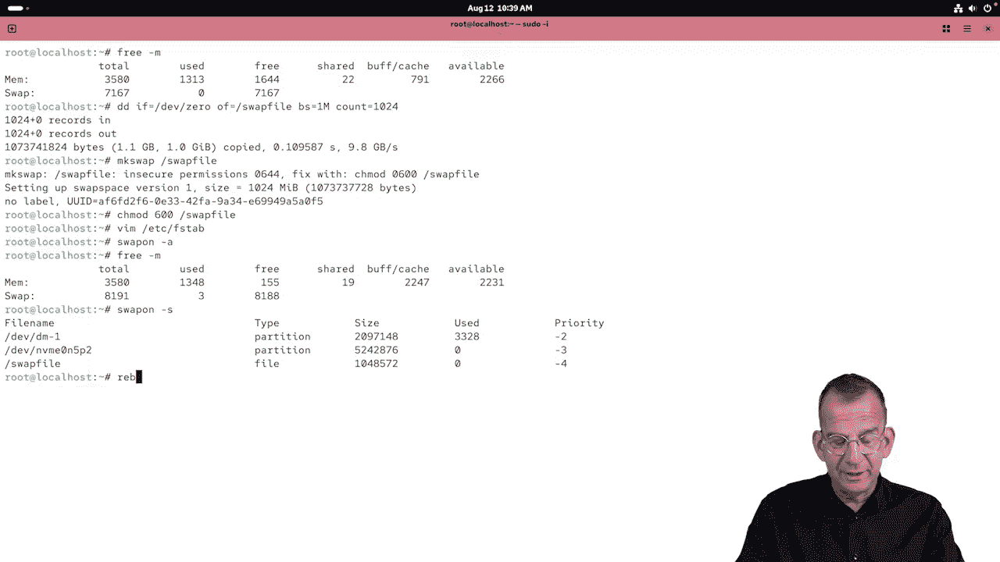

# CompTIA Linux+ V8：126：重置丢失的 Root 密码 🔑

在本节课中我们将要学习如何重置丢失的 Root 密码。这是 Linux 系统管理中非常常见的一个场景，很多时候我们因为疏忽忘记了管理员密码，导致无法正常登录系统。本节课会先讲解原理，然后通过实际演示展示完整的操作步骤，让你即使在忘记密码的情况下也能重新获得系统控制权。

大多数 Linux 发行版在启动过程中都会提示输入密码。这就是为什么你不能直接进入 systemd 的 emergency target 或者 rescue target 的原因。如果系统在启动时就要求身份验证，而你又没有正确的密码，就无法通过常规方式进入维护模式。所以我们需要在引导阶段就想办法绕过这个限制，从而拿到 root 权限。

你可以使用两个选项，要么使用 `init=/bin/bash`，要么使用 `rd.break` 作为内核引导参数，从 GRUB 提示符处传入。这两个方案中 `init=/bin/bash` 更加通用，也就是说它适用于绝大多数发行版，这就是我打算重点演示的原因。`rd.break` 很有趣，但它会引导进入 initramfs，并且是 Red Hat 特有的方法，而 `init=/bin/bash` 这种方法在所有发行版之后都能用。

以下是两种常用的内核引导参数：
- `init=/bin/bash`：适用于大多数发行版，直接进入 root shell。
- `rd.break`：Red Hat 特有，进入 initramfs 环境。

进入故障排除模式后，使用 `init=/bin/bash` 你已经拥有了根文件系统的控制权，但是根文件系统处于只读状态。这时候你不能直接修改文件，也不能修改密码。下一条命令是 `mount -o remount,rw /`，这会把根目录重新挂载为可读写状态，之后你就可以非常容易地使用 `passwd` 重置密码了。

但是有一件事你绝对不能忘记，那就是 SELinux。Red Hat 系统受 SELinux 保护，为了确保 SELinux 能够被正确处理，你需要使用 `touch /.autorelabel` 命令，在重启时正确地应用 SELinux 上下文标签。如果不执行这一步，重启后你的系统将会无法访问，甚至无法正常启动。

在 Ubuntu 上会稍微简单一些。你可以直接使用 `systemd.unit=emergency.target`，或者也可以使用 `rd.break`，这两种方法都有效。

以下是 Ubuntu 上可用的启动目标：
- `systemd.unit=emergency.target`：进入紧急模式。
- `rd.break`：同样可以用于故障排除。

下面是演示环节，我将会在 Red Hat 系统上展示，原因是这种情况更复杂，也更能代表实际困难。我现在回到我的 CentOS 机器，准备重启它。

执行重启之后，你会进入引导管理器。如果没有顺利进入 GRUB 提示符，就重启机器，下一次启动时系统会检测到上一次启动未成功完成，从而自动给你 GRUB 引导提示符。在默认行上按 E 进行编辑，去掉 `rhgb` 和 `quiet`，然后添加 `init=/bin/bash`，按 `C-X` 或 `Ctrl+X` 启动。

以下是 GRUB 编辑的具体步骤：
1. 在引导管理器中选择 CentOS Linux。
2. 按 E 进入编辑界面。
3. 删除 `rhgb` 和 `quiet`。
4. 添加 `init=/bin/bash`。
5. 按 `C-X` 或 `Ctrl+X` 启动系统。

启动之后，你会看到根提示符，而且根本不需要输入任何密码。当你在顶部执行 `mount` 时，可以看到根文件系统已经被挂载，但是是只读 (ro) 状态，这就是为什么需要执行 `mount -o remount,rw /` 的原因。

现在可以使用 `passwd` 设置新密码，输入一次，再输入一次确认即可。

但是因为这是 CentOS 系统，而且 CentOS 就像其他 Red Hat 家族发行版一样默认启用 SELinux，所以我需要执行 `touch /.autorelabel`，这样可以确保 SELinux 上下文标签在下一次启动时被修复。

接下来需要重启。因为刚才是用 `init=/bin/bash` 启动的，所以当前 PID 1 是 bash，systemd 不能作为 bash 的子进程，正常的 fork 机制在这里无效。我们需要把当前的 bash PID 1 替换成 systemd，这就是 `exec` 命令在做的事情。

执行以下命令：
`exec /usr/lib/systemd/systemd`

这时候你可以看到 SELinux 上下文标签正在重新标记，需要等待完成。完成之后系统会再次重启，这是预期行为，不用担心，通常在这样的演示系统中大概一分钟左右就能完成。

重启之后，当你看到登录提示符，就可以以 root 用户身份登录了。

本节课中我们一起学习了如何重置丢失的 Root 密码。我们了解了引导阶段的密码限制，掌握了使用 `init=/bin/bash` 进入维护模式的方法，学会了用 `mount -o remount,rw /` 将根文件系统改为可读写，用 `passwd` 修改密码，并且特别注意了在 Red Hat 系统上使用 `touch /.autorelabel` 修复 SELinux 标签。最后通过实际演示完成了整个流程，希望能对你有所帮助。
