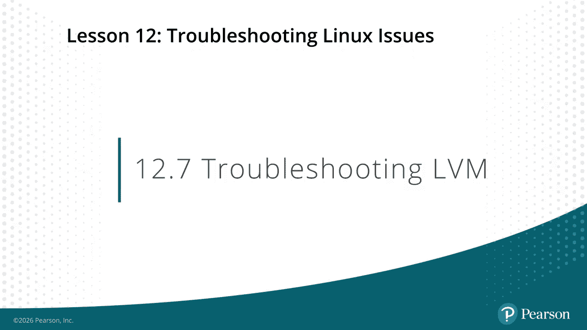
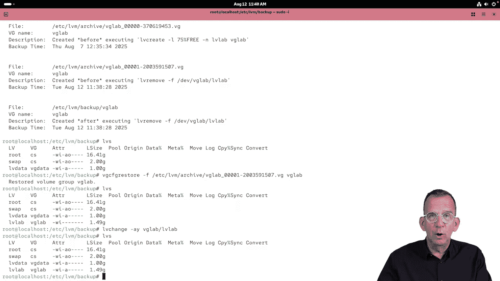

# CompTIA Linux+ V8：04:59：LVM故障排除 🔧




## 概述

在本节课中，我们将要学习LVM逻辑卷故障排除的完整流程。如果某个逻辑卷不小心丢失了，不必担心，因为可以通过VG CFG Restore命令轻松修复。接下来的内容会先介绍LVM的自动备份机制，然后演示如何手动删除逻辑卷来模拟故障，最后一步步讲解如何找回丢失的逻辑卷。整个过程使用的命令都很简单，即使是初学者也能快速上手。

整个恢复流程可以分为以下几个步骤：

1. 查看/etc/lvm/backup目录中的备份文件。
2. 使用vgcfgrestore命令恢复卷组。
3. 使用lvchange命令激活逻辑卷。

核心恢复公式如下：


```text
逻辑卷恢复 = 备份文件 + vgcfgrestore + lvchange -a y
```


## LVM元数据的自动备份机制

在概述中我们了解了LVM故障排除的大致思路，本节中我们来看看LVM是如何自动备份元数据的。

LVM有一个非常实用的特性，它会自动把卷组的元数据以文本形式备份出来。这些备份文件会被写入系统目录/etc/lvm/backup中。这意味着你不需要手动创建备份，系统会在后台自动完成所有工作。

核心备份路径如下：

```text
/etc/lvm/backup
```

进入该目录后，你会发现每个卷组都对应一个备份文件。打开任意一个文件，里面记录了该卷组的详细信息，包括物理卷的具体情况、设备ID、交换分区以及所有逻辑卷的配置。换句话说，卷组里包含什么，备份文件里就有什么。

这些备份是在什么时候产生的？通常情况下，每当你对卷组做了任何更改之后，LVM就会自动生成一次新的备份。所以你不需要操心备份的时机，只要知道在出现问题时可以使用VG CFG restore命令来利用这些备份即可。


## 查看备份文件的内容

了解了备份机制之后，本节中我们来看看备份文件里具体记录了哪些内容。

为了让你更直观地了解备份文件里记录了什么，我们可以查看系统中默认卷组的备份内容。这里以卷组vg_lab为例，它是系统安装时就创建好的默认卷组。

备份文件中记录的关键信息可以用下面的方式来理解：

```text
卷组名称 + 物理卷信息 + 设备ID + 逻辑卷配置 + 交换卷信息
```

在执行任何卷组变更操作之前和之后，系统都会分别生成备份文件。你可以通过文件名判断该备份是在哪个操作前后创建的。例如，一次备份可能是在执行vgchange之前创建的，另一次则是在执行之后自动生成的。这些时间点的记录，为后续的恢复操作提供了可靠的依据。


## 删除逻辑卷以模拟丢失场景

查看完备份文件的内容后，本节中我们来模拟一次逻辑卷丢失的场景。

接下来我们要故意删除一个逻辑卷，来模拟真实环境中意外丢失的情况。首先使用lvs命令查看当前系统中有哪些逻辑卷，确认目标逻辑卷确实存在。

以下是查看逻辑卷的命令：

```bash
lvs
```

执行后你会看到名为lv_lab的逻辑卷。为了让它“消失”，我们使用lvremove命令并加上强制参数，直接删除/dev/vg_lab/lv_lab这个设备。

删除命令如下：

```bash
lvremove -f /dev/vg_lab/lv_lab
```

运行完之后，逻辑卷就会被移除。这时候如果你再次运行lvs，就会发现lv_lab不见了，这说明我们的模拟故障已经成功制造出来了。接下来就要开始恢复工作了。


## 使用vgcfgrestore恢复逻辑卷

逻辑卷被删除之后，本节中我们来演示如何使用vgcfgrestore找回它。

当逻辑卷丢失后，最重要的恢复工具就是vgcfgrestore。在使用它之前，我们需要先确认备份文件中是否包含我们想要恢复的状态。

首先运行vgcfgrefresh命令，刷新卷组vg_lab的备份信息：

```bash
vgcfgrefresh -l vg_lab
```

执行之后，你会看到两条相关的记录，一条是在执行lvremove之前创建的，另一条是在执行lvremove之后自动生成的。我们需要关注的是删除之前的那条备份，因为它里面保存的正是逻辑卷还存在时的状态。

接下来，把这个备份文件的名称复制下来，然后使用vgcfgrestore命令进行恢复。命令的基本格式如下：

```bash
vgcfgrestore -f <备份文件名> vg_lab
```

其中<备份文件名>是你刚才复制的文件，vg_lab是卷组的名字。执行完这个命令后，系统会将卷组vg_lab恢复到备份文件记录的状态。此时再次运行lvs，你会惊讶地发现lv_lab已经重新出现在列表中了。


## 激活恢复后的逻辑卷

卷组恢复完成之后，本节中我们需要确保逻辑卷处于激活状态。

虽然逻辑卷已经恢复，但它可能还没有被激活，所以在lvs输出中你看不到表示激活状态的“a”标志。为了让逻辑卷真正可用，我们需要使用lvchange命令将它激活。

激活命令如下：

```bash
lvchange -a y vg_lab/lv_lab
```

这里的-a y表示将激活状态设置为yes。执行完成后，再次运行lvs，你会看到lv_lab已经处于可用状态。这时候逻辑卷就算是彻底找回来了。

如果该逻辑卷之前已经挂载过，建议重启系统，确保挂载能够通过/etc/fstab正确生效；或者你也可以手动挂载。无论哪种方式，到这一步你的逻辑卷恢复任务就已经成功完成了。


## 总结



本节课中，我们一起学习了LVM逻辑卷丢失时的排查与恢复方法。首先了解到LVM会自动将卷组元数据备份到/etc/lvm/backup目录，无需人工干预；其次通过lvremove手动删除逻辑卷模拟了故障场景；接着使用vgcfgrestore命令结合备份文件，将卷组恢复到删除前的状态；最后用lvchange -a y激活逻辑卷，使其重新可用。掌握这些步骤后，即使误删了LVM逻辑卷，也能快速把它找回来。

