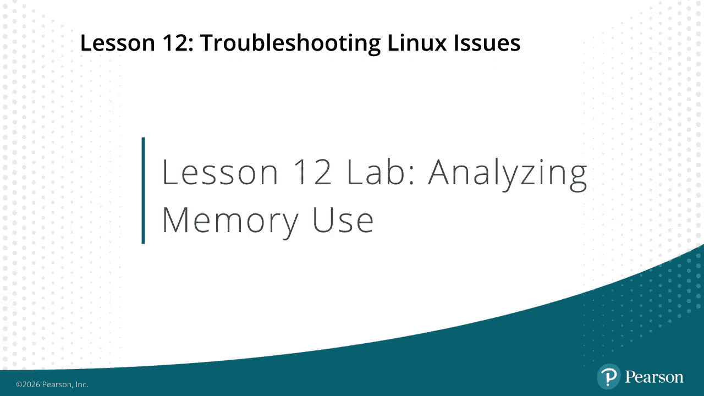

# 🐧 CompTIA Linux+ V8：12：内存使用分析实验


在本节课中我们将要学习如何在 Linux 系统中分析内存使用情况。通过本节的学习，你将掌握查看系统内存状态的基本方法，并确认系统是否具备足够的交换空间来存放那些不活跃的应用程序内存。内容比较基础，适合刚接触 Linux 内存管理的初学者，大家跟着步骤一步步来就好，不需要担心太复杂的理论。


## 实验概述


接下来我们先来看看这个实验的具体内容。本节课的核心任务是进行一个内存使用分析实验，在这个实验里你需要在自己的系统上执行相关操作，观察内存被如何占用，并且判断当前的内存资源是否充足。以下是实验的主要目标：

- 使用合适的命令查看系统当前的内存使用状态
- 分析物理内存和交换空间的占用情况
- 确认系统有足够的交换空间存放不活跃的应用程序内存


## 分析内存使用的步骤


上一节我们介绍了内存的基本概念，本节中我们来看看如何在实际系统中分析内存使用。你需要按照以下步骤进行操作，每一步都不要跳过，因为每一步都有助于你完整掌握内存状态：



1. 打开终端，输入查看内存信息的命令
2. 观察输出结果中的已用内存、空闲内存以及缓存内存
3. 检查交换空间的总量和已用量
4. 对比内存使用情况，确定系统内存是否满足运行需求


在实际操作中，可以使用免费的系统命令来获取内存状态。最常用的命令如下所示，初学者可以直接复制粘贴使用：

```bash
free -h
```

执行这条命令后，系统会以人类易读的方式显示内存使用情况，包括总内存、已用内存、空闲内存以及缓冲区缓存占用。如果你想更详细地查看内存细节，也可以查看系统内核提供的虚拟文件，具体操作如下：

```bash
cat /proc/meminfo
```

这个文件包含了系统内存的所有底层统计信息，虽然内容很多，但初学者只需关注几个关键项即可，比如 MemTotal 和 MemAvailable 等，它们能帮助你快速了解当前可用内存量，而不需要逐行研究所有数据。


## 检查交换空间是否足够


刚才我们学习了如何查看内存使用，本节中我们来看看如何确保交换空间足够大。交换空间是系统在物理内存不足时，用来临时存放不活跃内存页面的磁盘区域，简单来说，它就是内存的后备仓库，能在物理内存吃紧时防止系统直接崩溃，是保障系统稳定运行的重要组成部分。

要保证系统能够正常运行，需要满足以下条件：

- 系统拥有足够大的交换空间
- 交换空间能够存放所有不活跃的应用程序内存
- 物理内存与交换空间的总和足以支撑当前运行的应用程序


这里所说的交换空间，在原文中被误写为 soap，实际上就是系统用来扩展内存的磁盘空间，它不占用物理内存，却能在关键时刻派上用场。

核心判断可以用下面的简单公式来理解，这个公式能让你一眼看出内存是否充足：

```text
可用内存总量 = 物理内存总量 + 交换空间总量
```


如果可用内存总量小于当前所有应用程序需要的内存，系统可能会出现运行缓慢甚至程序崩溃的情况。因此，在实验结束前，请务必确认你的系统有足够的交换空间来应对内存不足的场景，这是保证系统稳定运行的重要前提，建议大家养成定期检查的习惯。


## 本节总结


本节课中我们一起学习了如何在 Linux 系统中分析内存使用。我们介绍了使用 free -h 命令和查看 /proc/meminfo 文件的方法，并讨论了如何确保系统有足够的交换空间来存储不活跃的应用程序内存。希望这些内容能帮助你更好地理解 Linux 内存管理的基础知识，为后续的学习打下坚实基础，建议课后多在自己的系统上练习几次，加深印象。


