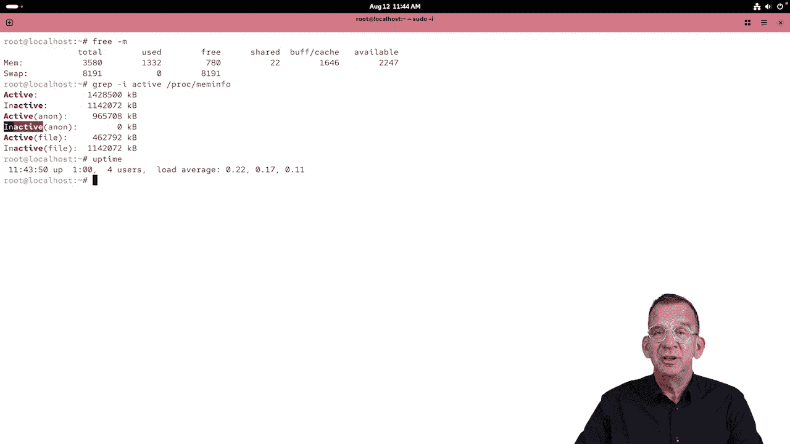

# CompTIA Linux+ V8：Lesson 12：Analyzing Memory Use 🧠


在本节课中，我们将一起学习如何在 Linux 系统中分析内存使用情况。我们会使用 `free -m` 命令来查看当前的内存占用，并学习如何判断系统是否存在内存压力。同时，我们会通过 `/proc/meminfo` 文件来获取更详细的内存信息，特别是关于活跃匿名内存和非活跃内存的内容。此外，我们还会讨论交换分区（swap）的作用，以及如何使用 `uptime` 命令来辅助判断系统状态。所有内容都会用大白话来讲解，确保初学者也能听懂。


## 第一步：使用 free -m 查看内存使用情况

在开始分析之前，我们需要知道查看内存最常用的命令是什么。这里就是 `free -m`，它可以把内存信息以 MB 为单位显示出来，方便我们直接阅读。

执行以下命令：

```bash
free -m
```

以下是命令输出中需要关注的关键数据：
- 已使用内存（used）：约 1332 MB
- 可用内存（available）：约 780 MB

从这些数字可以看出，可用内存单独一项就超过了总内存的 20%，而整体可用比例甚至超过了 60%。这意味着当前系统的内存状况非常健康，完全不存在内存不足的问题，我们暂时不需要为此担心。

不过，即使表面上看起来没有问题，我们依然需要深入分析一下系统内部究竟发生了什么，不能只看表面数据。

## 第二步：通过 /proc/meminfo 查看活跃内存详情

要想获得更细致的内存信息，尤其是和交换分区相关的细节，我们需要查看内核暴露的内存信息文件。此时可以使用 `grep` 命令过滤 `/proc/meminfo` 中的内容。

执行以下命令：

```bash
grep -i "Active" /proc/meminfo
```

以下是我们需要留意的两个核心概念：
- Active anon（活跃匿名内存）：大约 1 GiB，表示当前正在被活跃进程使用的匿名内存。
- Inactive（非活跃内存）：数值为 0，表示当前没有被标记为非活跃的内存页面。

为什么我们要特别关注非活跃内存呢？这是因为当系统面临内存短缺时，操作系统可以把非活跃内存移到交换分区中，从而释放物理内存。换句话说，非活跃内存是系统在内存紧张时的“后备军”。这里有一个关键问题：我们是否有足够的交换空间来容纳这些非活跃内存？可以用以下简单公式来判断：

```text
可用交换空间 >= 非活跃内存
```

不过，由于当前系统中根本没有非活跃内存，所以这个问题暂时不存在。

## 第三步：使用 uptime 命令辅助判断

除了直接查看内存信息，系统运行时间也是一个重要的参考指标。它可以帮助我们理解为什么某些内存状态会出现或消失。

执行以下命令：

```bash
uptime
```

以下是 `uptime` 命令能告诉我们的信息：
- 系统已经运行的时间。
- 当前的负载平均值。

通过 `uptime` 我们可以看到，这台系统运行时间并不长。这也正好解释了为什么当前没有非活跃匿名内存：系统刚启动不久，还没有产生足够的内存页面被标记为非活跃状态。

如果系统上真正开始运行大量程序，或者运行时间变长，内存状态一定会发生变化，届时非活跃内存也会出现。这就是在分析内存使用时，我们应该持续关注的内容。

## 总结



本节课中我们一起学习了如何使用 `free -m` 查看 Linux 系统的内存使用情况，并通过实际数据判断当前内存是否充足。接着，我们学习了如何用 `grep -i "Active" /proc/meminfo` 查看活跃匿名内存和非活跃内存，并理解了非活跃内存在内存短缺时会被移至交换分区的原理。最后，我们介绍了 `uptime` 命令，并解释了系统运行时间短会导致非活跃匿名内存为零的原因。希望这些内容能帮助你更好地掌握 Linux 内存分析的基础方法。

