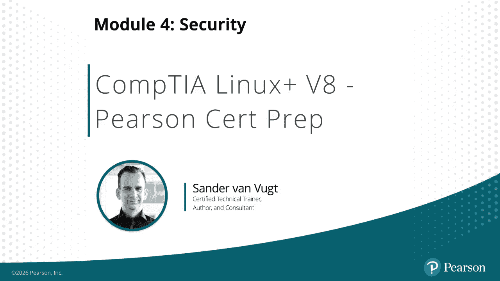
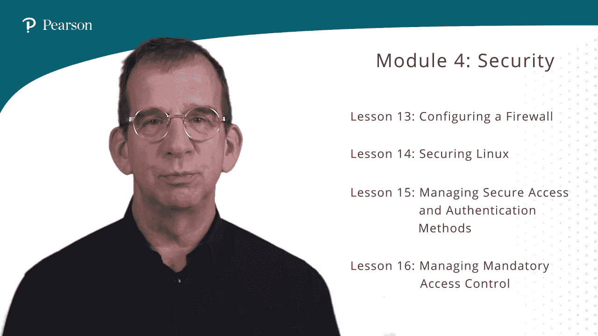

# 🔒 CompTIA Linux+ V8：第4模块：服务器安全模块介绍

在本节课中我们将要学习CompTIA Linux+ V8课程的第4个模块内容。这个模块主要讲的是服务器安全方面的知识，是Linux系统管理中非常重要的一部分。如果你想让服务器运行得更稳妥，不被坏人入侵，那么这些安全知识就是你必须掌握的基础。我们会用最直白的方式来讲解，不用太深奥的术语，让初学者也能听得懂。

首先，我们先来看看这个模块整体上要讲些什么。

欢迎来到第4个模块，简称Mod4。在每一个模块里面，你都会学到跟服务器安全相关的内容。服务器安全说白了，就是怎么保护你的服务器不被未经授权的人访问，怎么防止数据泄露，怎么确保只有正确的人能做正确的事情。这个模块一共包含好几个小课，每个小课侧重点不一样，但都围绕着服务器安全这个中心主题展开。



接下来，我们先看看第13课会讲些什么内容。

在第13课中，我们会探索不同的防火墙选项。防火墙就像是安装在服务器大门口的保安，它负责检查进出的流量，决定哪些可以进来，哪些应该被挡在外面。不同的防火墙工具有不同的配置方式，了解这些选项能帮你根据实际情况挑选最合适的一个。

以下是防火墙规则的简单示例：

```bash
if 来源IP in 信任列表:
    允许通过
else if 端口 in 开放端口列表:
    允许通过
else:
    拒绝所有
```

防火墙只是服务器安全的一环，除了控制网络流量，系统本身也需要一些安全特性来加固。

第14课讨论一些通用Linux安全相关特性。这里的Linux安全特性，指的是操作系统层面自带的一些防护机制，比如文件权限、用户管理、日志审计等等。这些特性虽然不像防火墙那么显眼，但它们是服务器安全的基石，没有这些基础防护，单靠防火墙也是不够的。

以下是Linux文件权限的常见表示方式：

```text
rwxr-xr-x
  └─┬┘  └─┬┘  └──┬┘
  所有者  组    其他人
```

系统层面的安全特性搞定了，接下来我们要看的是怎么保证访问服务器的人是合法的。

在第15课里面，你会学到关于安全访问和认证的内容。简单来说，认证就是确认“你是你”的过程，比如输入密码、使用密钥或者做双重验证。安全访问则是指在认证通过之后，用户只能访问自己被允许访问的资源，不能越界。这一部分内容直接关系到谁能登录你的服务器，能不能执行敏感操作。

以下是认证和访问控制的基本逻辑：

```
用户输入凭证 → 系统验证凭证 → 验证通过 → 授予访问权限
```

除了访问控制，还有更严格的强制访问控制机制，我们在最后一课中会接触到。

这个模块的最后一课，主要讲的是强制访问控制。强制访问控制，也就是MAC，是一种比普通权限更严格的安全模型。在MAC模型下，即使是文件的所有者，也不能随意修改安全标签，所有的访问决策都由系统策略统一决定，而不是由用户自己说了算。这种机制通常用在安全要求非常高的环境里面。

以下是强制访问控制的决策模型：



```
访问请求 = 主体(Subject) + 客体(Object) + 安全标签(Security Label)
系统策略 → 允许 / 拒绝
```

本节课中我们一起学习了CompTIA Linux+ V8第4个模块的介绍内容。我们先了解了这个模块围绕服务器安全展开，然后分别看了第13课的防火墙选项、第14课的Linux安全特性、第15课的安全访问与认证，最后还看了强制访问控制。这些知识点构成了服务器安全的基础框架，后续课程会更深入地讲解每一个具体技术。
