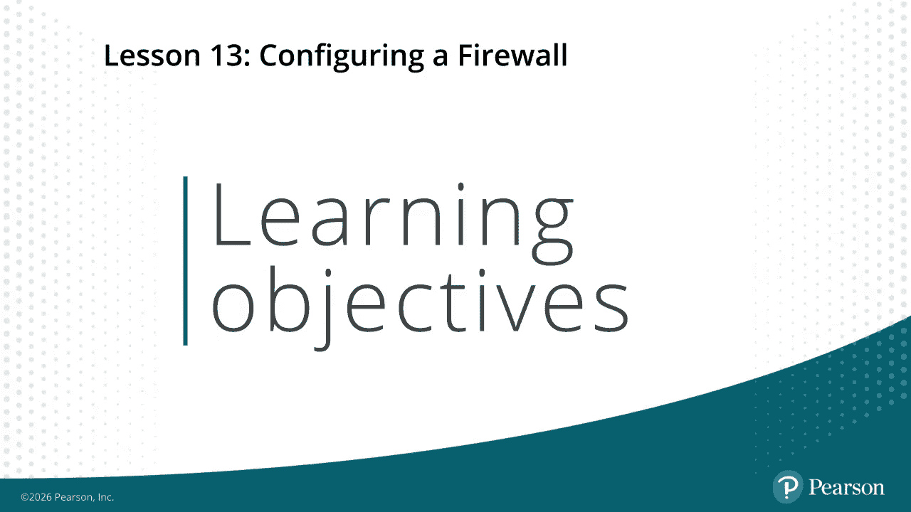

Linux防火墙配置：4.63：配置防火墙的学习目标 🛡️




在本节课中，我们将一起学习如何在 Linux 系统上配置防火墙。老师会先介绍网络端口的基础知识，然后解释防火墙的通用工作机制，接着重点讲解几种常用的 Linux 防火墙工具，最后带你进入实验环节进行动手练习。这节课适合零基础的初学者，讲解会尽量通俗易懂，避免使用过于深奥的专业术语。


首先，让我们先看看这节课的具体内容和学习目标。老师会用简单的语言带你入门，让你快速了解防火墙配置的大致步骤。

大家好，欢迎来到配置防火墙。在本节课中，你将学习如何配置 Linux 防火墙。这节课是 Linux 安全学习路径中的重要一环，掌握防火墙配置对于保护系统安全非常有帮助，建议你认真对待每一个知识点。


上一节我们简单介绍了防火墙的概念，本节中我们先来看看网络端口。

我会先讲解网络端口。网络端口是 Linux 防火墙的重要组成部分。如果不了解端口，就很难理解防火墙到底在过滤什么，所以这部分是基础中的基础，请务必仔细听讲。


网络端口的作用可以用下面这个简单公式来描述：

```
网络端口 = 应用程序与外部网络通信的入口
```


接下来，我会解释防火墙的整体工作原理。

了解了端口之后，接下来我们来看看防火墙整体是如何运作的。防火墙就像网络大门的保安，它检查进出的数据包，根据规则决定哪些可以放行，哪些需要拦截，从而保护主机安全。


之后，我们将重点讨论最常见的几种 Linux 防火墙解决方案：UFW、FirewallD 和 iptables。

以下是本节课将要介绍的主要防火墙工具：

- UFW：简单易用的防火墙配置工具，适合初学者快速上手
- FirewallD：适用于多种 Linux 发行版的动态防火墙管理器，支持区域和服务管理
- iptables：经典的基于规则的包过滤工具，功能强大但学习曲线较陡


你还会了解 nftables。nftables 是最近引入到 Linux 的最新防火墙解决方案。

除了上述传统工具，你还会了解到 Linux 防火墙技术的最新发展。nftables 代表了 Linux 内核网络过滤技术的最新方向，未来可能会逐渐替代一些老旧工具，值得重点关注。


和往常一样，本节课包含实验环节以及实验答案。

理论讲解完成后，和往常一样，课程还安排了实践环节。建议你亲自动手操作一遍，只有实践才能真正掌握防火墙配置，避免只懂理论不会动手。


本节课中我们一起学习了配置 Linux 防火墙的基本流程。我们了解了网络端口的作用，梳理了防火墙的通用工作原理，重点介绍了 UFW、FirewallD、iptables 等常用工具，并了解了 nftables 作为最新方案的地位，最后进入了实验环节进行动手练习。希望你能通过本节课掌握防火墙配置的核心思路，为后续的 Linux 安全学习打下坚实基础。

