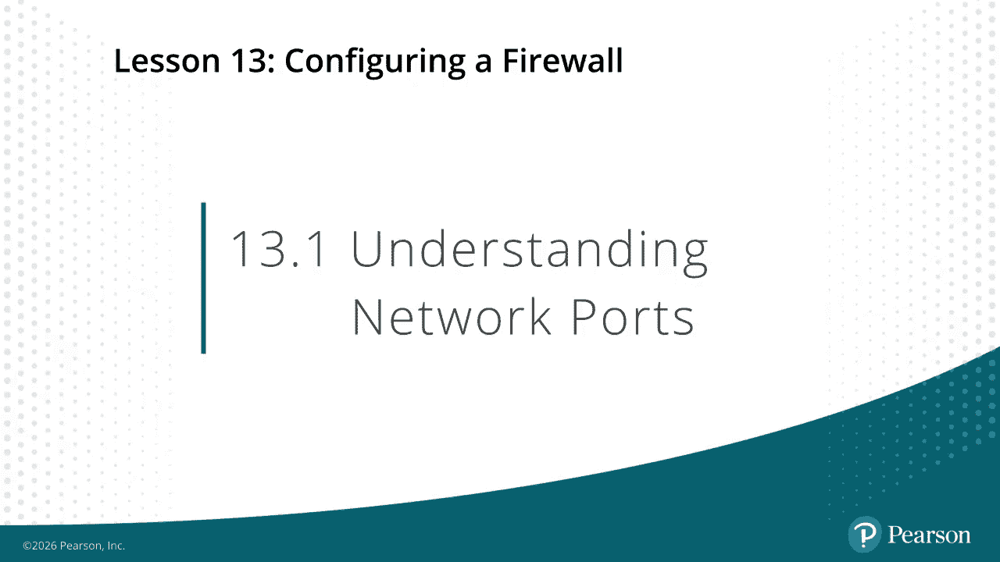
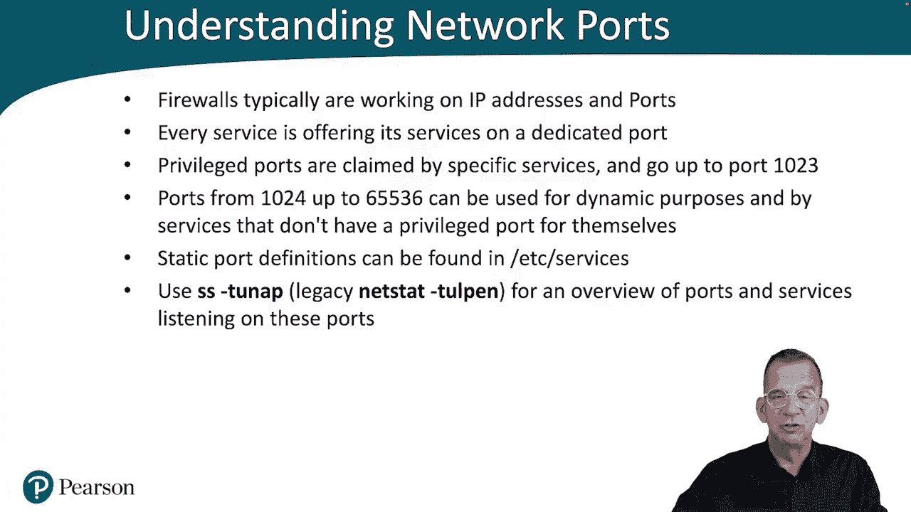
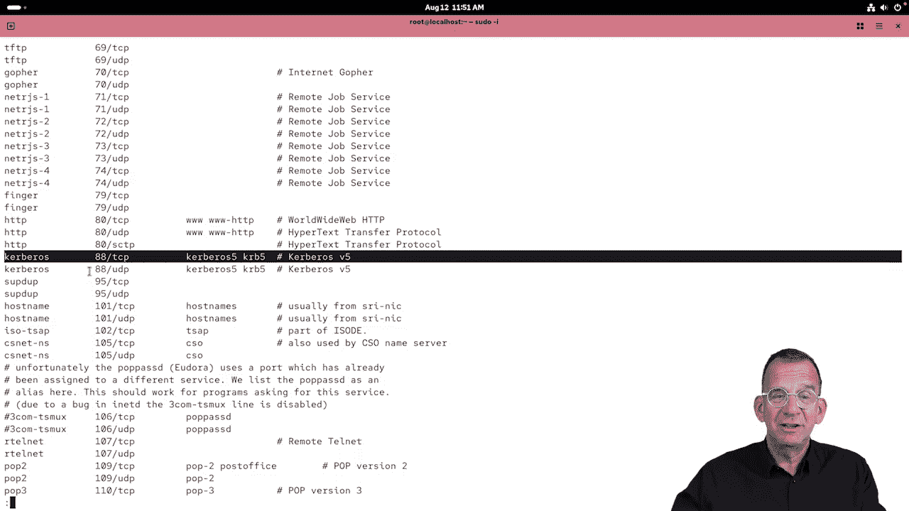

CompTIA Linux+ V8：04：理解网络端口 🔌




在本节课中，我们将一起学习关于网络端口的基础知识，尤其是在配置防火墙时为什么理解端口如此重要。我们会从端口的基本概念说起，接着聊聊特权端口和动态端口的区别，再看看 Linux 系统里用于记录端口定义的 /etc/services 文件，最后通过一个实际的例子，教你如何安全地为自己的服务选择一个可用的端口。无论你是刚接触 Linux 的新手，还是想复习网络基础的学习者，这节课都会用大白话把这些概念讲清楚，让你在动手配置防火墙或服务时不再迷茫。

首先，我们来看看防火墙是如何工作的，以及端口在这个过程中扮演什么角色。

防火墙在工作时，通常会同时关注 IP 地址和端口号，简单来说，IP 地址用来找到目标机器，而端口号则用来区分同一台机器上的不同服务。你可以把 IP 地址想象成一栋大楼的门牌号，而端口号就像是大楼里每个房间的房号，快递员（也就是网络数据包）既需要知道大楼在哪里，也需要知道具体把包裹送到哪个房间。每个网络服务在运行时，都会绑定到一个特定的端口上，这样外部发来的数据才能被正确地交给对应的程序处理。

接下来，我们需要区分不同类型的端口，因为它们的使用权限和范围是不一样的。

在 Linux 系统中，端口被划分为几个不同的范围，其中最常见的就是特权端口。特权端口是指那些被特定服务占用或保留的端口，它们的编号范围是从 0 到 1023。普通用户不应该为自己的自定义服务使用这些端口，因为这些端口已经被系统或知名服务“预订”了。如果你非要在这些端口上运行服务，就必须拥有管理员权限，也就是 root 权限，才能完成绑定操作。

```text
特权端口范围：0 到 1023
动态端口范围：1024 到 65535
```

除了特权端口之外，还有动态端口。动态端口的编号范围是从 1024 一直到 65535，这些端口可以由某些进程自动分配使用，也可以由管理员手动配置给那些没有固定特权端口的服务。简单来说，特权端口是“名额有限、需要申请”的，而动态端口则相对自由，适合临时或自定义的网络连接。

既然端口有这么多种，而且有些是被保留的，那么系统是如何记录这些端口分配情况的呢？答案就在 /etc/services 文件里。



/etc/services 是一个静态的端口定义文件，里面列出了大量已知服务对应的端口号和协议类型。这份列表由互联网号码分配机构维护和更新，你可以把它看作是一本“端口电话本”，记录了哪些端口号已经被哪些服务占用。在你决定为自己的程序选择一个端口之前，查看这个文件是一个非常好的习惯，可以避免不小心和已有服务发生冲突。

以下是该文件中主要包含的端口类型：
- 知名端口（Well-known ports）：也就是特权端口，范围在 0 到 1023 之间。
- 注册端口（Registered ports）：处于独立的范围，通常用于经过注册的特定服务。
- 动态端口（Dynamic ports）：专门用于动态分配，如果你希望完全符合规范，应该将动态端口分配在 49152 以上。

现在我们知道了端口的分类和记录方式，接下来看看在实际操作中，该如何检查端口是否被占用，并为自己的服务挑选合适的端口。

你之前可能已经学过 ss 命令和 netstat 命令，它们可以让你查看当前系统中哪些端口正在被使用。但是，这些命令只能显示当前被占用的端口，并不能告诉你哪些端口是被系统保留的。因此，如果你打算自己配置某个服务，光靠 ss 或 netstat 是不够的，你还需要去查看 /etc/services 文件，确认你想用的端口并没有被预定义给其他服务。

举个例子，假设你决定在自己的服务器上运行一个 Web 服务器，并且想让它监听 82 号端口。这时候你应该怎么做呢？很简单，先打开 /etc/services 文件，看看 80 到 88 号端口之间是否已经有其他定义。如果发现 82 号端口目前没有被占用，那么你就可以放心使用它。不过要注意，因为 82 号端口属于已注册的端口范围，绑定它时你仍然需要使用管理员权限，否则服务无法启动。

```bash
# 检查当前端口占用情况
sudo ss -tlnp

# 查看 /etc/services 中的端口定义
cat /etc/services | grep 82
```



本节课中，我们一起学习了网络端口的基本概念，包括防火墙如何基于 IP 地址和端口工作，特权端口和动态端口的区别及各自的编号范围，以及 /etc/services 文件在端口管理中的作用。我们还通过一个实际的例子，了解了如何在选择自定义端口时查询系统记录并确保拥有足够的权限。希望这些内容能帮助你建立起对 Linux 网络端口的直观认识，为后续的防火墙配置和服务部署打下基础。
