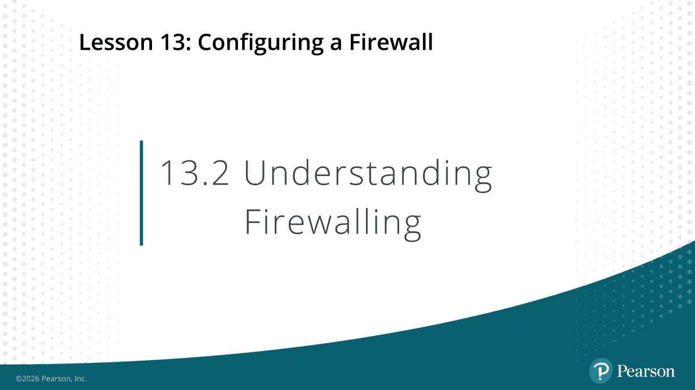
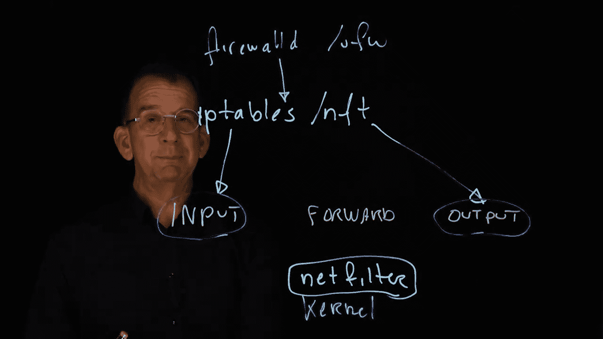

🔥 CompTIA Linux+ V8：132：防火墙原理解析

在本节课中我们将要学习 Linux 系统中的防火墙原理。防火墙是保护服务器安全的重要组成部分，对于刚开始接触 Linux 的初学者来说，了解防火墙是在系统内部如何运作的，以及我们可以使用哪些工具来配置它，是非常必要的。下面我们就从最基础的内核实现开始说起，慢慢把整个防火墙的工作流程理清楚。




## 防火墙在内核中实现

要理解 Linux 防火墙，首先得知道一件非常关键的事情：防火墙的功能是直接在操作系统内核里实现的。这意味着数据包在被交给应用程序之前，内核就已经有机会对它们进行检查和过滤了，所以内核就是防火墙工作的最底层场所。

核心概念如下：

```
防火墙 = 内核中的数据包过滤机制
```


## netfilter 框架与三条链

上一节我们介绍了防火墙是在内核中实现的，本节中我们来看看内核里具体是用什么框架来完成数据包过滤的。

在 Linux 内核中，有一个专门的框架，它的名字就叫 netfilter。netfilter 提供了三个不同的网络接口，也就是我们常说的三条链。这三条链分别负责处理不同方向的流量，下面是对它们的具体介绍。

以下是三条主要链的作用：

- `INPUT链`：处理进入本机的入站数据包。
- `FORWARD链`：处理需要通过本机转发的数据包，通常用于路由器场景。
- `OUTPUT链`：处理从本机发出的出站流量。

公式如下：

```
每个数据包 = 必须经过 INPUT / FORWARD / OUTPUT 链中的规则检查
```

也就是说，系统里每一个进出的数据包，都会被这些链里的规则逐一处理，决定是允许通过还是拒绝掉。


## 使用 iptables 或 nftables 写入规则

上一节我们介绍了 netfilter 的三条链，本节中我们来看看如何把防火墙规则放进这些链里，从而真正管理防火墙。

要管理防火墙，你需要想办法把规则加入到 netfilter 中。在早期的 Linux 系统里，大家通常使用 iptables 来完成这项工作；而到了今天，nftables（也就是 NetFilter Tables）已经成为默认的选择。无论你使用 iptables 还是 nftables，操作的基本思路都是一样的：你要在 INPUT 链里写规则，或者在 OUTPUT 链里写规则。这些规则会对进入系统的每一个数据包进行处理。

核心命令关系如下：

```
用户规则 -> iptables / nftables -> netfilter 链 -> 内核处理数据包
```

不过 iptables 和 nftables 本身比较复杂，对初学者来说不太友好，直接写底层规则需要花不少时间去学习。


## 前端工具 firewalld 和 UFW

上一节我们介绍了 iptables 和 nftables，本节中我们来看看有没有更简单的工具可以使用，让防火墙的配置变得不那么困难。

因为 iptables 和 nftables 较为复杂，所以出现了一些前端实用工具，它们可以帮我们更方便地管理防火墙。最常见的两个就是 firewalld 和 UFW。这两个工具最终会把规则写入到 iptables 或者 nftables 中，进而让规则进入 INPUT 链或 OUTPUT 链，从而处理入站和出站数据包。使用这些前端工具，你不需要直接去写复杂的底层规则，就能完成防火墙的配置。

以下是工具之间的关系：



- `firewalld`：向 iptables 或 nftables 写入规则。
- `UFW`：向 iptables 或 nftables 写入规则。


## 下一步学习

在接下来的几个视频中，你将学习如何实际操作这些工具，配置属于你自己的防火墙规则，并保护好你的 Linux 系统。


本节课中我们一起学习了 Linux 防火墙的基本原理。我们知道防火墙是在内核中实现的，内核使用 netfilter 框架，并通过 INPUT、FORWARD、OUTPUT 三条链来处理数据包。我们还了解了 iptables 和 nftables 这两个底层工具，以及 firewalld 和 UFW 这两个更简单的前端工具。希望这些内容能帮你建立起对 Linux 防火墙的初步认识。

