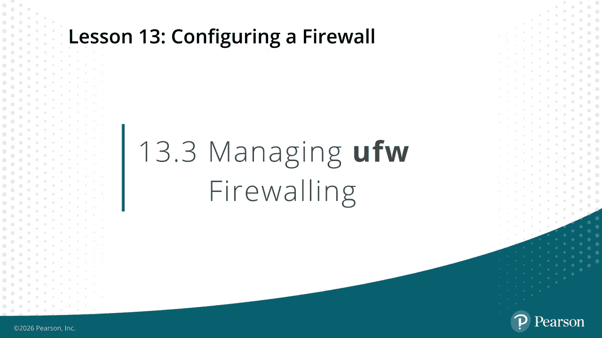
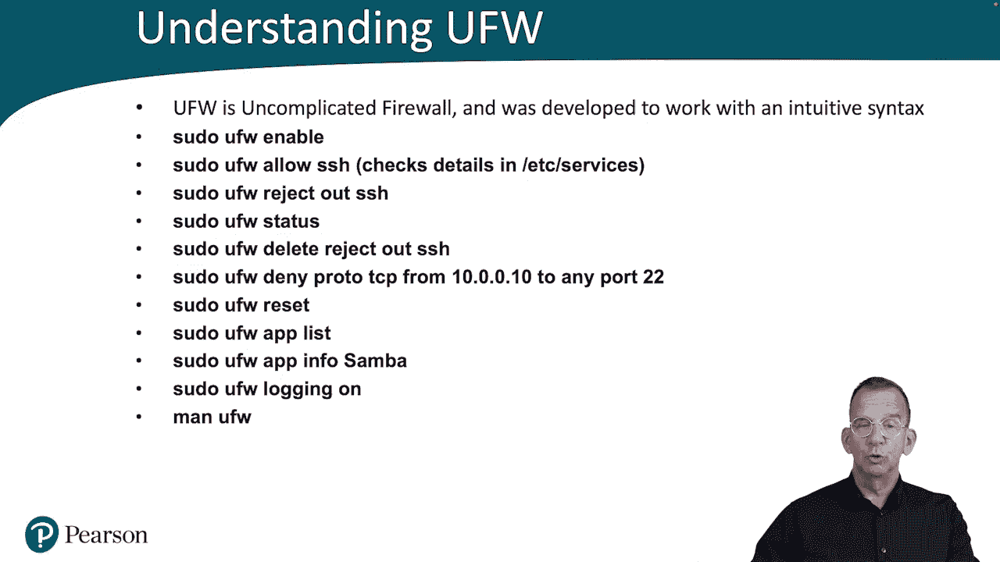
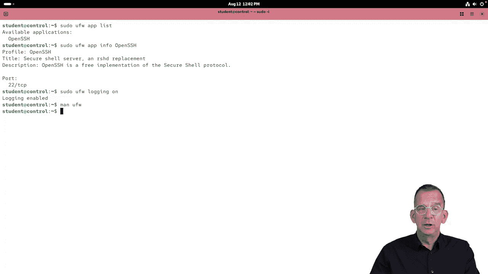

🔥 CompTIA Linux+ V8：06：管理 UFW 防火墙


在本节课中，我们将要学习 UFW 防火墙的基础管理方法。UFW 的全称是 Uncomplicated Firewall，也就是“简单防火墙”。它是 Ubuntu 系统上的默认防火墙工具，设计初衷是让配置防火墙规则变得直观且简单。如果你正在通过 SSH 连接到一台 Ubuntu 服务器，那么在操作防火墙时必须格外小心，因为一不小心就可能把自己锁在服务器外面。接下来我们会一步步演示如何查看状态、启用服务、放行 SSH、拒绝不需要的流量，以及如何查看日志和手册文档。


## 🛡️ 什么是 UFW



上一节我们介绍了 Linux 基础网络概念，本节中我们来看看什么是 UFW 防火墙。

UFW 是 Ubuntu 预装的防火墙管理工具。它的语法设计得非常直观，即使你不熟悉底层的 iptables 规则，也可以快速上手。简单来说，UFW 就是一道防火墙门卫，根据你设定的规则决定哪些网络流量可以进来，哪些流量可以出去。

下面是几个核心概念的说明：

- **防火墙状态**：用来查看 UFW 当前是处于启用还是停用状态。
  ```bash
  sudo ufw status
  ```
- **默认策略**：防火墙对未匹配规则的流量采取的默认动作，比如允许或拒绝。
- **规则**：明确允许或拒绝特定端口、协议或 IP 地址的流量。

以上就是 UFW 的基本定义和核心概念。


## 🔍 检查 UFW 当前状态

在上一节我们了解了什么是 UFW，本节中我们来看看如何检查防火墙当前是否可用。

演示环境是一台 Ubuntu 服务器，管理员正通过 SSH 远程连接。这意味着如果操作失误，当前的远程连接可能会中断，所以每一步都要谨慎执行。

首先，我们需要确认 UFW 是否已经安装并且处于活动状态。以下是查看状态的命令：



```bash
sudo ufw status
```

执行后，如果输出显示 `inactive`，说明防火墙当前处于关闭状态。这时候系统上的网络端口没有经过 UFW 的过滤保护。

然后我们可以决定是否要启用它。


## 🚪 在启用防火墙前先放行 SSH

在上一节我们检查了 UFW 状态，本节中我们来看看如何在启用防火墙之前保护 SSH 连接。

因为管理员是通过 SSH 端口（默认是 22 端口）连接服务器的，如果直接启用防火墙而不放行 SSH，那么非常有可能会导致当前的 SSH 会话被强制断开，之后也无法重新连接。因此，聪明的做法是在启用防火墙之前，先添加一条允许 SSH 流量的规则。

以下是允许 SSH 的命令：

```bash
sudo ufw allow ssh
```

这条命令的意思是：允许通过 SSH 协议的入站流量，对应的就是端口 22。执行之后，UFW 就会在规则列表中记录下这条允许项，即使之后开启防火墙，SSH 连接也不会被意外阻断。


## ⚡ 启用 UFW 并查看运行状态

在上一节我们放行了 SSH 服务，本节中我们来看看如何正式启用防火墙，并确认规则是否已经生效。

现在 SSH 已经被允许，我们可以比较放心地启用 UFW 了。系统会提示操作可能会干扰现有的 SSH 连接，但因为我们已经放行了 SSH 端口，所以可以继续执行。

以下是启用命令：

```bash
sudo ufw enable
```

启用完成后，我们再次查看状态：

```bash
sudo ufw status
```

此时输出会显示防火墙处于 `active` 状态，并且会被设置为随系统启动自动开启。你可以看到端口 22 已经被允许，而且支持 IPv4 以及 IPv6 双协议栈。这意味着无论是使用哪种 IP 版本，SSH 流量都可以正常通过防火墙。


## 🚫 拒绝特定的出站流量（以 FTP 为例）

在上一节我们启用了防火墙并查看了状态，本节中我们来看看如何拒绝特定的出站网络流量。

除了控制进入服务器的流量，UFW 也可以管理从服务器发出去的流量。假设我们不希望服务器主动发起 FTP 连接，可以添加一条拒绝出站 FTP 流量的规则。这里选用 FTP 是因为演示环境中并不使用该服务，所以即使拒绝也不会影响当前的 SSH 会话。

以下是拒绝出站 FTP 的命令：

```bash
sudo ufw reject out ftp
```

执行之后，再次查看状态就能看到针对 FTP 出站流量的拒绝规则。如果之后你后悔了，或者需要恢复 FTP 出站权限，可以使用删除命令：

```bash
sudo ufw delete reject out ftp
```

这条命令会把刚才添加的拒绝规则从列表中移除，语法结构非常直观，容易记忆。


## 🌐 拒绝特定 IP 地址访问指定端口

在上一节我们学习了拒绝出站 FTP 流量，本节中我们来看看如何针对特定的 IP 地址拒绝访问某个端口。

有时候我们不需要拒绝全部的 FTP 流量，只需要阻止某一台特定机器访问我们的服务器。这时候可以编写更精细的规则，指定协议、源 IP 地址、目标端口等条件。

以下是拒绝某个 IP 地址访问端口 22 的命令示例：

```bash
sudo ufw deny proto tcp from 10.0.0.10 to any port 22
```

这条命令的意思是：拒绝来自 IP 地址 10.0.0.10 通过 TCP 协议访问本机任意网卡的 22 端口。执行完成后，再次运行 `sudo ufw status` 就能看到这条拒绝规则已经生效，列表中会显示对该 IP 地址访问端口 22 的 deny 动作。

通过这种方式，你可以拒绝单个 IP 地址，也可以调整规则来拒绝整个网段访问特定端口，非常灵活。


## 📦 使用应用程序简化防火墙管理

在上一节我们学习了针对 IP 地址的精细拒绝规则，本节中我们来看看 UFW 如何支持基于应用程序的规则管理。

UFW 不仅可以直接操作端口，还可以使用预定义的应用程序配置文件。不过，这些应用程序需要先安装相关软件包，UFW 才能识别它们。在演示环境中，系统里只识别到了一个应用，那就是 OpenSSH。

以下是查看可用应用列表的命令：

```bash
sudo ufw app list
```

如果你想了解某个应用具体包含哪些端口和协议，可以使用应用信息查询命令：

```bash
sudo ufw app info openssh
```

输出会显示 OpenSSH 的简短描述，告诉你它对应哪些端口规则。这样你就可以直接使用应用名称来管理防火墙，而不需要记住具体的端口号，操作更加方便。


## 📝 开启日志并查看官方手册

在上一节我们介绍了基于应用程序的规则管理，本节中我们来看看如何开启防火墙日志，以及在哪里查找完整的语法参考。

在排查网络连接问题时，防火墙日志非常有用。它可以记录哪些流量被允许，哪些流量被阻断，帮助管理员快速定位问题所在。

以下是开启日志的命令：

```bash
sudo ufw logging on
```

开启日志后，系统会把防火墙的访问和阻断信息写入日志文件，方便之后进行故障排查。

最后，如果你想了解 UFW 支持的所有语法组件和高级用法，可以查看系统手册页：

```bash
man ufw
```

手册页中详细列出了所有可用的命令选项和参数，基于这些信息，你应该能够构建起一个功能相当强大的防火墙策略。




## 📋 本节总结

本节课中我们一起学习了 UFW 防火墙的基础管理方法。我们先了解了 UFW 是什么，它是 Ubuntu 上默认的简单防火墙工具。接着演示了如何在通过 SSH 连接的服务器上安全地检查和启用防火墙，重点强调了必须先放行 SSH 端口，避免把自己锁在服务器外面。然后我们学习了如何拒绝出站 FTP 流量、如何删除不需要的规则，以及如何拒绝特定 IP 地址访问指定端口。最后介绍了使用应用程序配置文件简化管理、开启日志辅助排查问题，并查看 `man ufw` 手册获取更多语法细节。希望通过这节课，你能够熟练掌握 UFW 的日常操作，为自己的 Linux 服务器构建基本的网络安全防护。
