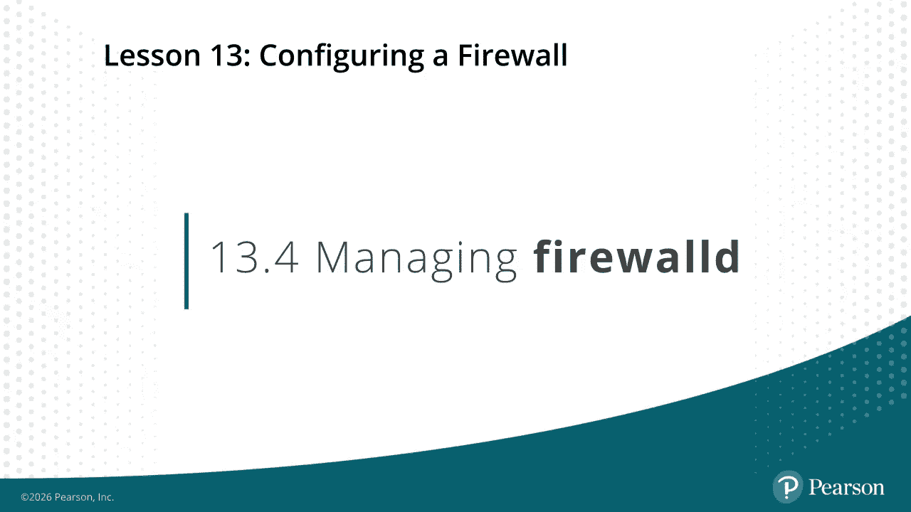
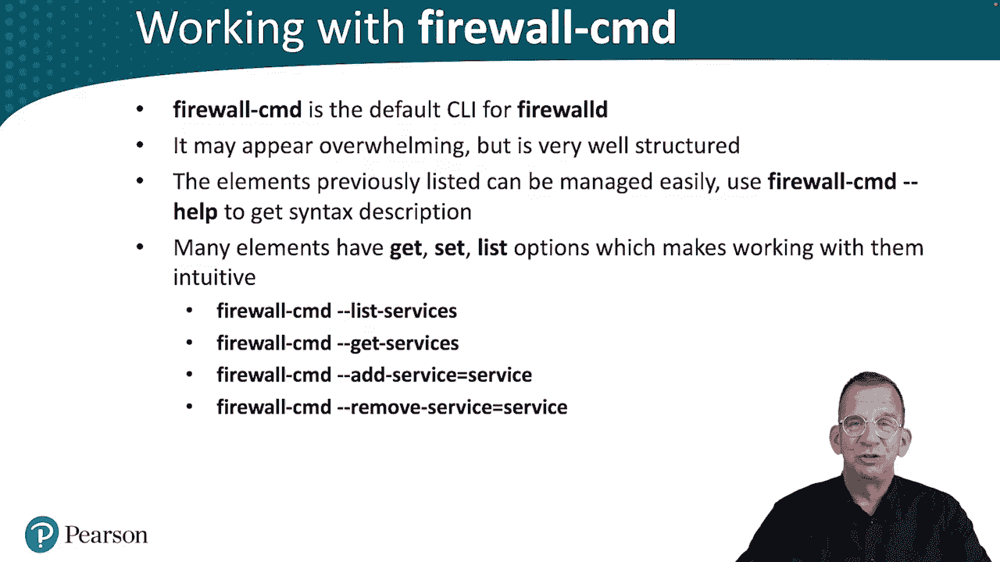
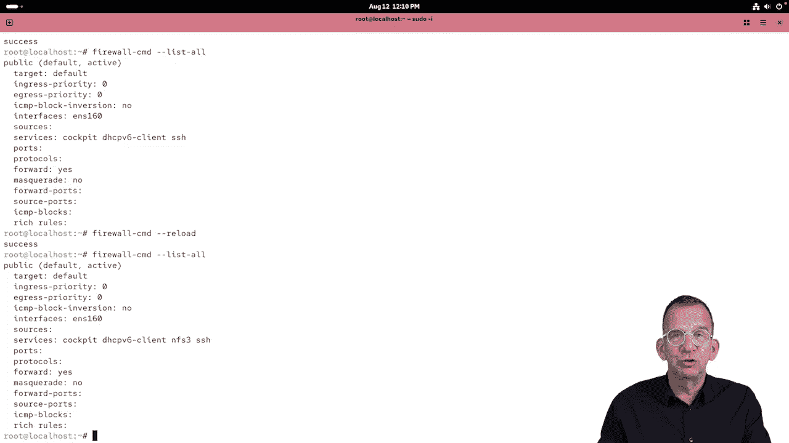

# CompTIA Linux+ V8：67：管理 firewalld 🔥

在本节课中，我们将要学习如何在 Linux 系统中管理防火墙服务 firewalld。 firewalld 是红帽系 Linux 发行版中默认使用的防火墙解决方案。我们会先了解它的基本组成部分，再学习如何通过命令行工具 firewall-cmd 来配置区域、服务和转发规则，最后掌握运行时配置与永久配置之间的区别，确保你的防火墙设置在重启后依然生效。

## firewalld 的基本概念

firewalld 是红帽系 Linux 发行版（RHEL 及其衍生版本）中默认内置的防火墙管理工具。它的设计目标是让系统管理员能够用更简单的方式来控制网络流量的进出，而不需要直接去编写复杂的 iptables 规则。 firewalld 把网络环境抽象成几个核心概念，通过组合这些概念来构建完整的防护策略。

以下是 firewalld 的主要组成部分：

- 区域（Zone）：一个或多个网卡的集合，面向特定方向，可以为其分配规则。
- 网卡（Interface）：单独的物理或虚拟网络接口，在 firewalld 中必须隶属于某个区域。
- 服务（Service）：基于 XML 的配置文件，定义需要打开的端口和应使用的内核模块。

每个区域可以看作是一组网卡的逻辑分组。例如，如果你的服务器连接了多个内部网卡或多个对外网卡，你可以把它们放在同一个区域里，然后在这个区域之上统一构建访问规则。这样一来，管理起来会比较集中，也不会因为网卡数量增多而变得混乱。

除了区域、网卡和服务之外，firewalld 还支持更高级的流量转发功能，我们来看看具体是怎么实现的。

## 端口转发与 IP 伪装

在实际网络环境中，防火墙不仅要负责拦截不想要的流量，还常常需要把进出的流量重定向到正确的目标。 firewalld 提供了端口转发和 IP 伪装两种机制来处理这类需求。

端口转发可以把进入特定端口的流量发送到另一个端口，这个目标端口甚至可能位于另一台机器上。你可以把它理解为一种流量导向规则。 IP 伪装（IP Masquerading）则是在路由器上提供网络地址转换（NAT）功能。如果你的 firewalld 服务器充当网络网关，开启 IP 伪装后，连接到该路由器的内网设备就可以通过这台防火墙访问互联网，而外部网络看不到这些内网设备本身的地址。

IP 伪装的流向可以用下面这个简单公式表示：

内网设备 → firewalld 路由器（开启 IP 伪装） → 互联网

如果你的防火墙服务器承担路由器的角色，建议启用 IP 伪装，这样内网中的所有主机都能安全地上网，同时保持自身不被外部直接发现。

如果你需要比基本服务更复杂的过滤逻辑，firewalld 还提供了丰富规则机制，下面我们介绍一下。

## 丰富规则（Rich Rules）

基本的区域和服务配置可以满足大部分常见场景，但有时候管理员需要编写更细粒度的条件，比如只允许某个特定 IP 地址段访问某个端口，或者根据源地址做不同的处理。为了实现这些更复杂的配置，firewalld 提供了丰富规则（Rich Rules）语法。

丰富规则是对 firewalld 原有配置语法的扩展，它让管理员能够用更灵活的方式表达防火墙策略，不再局限于简单的开放或关闭端口。

掌握了这些概念之后，接下来就是最关键的部分，也就是如何在实际操作中使用命令行工具来管理 firewalld。

## 使用 firewall-cmd 管理 firewalld

要在命令行中操作 firewalld，核心工具就是 firewall-cmd。虽然它的参数选项比较多，初次看到可能会觉得压力很大，但实际上这套命令结构非常清晰，只要掌握了基本模式，日常使用就不困难。

你可以通过以下命令查看完整的语法说明：

firewall-cmd --help

如果你只想查看与服务相关的命令，可以把帮助信息过滤出来，例如：

firewall-cmd --help | grep service

firewalld 中的许多配置元素都支持获取、设置和列出三种操作。以下是常见的操作模式：

- list services：列出当前已生效的服务配置
- get services：显示系统中所有可用的服务定义
- add service：向当前区域添加某个服务
- remove service：从当前区域移除某个服务

这些命令的命名规则比较直观，list 用来查看当前状态，get 用来查看可选内容，add 和 remove 则用来做增删操作。

在实际使用 firewall-cmd 时，还有一个非常重要的概念需要注意，那就是运行时配置和永久配置的区别。

## 运行时配置与永久配置

使用 firewalld 时有一个关键点必须牢记：你所做的更改默认只作用于当前的运行时环境。这意味着，如果你只是临时添加了一条规则，系统重启之后这条规则就会消失。因此，在 firewalld 中做任何配置，通常都需要执行两次：一次是添加到运行时，另一次是添加到永久配置。

要让配置在重启后依然有效，需要使用 --permanent 选项。下面是一个典型的操作流程：

1. 先用 firewall-cmd --add-service ssh 将 SSH 服务添加到运行时
2. 再用 firewall-cmd --add-service ssh --permanent 将同样的服务写入永久配置

如果你只执行第一步而省略第二步，那么重启机器后 SSH 服务的防火墙放行规则就会丢失，导致远程连接失败。因此，在生产环境中配置防火墙时，务必记得检查是否已经加上 --permanent 标志。

概念讲完了，接下来我们通过一个实际的演示来看看这些命令是怎么运行的。

## 实际操作演示

现在我们进入实操环节，看看如何在真实系统中查看和修改 firewalld 配置。首先，使用以下命令查看当前的完整配置状态：

firewall-cmd --list-all

执行之后，你会看到当前所在的区域名称，默认情况下通常是 public，同时 firewalld 处于激活状态。在这个默认区域中，系统会显示当前绑定的网卡接口，例如 ENS 160，以及已经开放的默认服务，常见的包括 cockpit、dhcpv6-client 和 ssh。

如果你想查看系统中所有可用的服务列表，可以使用：

firewall-cmd --get-services

这就相当于查阅一本服务目录，告诉你 firewalld 预定义了哪些服务可以直接启用。假设你想了解 NFS V3 服务具体开放了哪些端口，可以去查看它的配置文件，路径通常是：

/usr/lib/firewalld/services/nfs3.xml

打开这个 XML 文件后，你会发现 NFS V3 同时打开了 TCP 和 UDP 的 2049 端口。如果你想把 NFS V3 服务添加到当前区域，可以执行：

firewall-cmd --add-service nfs3

执行完之后，再用 firewall-cmd --list-services 查看，应该就能看到 nfs3 出现在列表中了。不过要注意，这时候如果执行 firewall-cmd --reload 重新加载防火墙，nfs3 就会消失，因为它只存在于运行时内存中，没有写入永久配置。

要解决这个问题，有两种方法。一种是把刚才的命令重新执行一遍，另一种是在添加服务时直接带上 --permanent 选项，例如：

firewall-cmd --add-service nfs3 --permanent

这样做之后，虽然当前列表可能还不会立刻显示变化，但当你再次执行 firewall-cmd --reload 时，防火墙会从永久配置文件中读取设置，nfs3 就会重新出现并持续生效。

以上就是关于 firewalld 基础管理的全部内容，下面我们来做一个总结。

## 总结

在本节课中，我们一起学习了 firewalld 的基本概念和管理方法。我们介绍了区域、网卡和服务三个核心组成部分，说明了端口转发和 IP 伪装如何帮助网关服务器处理流量，还简要提到了用于复杂配置的丰富规则。重点讲解了 firewall-cmd 命令行工具的使用方式，特别是 get、set、list 等操作模式，以及运行时配置与永久配置的区别。最后通过添加 NFS V3 服务的演示，展示了为什么在生产环境中必须配合 --permanent 选项使用，否则重启后规则会丢失。希望这些内容能帮助你建立起对 Linux 防火墙管理的初步认识。
