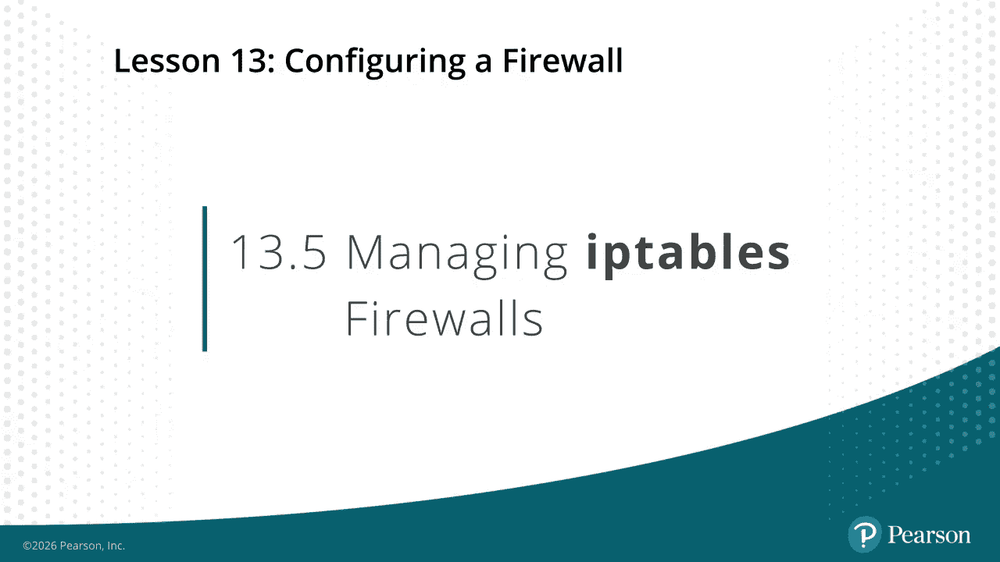
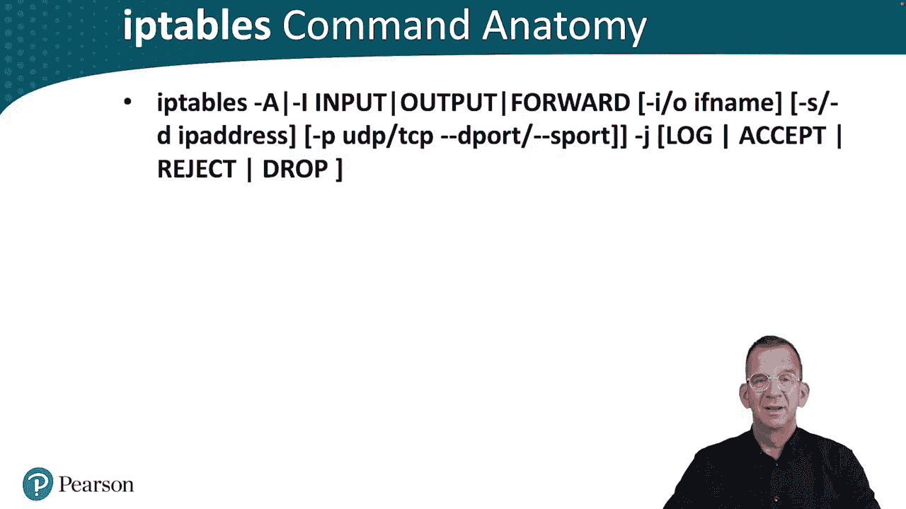
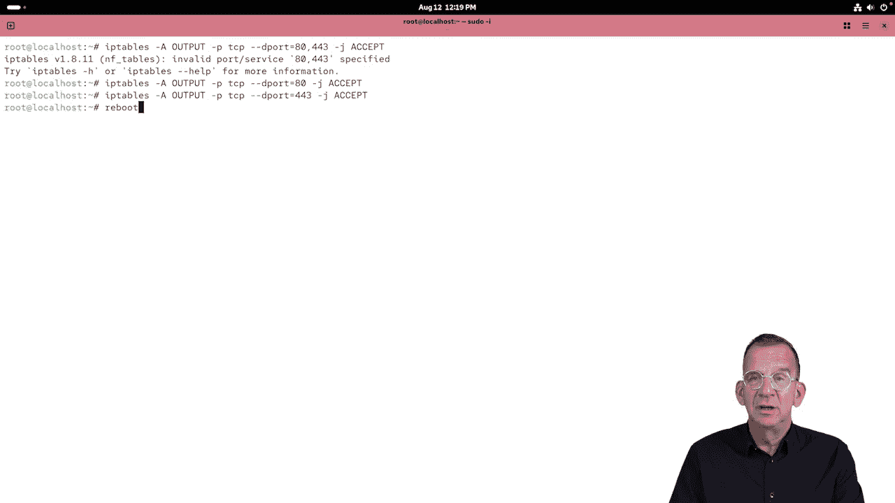

Linux+ 课程：第 135 节：管理 iptables 防火墙 🔥




## 课程概述

在本节课中，我们将一起学习 iptables 防火墙的基础知识与实际操作。你将了解 iptables 是什么，它和新型防火墙工具 nftables 有什么区别，以及如何在 Linux 系统上编写和应用 iptables 规则。无论是查看现有规则，还是设置数据包的进出策略，本节课都会用大白话为你讲解清楚，让初学者也能快速上手。

## 为什么还要学习 iptables

上一节我们介绍过网络基础知识，本节中我们先来看看 iptables 在现代 Linux 中的定位。

iptables 是一个经典的 Linux 防火墙管理工具。曾经它被标记为过时技术，但很多人仍然喜欢使用它，所以现在 iptables 正在迎来复兴。它被重新包装，你可以使用它来编写与当前语法兼容的防火墙。你可能想这样做，因为它提供了高级功能，可以配置非常具体的防火墙规则，如果你是高级防火墙用户，iptables 是一个非常好的实用工具。

现代系统通常提供 nftables 作为管理高级防火墙的标准解决方案。如前所述，iptables 工具经过重新设计，能够生成 nftables 规则。其原因在于，nftables 相当复杂，它的规则不像 iptables 规则那样容易编写。这就是为什么你可能更倾向于使用 iptables 而不是 nftables。

## iptables 命令结构拆解

接下来，我们需要了解 iptables 命令是如何组织的，才能正确地写规则。

使用 iptables 时，你应该掌握命令的构成方式。它的工作逻辑可以拆解为几个固定部分。

以下是 iptables 命令的主要组成部分：

- 操作位置：`-A` 表示在链的末尾追加规则，`-I` 表示在链的开头插入规则。
- 网络接口：`-i` 或 `-o` 指定输入或输出接口名称，顺便提一句，这是可选的，如果不指定接口名称，规则将应用到所有接口。
- 源或目标地址：`-S` 或 `-D` 分别表示源或目标，后面跟带有 CIDR 子网掩码的 IP 地址。
- 协议：`-P` 指定 UDP 或 TCP，后面总是跟 `--dport` 表示目标端口，或 `--sport` 表示源端口。
- 动作：`-J` 用于指定你想要执行的操作，选项包括 `log`、`accept`、`reject` 和 `drop`，其中 `log` 表示写入日志，`accept` 表示接受，`reject` 在发送错误消息的同时拒绝，让流量发起者知道出了什么问题，`drop` 表示静默丢弃。

防火墙动作的选择可以用公式表示：

action ∈ {log, accept, reject, drop}

iptables 防火墙中规则的顺序非常重要。例如，如果你先允许所有 SSH 流量，再拒绝某台主机的 SSH 流量，这不会生效，因为允许规则会先匹配拒绝主机的流量，直到遇到拒绝规则之前都不会拦截，这就是为什么通常要把具体的例外规则放在前面，把通用规则放在最后。

## 实操演示：查看规则与设置默认策略

光有理论还不够，我们来在 CentOS 系统上进行实际操作，看看 iptables 到底怎么用。

演示环境是 centraltenos 系统。首先需要禁用 firewalld，因为它和 iptables 可能会冲突，为此需要执行 `systemctl disable --now firewalld` 来关闭 firewalld 服务。



然后使用 iptables 命令来查看当前规则。

以下是查看 iptables 规则的命令：

```bash
iptables -L
```

执行后你会看到三条链：INPUT 链、FORWARD 链和 OUTPUT 链，默认策略通常是 ACCEPT。INPUT 链用于入站数据包，OUTPUT 链用于出站数据包，FORWARD 链本示例中暂不关注。默认策略是 ACCEPT，如果想构建一个真正能够拦截一切的防火墙，最好先修改策略，将 OUTPUT 链策略设置为 DROP，注意 DROP 必须大写。我也会将 INPUT 链策略设置为 DROP。

此时尝试 ping 一个域名，比如 `ping google.com`，结果会出现 "Name or service not known"。"Name or service not known" 是 DNS 错误，这是正常的，因为 ping google.com 的第一件事就是连接 DNS 来查找 IP 地址，而现在 DNS 无法访问，所以我们需要确保 DNS 流量能通过，具体做法是在 OUTPUT 链上使用 `iptables -A OUTPUT`。

## 实操演示：允许 DNS 与返回流量

既然默认策略是拒绝所有流量，我们需要手动放行必要的服务，首先是 DNS。

要允许 DNS 解析，需要在 OUTPUT 链上放行端口 53 的流量。

以下是允许出站 DNS 流量的命令：

```bash
iptables -A OUTPUT -p tcp --dport 53 -j ACCEPT
iptables -A OUTPUT -p udp --dport 53 -j ACCEPT
```

这里解释一下：端口 53 是 DNS 的标准端口。DNS 既可以使用 TCP 也可以使用 UDP，所以两个协议都要放行。如果你不确定端口号，可以查看 `/etc/services` 文件，里面记录了常见的服务端口。

接下来做几乎同样的操作，但这次指定 UDP 协议也放行，因为 DNS 流量既可以通过 TCP 也可以通过 UDP 传输。你觉得现在万事俱备了吗？当我们再次 ping google.com 时，仍然没有任何响应，这是因为返回数据包被阻挡了。

查看 `iptables -L` 会发现，输出链中已经有一些允许的流量，但没有任何入站流量被放行，为了解决这个问题，我们需要使用状态模块。

以下是允许已建立连接的回包进入的命令：

```bash
iptables -A INPUT -m state --state ESTABLISHED,RELATED -j ACCEPT
```

`-m state` 用于调用内核状态模块，该模块跟踪数据包状态，我们要查找状态为 ESTABLISHED 或 RELATED 的流量并接受。这意味着只有当入站流量是已有连接的响应时才会被接受，也就是说，只有对已授权的出站流量的回复才会被放行。你可以看到这条规则已经列在防火墙规则中，我们再次尝试 ping google.com，这次可以正常工作了。

## 实操演示：允许 Web 流量与清理配置

接下来我们再放行网页流量，然后演示如何清理配置。

如果你想允许出站的 Web 流量，需要放行端口 80 和端口 443。

以下是逐条放行 Web 端口的命令：

```bash
iptables -A OUTPUT -p tcp --dport 80 -j ACCEPT
iptables -A OUTPUT -p tcp --dport 443 -j ACCEPT
```

需要注意的是，不能使用逗号分隔列表来一次性写多个端口，比如 `--dport 80,443` 不行，因此需要逐条添加，分别放行端口 80 和端口 443，因为你可能也想允许出站 Web 流量。

此时，我们已经配置了一个相当完善的 iptables 防火墙。为了演示干净，接下来重启系统以清除所有 iptables 配置，我不打算让配置持久化，只是想讲解它的工作原理。

## 本节总结



本节课中，我们一起学习了 iptables 防火墙的基础概念与命令结构。我们了解了 iptables 与 nftables 的关系，掌握了 `-A`、`-I`、`-p`、`--dport`、`-j` 等核心参数的用法，也通过实际演示学会了如何设置默认策略、放行 DNS 和 Web 流量，以及如何处理返回数据包。希望这些内容能帮助你入门 iptables 防火墙管理。
