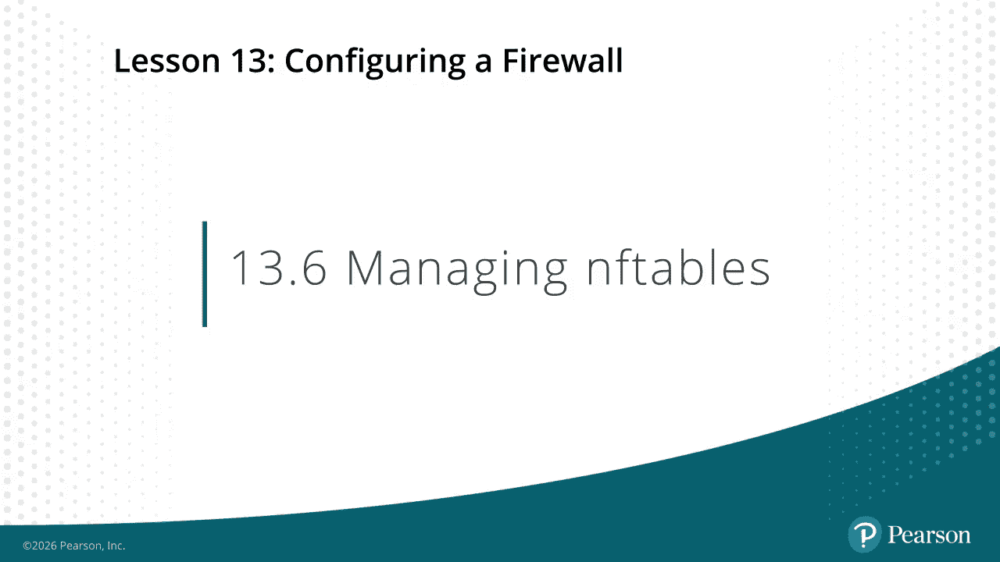
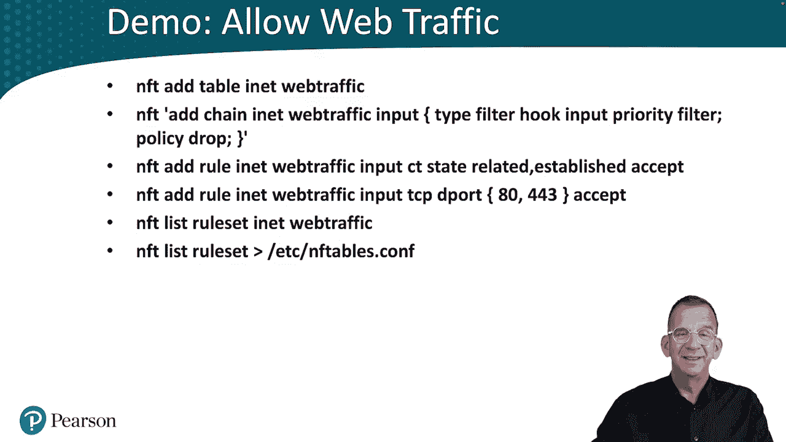
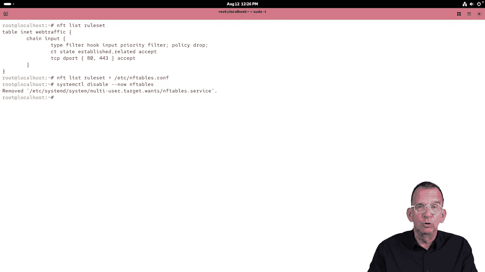

# CompTIA Linux+ V8：136：管理 nftables 🛡️




## 课程概述

在本节课中，我们将学习 nftables。nftables 是 iptables 命令的现代替代方案。你可能不会每天都用到它，但在实际工作中偶尔会遇到，所以最好了解它是怎么回事。FirewallD 通过 FirewallCMD 管理 nftables 规则，而 UFW 则使用 ufw 命令作为前端工具。这种做法对于简单配置非常方便，但是如果你需要详细且高级的访问控制，nftables 是唯一的选择。当你决定使用 nftables 时，必须先禁用 FirewallD 或 UFW，否则两个防火墙会冲突。

## 什么是 nftables

上一节我们简单介绍了 nftables 的定位，本节中我们来详细看看它到底是什么。nftables 是 Linux 系统里的防火墙工具，它取代了老旧的 iptables。你可以把它理解为网络流量的守门员，负责决定哪些数据包可以进入系统，哪些数据包应该被拦截在外面。它的核心工作就是检查进出的网络包，然后根据你设定的规则放行或丢弃。

## 为什么需要直接使用 nftables

知道了 nftables 是什么之后，本节中我们来看看为什么还要专门学它，而不是一直依赖简单的命令行工具。FirewallD 和 UFW 都提供了简单的前端界面，适合快速搭建基本防火墙。但是当你需要非常精细的访问控制，比如针对特定端口、特定协议或者特定连接状态编写复杂规则时，这些前端工具就力不从心了。这时候就必须直接操作 nftables。而且请记住，一旦开始使用 nftables，FirewallD 和 UFW 必须全部关闭，不能同时运行。

## 安装 nftables

前面讲完了理论背景，本节中我们开始动手安装 nftables。nftables 在系统中默认没有预装，所以第一步就是手动把它装上。以下是安装和初始化的命令。

```bash
sudo dnf install nftables
```

安装完成后，需要启用 nftables 服务并让它立即运行。

```bash
sudo systemctl enable --now nftables
```



为了避免冲突，接下来要停止、禁用并掩盖 FirewallD。掩盖的意思是，即使有人尝试启动 FirewallD，系统也会报错提示它已被掩盖，从而防止意外情况发生。

```bash
sudo systemctl stop firewalld
sudo systemctl disable firewalld
sudo systemctl mask firewalld
```

## 查看当前规则集

安装和初始化完成之后，本节中我们来看看系统里现在到底有什么规则。以下命令可以列出当前所有的 nftables 规则。

```bash
sudo nft list ruleset
```

刚开始的时候，输出应该是空的，这很正常，因为我们刚刚才安装，还没有添加任何规则。

## 创建表和链

既然当前没有规则，本节中我们来创建自己的表和链。在 nftables 中，核心组织关系可以用简单的代码形式表示：`表 → 链 → 规则`。表是规则的集合，链也是规则的集合，而且链是隶属于表的。我们要创建一个名为 web_traffic 的表，属于 inet 家族。

```bash
sudo nft add table inet web_traffic
```

表创建好之后，接下来要在这个表里面创建一条链。链的作用是进一步组织规则，我们把这条链命名为 input，类型设为 filter，挂钩点也是 input，优先级设为 filter，默认策略设为 drop，也就是默认拒绝所有进入的流量。

```bash
sudo nft add chain inet web_traffic input { type filter hook input priority filter \; policy drop \; }
```

这里的语法看起来有点像 JSON，需要花括号、分号和单引号。很容易在这里打错字，这也是为什么大多数人在大多数情况下更喜欢使用 FirewallD 这样的简单前端工具。

## 添加放行规则

表和链都建好了，本节中我们来添加具体的放行规则。以下是两条常用的规则示例。

```bash
sudo nft add rule inet web_traffic input ct state related,established accept
sudo nft add rule inet web_traffic input tcp dport 80,443 accept
```

第一条规则的意思是，允许与已建立或相关连接的返回流量通过，这样正常的网络通信才能正常工作。第二条规则的意思是，允许 TCP 80 端口和 443 端口的流量，也就是普通的网页流量。这里可以用逗号分隔列出多个端口，配置起来比较灵活。

## 验证配置

规则添加完毕之后，本节中我们来验证一下配置是否生效。以下命令会把当前所有规则以整齐的格式显示出来。

```bash
sudo nft list ruleset
```

如果看到刚才添加的那些规则都出现在输出里，并且格式清晰，就说明配置没有问题。

## 保存配置并重启服务

验证通过之后，本节中我们来把配置保存下来，避免系统重启后规则丢失。你需要把当前配置写入配置文件 /etc/nftables.conf，然后重启 nftables 服务使其生效。

```bash
sudo systemctl restart nftables
```

重启完成后，你的防火墙规则就会持久化保存。

## 结束演示与清理环境

教程演示即将结束，本节中我们来做一下清理工作，以免影响后续课程。因为这只是一个演示环境，不希望在之后的课程中因为 nftables 造成网络问题，所以最后要禁用并停止 nftables。

```bash
sudo systemctl disable --now nftables
```

如果不执行这一步，后续跟着其他视频学习时，可能会因为防火墙规则阻塞而连不上网络或者无法正常访问服务。

## 本节总结



本节课中我们一起学习了 nftables 是什么，为什么需要直接使用它，如何安装和初始化，如何创建表和链，如何添加放行网页流量的规则，如何验证和保存配置，最后如何清理环境。希望通过这节课，你对 nftables 有了初步的认识，并且能够在需要的时候独立配置基本的防火墙规则。

