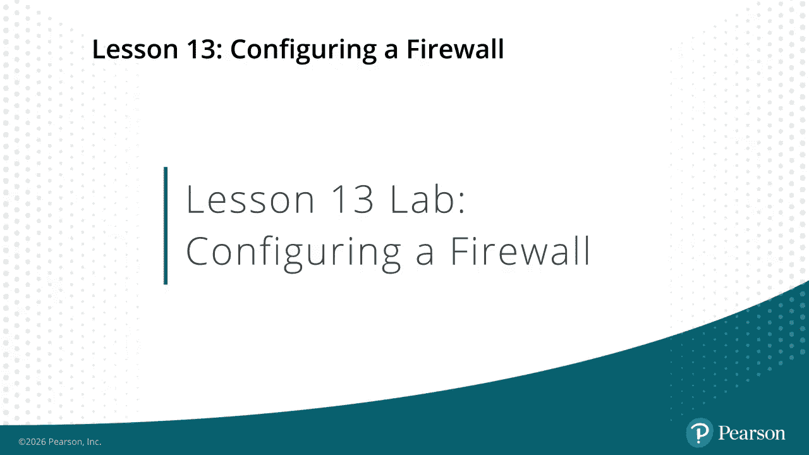
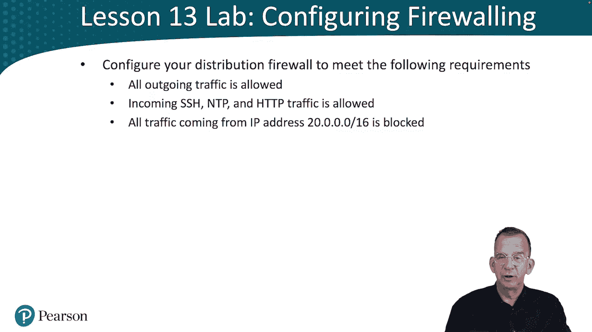

CompTIA Linux+ V8：13：配置防火墙 🛡️

在本节课中我们将要学习如何给Linux系统配置防火墙。防火墙就像是一扇大门，它负责决定哪些数据包可以进来，哪些数据包可以出去。我们会用大白话把防火墙的基本规则讲清楚，让没有基础的同学也能听懂。具体来说，我们会先设定一些最基本的要求，然后告诉你这些要求在实际操作中意味着什么。

在开始具体配置之前，我们先回顾一下上一节的内容。上一节我们介绍了Linux系统的基础网络概念，包括IP地址和端口号的作用。本节中我们来看看防火墙如何利用这些信息来过滤流量。


首先，请按照下列要求配置你的发行版防火墙。



以下是防火墙需要满足的具体条件。

- 所有出站流量都允许。
- 入站的SSH、NTP和HTTP流量全部允许。
- 所有来自2000.0.0.0/16网段的流量都被阻断。

上面这些规则看起来比较简单，但背后的逻辑很重要。为了让你更直观地理解，我们可以把防火墙的决策过程用一个简单的公式或者伪代码来描述。

```
防火墙决策逻辑：
if 流量方向 == 出站:
    动作 = 允许
else if 流量方向 == 入站 and (端口 == SSH or 端口 == NTP or 端口 == HTTP):
    动作 = 允许
else if 源地址在 2000.0.0.0/16 范围内:
    动作 = 阻断
else:
    动作 = 阻断
```

或者用数学公式表示：

$$ \text{动作} = \begin{cases} \text{允许} & \text{若为出站流量} \\ \text{允许} & \text{若为入站且端口属于}\{\text{SSH, NTP, HTTP}\} \\ \text{阻断} & \text{若源地址属于 } 2000.0.0.0/16 \\ \text{阻断} & \text{其他情况} \end{cases} $$

这里需要注意的是，出站流量全部放行意味着你的电脑可以主动访问外面的网络，比如浏览网页或者下载文件都不会被防火墙拦截。入站流量只开放SSH、NTP和HTTP，这分别用于远程登录、时间同步和网页服务，其他的入站请求默认不通过。而2000.0.0.0/16这个网段里的所有地址，无论它们想要干什么，都会被直接挡在门外。这就像是酒店大门只给特定房间的客人开门，而把某些不速之客直接列入黑名单。



好了，防火墙的基本配置要求就讲到这里。

本节课中我们一起学习了如何按照给定的需求来配置Linux发行版的防火墙。我们明确了出站全放行、入站仅开放SSH、NTP和HTTP、以及阻断特定IP网段这三条核心规则，并且用伪代码和公式把这些规则理顺了。希望你现在对防火墙的工作方式有了更直观的认识。
