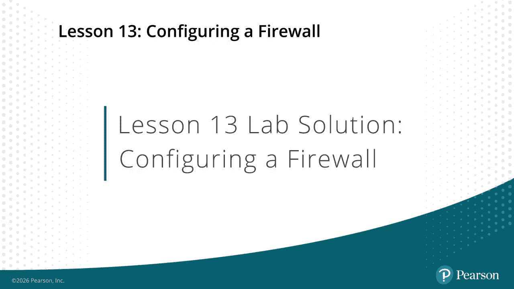
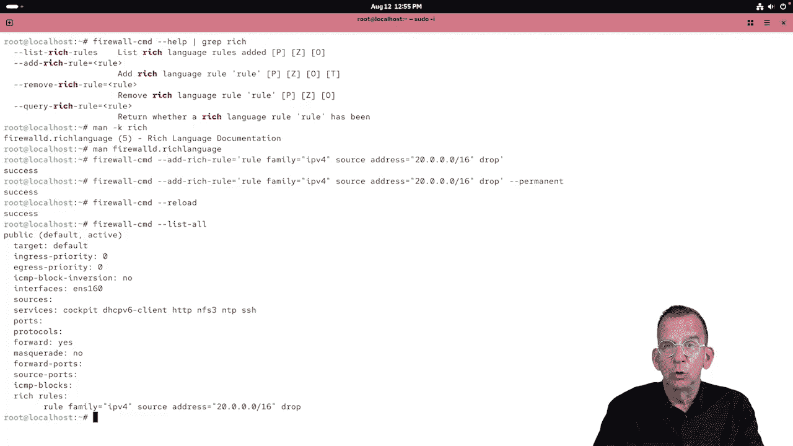

# CompTIA Linux+ V8：13：配置防火墙实验解答 🛡️




在本节课中我们将要学习如何在 SUSE 系统上配置 firewalld 防火墙。我们会先把防火墙恢复到默认状态，然后启用它，接着开放 SSH、NTP 和 HTTP 等常用服务，最后针对某个特定网段添加富规则来阻止入站流量，并确保这些设置在防火墙重启后依然有效。


第一节：恢复防火墙原始状态并启用服务

上一节我们介绍了防火墙的基本概念，本节中我们来看看如何把 firewalld 恢复到原始状态并让它真正运行起来。

首先，我们需要确保 firewalld 服务没有被屏蔽。如果它被 mask 了，系统就无法启动它，所以第一步是解除屏蔽。解除屏蔽之后，我们还要让防火墙开机自启，并且立即启动，这样后面的配置才能生效。

以下是执行步骤：

- 使用 systemctl 解除 firewalld 的屏蔽状态。
- 使用 systemctl 将 firewalld 设置为开机自启，并立即启动。

```bash
systemctl unmask firewalld
systemctl enable --now firewalld
```


第二节：查看并添加允许的服务

完成防火墙启动之后，我们需要确认当前允许哪些服务通过，然后把实验需要的服务加进去。

我们可以用 firewall-cmd 查看已经放行的服务列表，通常 SSH 默认已经在里面了。不过实验里还需要 NTP 和 HTTP，而目前这两个都不在允许列表中。因此我们需要手动添加它们。查询可用服务名称时，可以用 --get-services 配合 grep 快速定位，比如查 NTP 时，系统里的服务名就叫 NTP，这样比较方便。HTTP 也有不同的变体，但题目明确要求的是 HTTP，所以我们直接添加 HTTP 即可。在添加服务时，不需要在服务名和参数之间强制加上等号，直接写服务名就行。添加完服务后，记得加上 --permanent，否则防火墙重启后设置就会丢失。

以下是需要添加的服务命令：

- 添加 NTP 服务并设为永久生效。
- 添加 HTTP 服务并设为永久生效。

```bash
firewall-cmd --add-service=ntp --permanent
firewall-cmd --add-service=http --permanent
```


第三节：处理被阻止的网段并添加富规则

服务添加完成后，我们需要重新加载防火墙配置，让刚才的修改立即生效。但是，即便重新加载了，来自 2000/16 这个地址段的入站流量依然会被阻止。这时候，普通的服务放行就不够了，我们需要使用富规则（rich rule）来精确控制。

富规则有两个部分，一部分是 firewalld 的命令接口，另一部分是富规则语言本身。你可以用 firewall-cmd --help | grep rich 来查看富规则相关的选项，也可以通过 man firewalld.richlanguage 查看官方的富规则语言说明。在那个说明文档的底部，会有一些配置示例。我比较喜欢其中一个示例，它的作用是丢弃来自特定 IP 地址的所有连接，正好符合我们的需求。

基于这个示例，我们需要构造一条富规则，把来源地址设为 2000/16，协议族设为 IPv4，动作设为丢弃。添加富规则时，规则内容要放在单引号里面。添加完成后，同样不要忘记把这条富规则也设为永久生效，否则防火墙重启后就会失效。

以下是富规则的相关命令：

- 查看富规则帮助信息。
- 查看火墙富规则语言手册。
- 添加丢弃来自 2000/16 流量的富规则，并设为永久。
- 重新加载防火墙配置。

```bash
firewall-cmd --help | grep rich
man firewalld.richlanguage
firewall-cmd --add-rich-rule='rule family=ipv4 source address=2000/16 reject' --permanent
firewall-cmd --reload
```


第四节：验证当前配置并总结

所有规则添加完毕之后，我们需要确认防火墙现在的完整配置，确保刚才加的服务和富规则都生效了。

使用 firewall-cmd --list-all 可以显示当前所有的配置信息，包括服务、端口、富规则等。如果输出里能看到刚才添加的 NTP、HTTP 以及那条针对 2000/16 的富规则，就说明实验任务已经完成。这时候，无论是重新加载还是防火墙重启，配置都会保留下来。

以下是验证命令：

- 列出防火墙的完整当前配置。

```bash
firewall-cmd --list-all
```




本节课中我们一起学习了如何在 SUSE 系统上配置 firewalld 防火墙。我们先解除并启用了 firewalld 服务，然后添加了 NTP 和 HTTP 等允许服务，接着针对 2000/16 网段使用富规则阻止了入站流量，最后通过重新加载和列出全部配置来验证设置是否生效，并确保所有规则都设置为永久保存。

