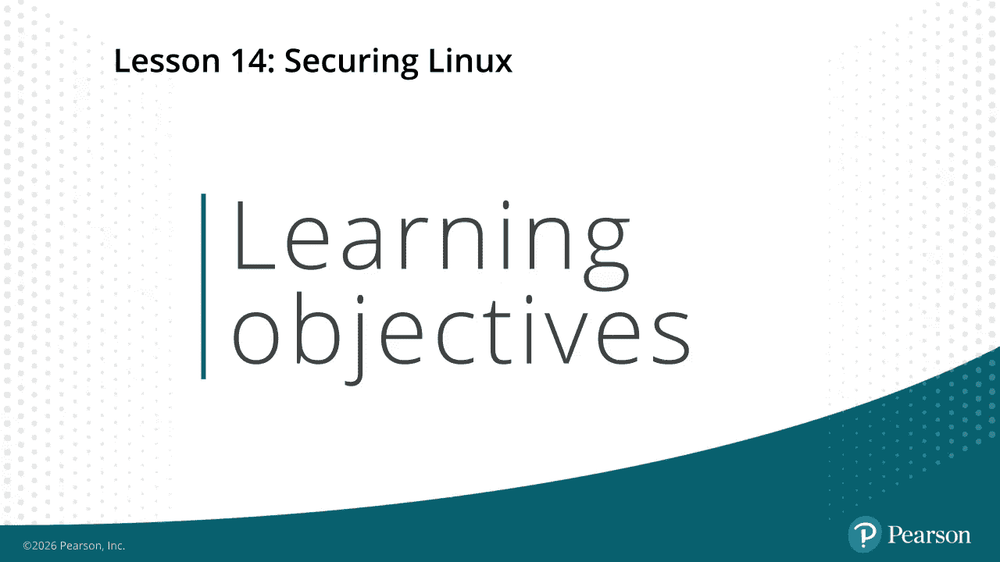

# CompTIA Linux+ V8：372：保护 Linux 的不同安全措施 🔒

在本节课中我们将要学习如何保护 Linux 系统。课程会带你逐个了解系统安全中常用的几种防护手段。首先我们会看怎么给引导加载程序设置密码，防止未授权用户在启动时修改系统参数。然后我们将看看 true deals，这部分内容也与系统启动安全相关。接着是对审计机制的初步介绍，审计可以帮助你记录谁在什么时候做了什么。之后我们会讲解如何在用户登录时显示公司提示消息，这通常通过 /etc/motd 文件来实现。再之后会讲解 LUKS 磁盘加密，用来保护硬盘上的数据不被盗读，还会介绍 GPG 工具，用于文件加密和数字签名。随后会介绍漏洞扫描和恶意软件检测，帮助你发现系统中的安全隐患。最后还会讲解如何安全地删除数据，确保敏感信息无法被恢复。课程的最后部分包含一个实验环节和对应的实验解答，供你练习和核对。


接下来我们先来看引导加载程序密码的管理。引导加载程序是系统启动时最先运行的程序，如果没有密码保护，任何人都可以通过编辑启动参数来获取 root 权限。因此设置引导加载程序密码是系统安全的第一道防线，值得每个管理员重视。


以下是管理引导加载程序密码的核心步骤：



- 编辑引导加载程序配置文件，通常位于 /etc/grub.conf 或 /boot/grub2/grub.cfg
- 使用 grub2-setpassword 命令生成密码哈希
- 重新生成引导配置，使密码设置生效

核心概念可以用下面的公式来理解：

系统安全等级 = 引导密码保护 + 文件权限控制 + 用户身份认证


上一节我们介绍了如何给引导加载程序设置密码，本节中我们来看看审计的基础知识。审计的作用是记录系统中发生的各种事件，比如谁登录了系统、修改了哪些文件、运行了什么命令。这些记录在系统出现问题时非常有用，可以帮助管理员定位安全事件的来源，也可以用于事后的合规检查。


以下是审计的主要作用：

- 记录用户登录和登出的时间
- 追踪对重要文件和目录的访问
- 记录系统配置的变更操作

审计日志通常保存在 /var/log/audit/ 目录下，你可以通过 ausearch 或 aureport 等工具来查看和分析这些记录。


刚才我们学习了审计的基本概念，接下来我们来看看如何在用户登录时显示公司提示消息。很多企业希望员工在登录系统时先看到一条安全提示或公司声明，这可以通过修改 /etc/motd 文件来实现。motd 是 "message of the day" 的缩写，意思是“今日消息”，系统会在每次交互式登录时自动显示这个文件的内容。


以下是配置登录提示消息的方法：

- 使用文本编辑器打开 /etc/motd 文件
- 输入你想要显示的公司警告或提示语句
- 保存文件并退出编辑器
- 重新登录系统，就能在屏幕上看到设置好的消息

这段消息可以包含公司名称、安全政策提醒或法律免责声明，内容完全由管理员自行决定。


在了解了登录提示消息之后，本节中我们来看看 LUKS 磁盘加密。LUKS 是 Linux Unified Key Setup 的缩写，是 Linux 系统中常用的磁盘加密标准。通过 LUKS，你可以对整个磁盘分区进行加密，没有正确密钥就无法读取里面的数据，即使硬盘被盗也能保护信息安全。


以下是使用 LUKS 加密磁盘的核心命令：

```bash
cryptsetup luksFormat /dev/sdb1
cryptsetup open /dev/sdb1 encrypted_data
mkfs.ext4 /dev/mapper/encrypted_data
mount /dev/mapper/encrypted_data /mnt/data
```

加密后的数据访问流程可以简化为：

用户输入密码 -> 解密主密钥 -> 挂载加密分区 -> 读写数据


上一节我们介绍了 LUKS 磁盘加密，本节中我们来看看 GPG 工具的使用。GPG 是 GNU Privacy Guard 的缩写，是一套用于加密和数字签名的开源工具。你可以用 GPG 给文件加密，也可以用它给邮件或软件包做数字签名，确保内容在传输过程中没有被篡改。


以下是 GPG 的常见操作命令：

```bash
gpg --gen-key
gpg --encrypt --recipient user@example.com file.txt
gpg --decrypt file.txt.gpg
```

使用 GPG 的基本逻辑是：

生成公私密钥对 -> 用公钥加密文件 -> 用私钥解密文件


接着我们来看看漏洞扫描和恶意软件检测。漏洞扫描的目的是发现系统中已知的安全弱点，比如未更新的软件包或开放的危险端口。常用的开源扫描工具包括 OpenSCAP，它可以帮助你检查系统是否符合安全基准。恶意软件检测则是查找系统中是否运行了病毒、木马或其他恶意程序，防止攻击者通过后门控制你的服务器。


以下是漏洞扫描和恶意软件检测的常见工具：

- OpenSCAP：用于系统安全配置扫描和合规性检查
- ClamAV：用于查杀 Linux 系统中的恶意软件
- rkhunter：用于检测根工具包和可疑文件

定期运行扫描并及时修复发现的问题是保持系统安全的重要习惯。


在学习了漏洞扫描之后，本节中我们来看看如何安全地删除数据。普通的删除操作（比如 rm 命令）只是把文件链接从目录中去掉，数据实际上仍然留在磁盘上，可以通过专门的工具恢复。如果你要处理包含敏感信息的硬盘，就需要使用安全删除工具，把数据所在的磁盘区域多次覆写，确保无法恢复。


以下是安全删除数据的常用命令：


```bash
shred -v -n 3 -z /dev/sdb1
wipe -r /path/to/file
```

安全删除的核心原理是：

原数据区域 -> 多次写入随机数据 -> 再写入零 -> 数据不可恢复


最后我们来看看课程末尾的实验环节。实验会让你在真实的 Linux 环境中动手操作，巩固刚才学到的所有安全知识。实验完成后，还会提供实验解答，你可以对照检查自己的步骤是否正确，找出需要改进的地方。


本节课中我们一起学习了保护 Linux 系统的多种安全措施。我们先了解了如何管理引导加载程序密码，防止未授权启动；接着介绍了审计机制，用于记录系统活动；然后学习了在登录时显示公司提示消息的方法；之后讲解了 LUKS 磁盘加密和 GPG 文件加密工具；还介绍了 OpenSCAP 漏洞扫描和恶意软件检测；最后学习了如何安全地删除敏感数据。希望这些内容能帮助你建立起 Linux 系统安全的基础认知，在实际工作中更好地保护服务器和数据。
