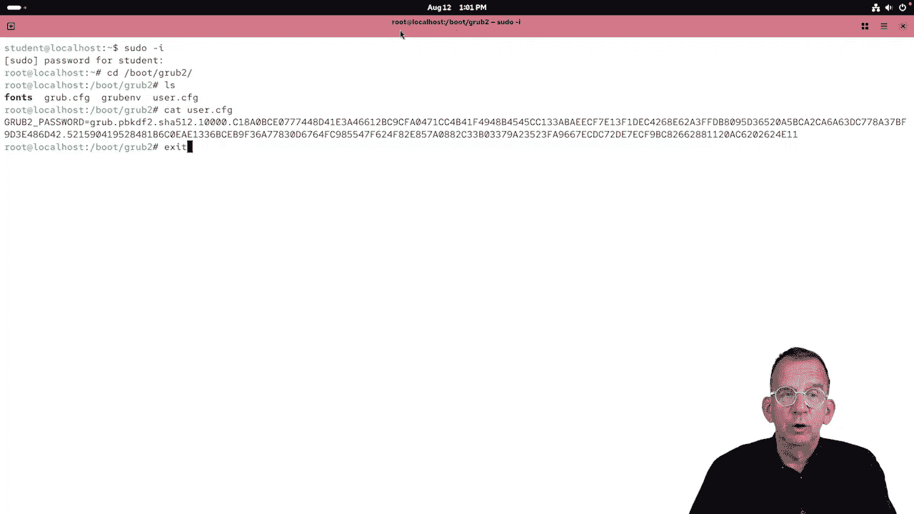

# CompTIA Linux+：141：管理引导加载程序密码 🔒

在本节课中，我们将一起学习如何为 Linux 系统的引导加载程序设置密码。引导加载程序是电脑开机时首先运行的程序，给它加上密码可以防止未经授权的人修改启动选项或直接进入系统。我们会分别看看 Red Hat 家族和 Ubuntu 家族的设置方法，还会通过一个实际演示来看看密码文件到底长什么样，让你对整个过程有个直观的认识。

## 引导加载程序密码的两种类型 🔑

在正式动手之前，我们先来搞清楚引导加载程序密码到底分哪两类，这样你之后配置的时候就不会混淆了。

在 Linux 系统中，引导加载程序密码主要分为两种。第一种是修改密码，也就是只有想改动启动配置时才需要输入；第二种是启动密码，也就是开机引导时就要验证身份。这两种密码的作用不同，但都能提升系统的安全性，防止别人随便动你的启动设置。

以下是常见的引导加载程序密码类型：

- 修改密码：只在更改引导配置时验证
- 启动密码：在系统启动引导阶段验证

## Red Hat 家族的设置方法 🎩

上一节我们介绍了密码的两种类型，本节中我们来看看 Red Hat 家族是怎么设置这些密码的。

如果你使用的是 Red Hat Enterprise Linux、CentOS 或者 Rocky Linux 这类系统，设置 GRUB2 引导加载程序密码非常简单，只需要一条命令。系统会自动帮你创建配置文件，并把用户名和密码存好，以后修改引导项的时候就会提示输入密码，不用你手动去编辑复杂的配置文件。

以下是 Red Hat 家族常用的命令：

```bash
grub2-setpassword
```

执行完这条命令之后，系统会在 `/boot/grub2/` 目录下生成一个名为 `user.cfg` 的文件。这个文件里面包含了引导加载程序的用户名和密码信息，是整个密码验证机制的核心，没有它密码就不会生效。

## Ubuntu 家族的设置方法 🐧

Red Hat 家族的方法我们已经看过了，本节中我们来看看 Ubuntu 这边又是怎么操作的。

Ubuntu 的设置步骤稍微复杂一点，不能直接用一条命令搞定。你需要先用一个专门的工具生成加密后的密码哈希值，然后手动把这个哈希值写入 GRUB 的配置目录，最后更新引导配置才能生效，整个流程比 Red Hat 多几个手动步骤。

以下是 Ubuntu 设置引导密码的大致步骤：

1. 使用 `grub-mkpasswd-pbkdf2` 生成哈希密码
2. 在 `/etc/grub.d/` 目录下创建 `00_header` 文件
3. 在文件中写入超级用户名和密码哈希
4. 运行 `update-grub` 更新配置

具体的配置文件内容大致长这样：

```
set superusers="student"
password_pbkdf2 student grub.pbkdf2.<你生成的哈希值>
```

这里的 `student` 只是示例用户名，你可以根据实际需要修改。生成的哈希值以 `grub.pbkdf2` 开头，需要完整复制到配置文件里，不能漏掉任何一个字符。

## 实际演示与背后原理 🔍


前面两节我们分别介绍了 Red Hat 和 Ubuntu 的设置方法，本节中我们来看一个实际演示，看看命令执行之后系统内部到底发生了什么，帮你把理论和实践联系起来。


在演示环境中，我们使用 CentOS 来展示。虽然 CompTIA Linux+ 考试同时涵盖 Ubuntu 和 Red Hat 家族，但教学重点会稍微偏向 Red Hat 这边，所以如果你准备考试，建议多花点时间熟悉 Red Hat 系的操作，这样更容易拿下相关知识点。

首先执行密码设置命令，系统会提示你输入一个足够安全的密码。输入完成之后，重启电脑，你会看到 GRUB 引导菜单。此时系统会要求你输入用户名和密码，正确输入之后才能进入引导界面。如果你不指定用户名，默认是针对 root 用户设置的，这一点在实际考试和工作中都很重要。

演示结束之后，我们回到根 shell，来看看 `/boot/grub2/` 目录下的情况。在这个目录里，你可以找到 `user.cfg` 文件，这个文件就是引导密码生效的关键所在。默认情况下，这个文件里的密码是针对 root 用户配置的，这就是引导加载程序密码的工作原理，简单来说就是把凭据存在系统能读到的地方。

## 本节总结 📝



在本节课中，我们一起学习了如何管理 Linux 引导加载程序的密码。我们了解了修改密码和启动密码这两种类型，学习了 Red Hat 家族使用 `grub2-setpassword` 命令设置密码的方法，也看到了 Ubuntu 需要通过 `grub-mkpasswd-pbkdf2` 生成哈希并手动编辑配置文件的步骤。最后通过实际演示，确认了 `/boot/grub2/user.cfg` 文件的作用。希望这些内容能帮助你更好地保护系统的启动安全。
