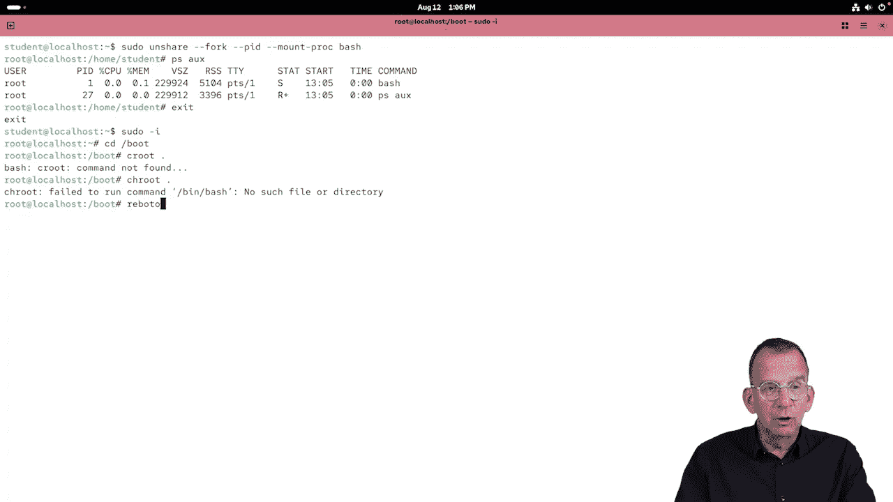

# CompTIA Linux+ V8：142：理解和管理 chroot 监狱 🚪

在本节课中，我们将一起学习什么是 chroot 监狱，以及如何在 Linux 系统中搭建和使用它。你还会了解到现代 Linux 如何把隔离能力扩展到命名空间，并且看到几个实际操作示例，帮助你理解这些技术在故障排除和容器场景中的作用。无论你是刚接触 Linux 的新手，还是正在准备相关认证考试，掌握 chroot 都能让你对系统安全有更直观的认识。

chroot 是什么

chroot 的全称是 change root，它的核心作用是把当前进程的根目录切换到一个指定的目录。简单来说，chroot 创建了一个与宿主系统隔离的环境，在这个环境里，用户和进程只能看到被限定的那部分文件和资源，无法访问操作系统其他部分。这样的设计通常用于运行需要额外安全防护的特定进程，避免进程一旦被攻破就能接触到整个系统。

从原理上看，你可以把 chroot 理解为下面这个公式：

```
chroot 环境 = 新根目录 + 必要的 Shell + 二进制文件 + 依赖库
```

要正确使用 chroot，不能只把程序文件放进去，还需要让运行该进程的用户能够访问所有相关的文件和进程。也就是说，除了可执行文件本身，你还需要放入相关的配置文件、依赖库以及必要的运行环境。


在 chroot 环境中需要包含的内容

如果你想在 chroot 监狱里运行某个程序，这个环境本身必须包含一些基础组件。具体来说，你需要提供 shell、常用的二进制文件，例如 less，以及这些二进制文件所依赖的动态链接库。不同的进程需要的文件不同，因此没有一个固定的清单适用于所有场景。

现代 Linux 中，chroot 的隔离理念进一步演进成了命名空间（namespaces）。命名空间在容器环境中非常重要，它让多个容器可以共享同一个内核，却互不干扰。


Linux 命名空间的类型

Linux 内核使用命名空间在不同层级上实现资源隔离。常见的命名空间包括网络命名空间、挂载命名空间、进程命名空间和用户命名空间。

以下是主要的命名空间类型：

- 网络命名空间：隔离网络接口、路由表和防火墙规则。
- 挂载命名空间：隔离文件系统挂载点，每个命名空间只看到自己的挂载。
- 进程命名空间：隔离进程 ID 视图，每个命名空间只看到自己的进程表。
- 用户命名空间：隔离用户和组 ID，让进程在自己的命名空间里拥有独立的用户身份。

当你进入一个命名空间后，会产生一种错觉，觉得自己是系统中唯一的存在。你只能看到自己的网络、自己的挂载点、自己的进程列表和自己的用户账户，看不到宿主系统中运行的其他内容。


命名空间在容器中的应用

容器技术大量使用命名空间来实现隔离。如果你想快速测试命名空间的效果，可以使用 unshare 命令。下面是一个示例，展示如何从非特权 shell 启动一个独立的命名空间：



```bash
unshare --pid --mount --fork proc
```

执行这条命令后，新的 shell 会脱离当前环境，变成该命名空间下的进程号 1。你也可以使用 ps aux 查看当前命名空间内的进程，会发现只有当前的 shell 在运行。此时，你启动的应用程序甚至看不到系统中运行的其他进程，这大大提升了安全性。使用 exit 命令可以退出这个命名空间，回到原来的环境。


chroot 的实际操作示例

接下来我们来看一个 chroot 的实际案例。首先进入 /boot 目录，尝试使用 chroot 命令。如果输入错误，系统会报错，提示找不到命令。这是因为在 chroot 环境中，你需要一个最小的系统环境，其中包含 bash、必要的库文件等，否则 chroot 后连基本命令都无法执行。

为了更直观地展示，我们可以重启系统，进入引导提示符，使用 rd.break 选项进入 initramfs 环境。initramfs 是一个存在于内存中的系统镜像，真实的系统根文件系统会挂载到某个特定目录下，例如 /sysroot。

先输入密码，然后使用 ls -a 命令查看根目录，可以看到 sysroot 环境。进入 /sysroot 目录后，你就能找到完整的磁盘根文件系统。此时尝试直接运行 chroot，可能会提示命令未找到，原因通常是路径没有加在 PATH 环境变量里。

正确的做法是使用完整路径，例如 /usr/sbin/chroot，或者从 /sysroot 目录出发，使用 /sysroot/usr/sbin/chroot。执行成功后，使用 pwd 命令查看当前位置，你会发现自己突然出现在文件系统的根目录下，尽管刚才还在 /sysroot 目录中。

使用 exit 退出 chroot 环境后，你会回到原来的目录。之所以要在 /sysroot 目录下使用 chroot，是为了方便故障排除，因为这样所有系统工具都位于正确的位置，可以直接用来修复损坏的系统。


本节课总结


本节课中，我们一起学习了 chroot 监狱的概念与作用，了解了在 chroot 环境中需要准备 shell、二进制文件和动态链接库，还介绍了 Linux 命名空间及其在容器中的应用，并通过 unshare 和 chroot 的实际命令演示了隔离环境的创建与使用。希望这些内容能帮助你更好地理解 Linux 的安全隔离机制。
