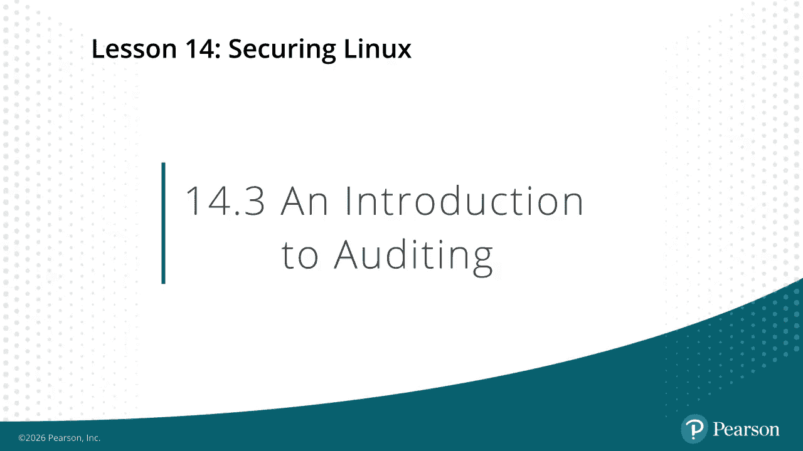
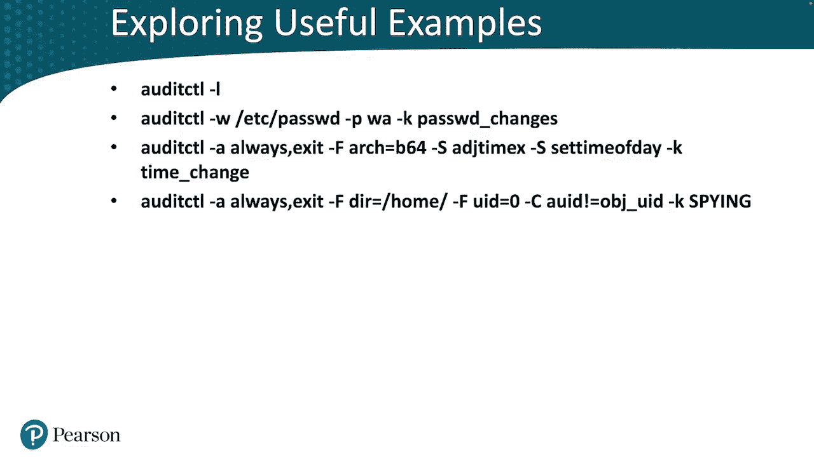
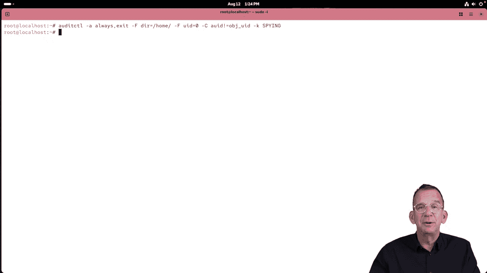

# CompTIA Linux+：14.3：审计简介 🔍




在本节课中，我们将一起学习 Linux 系统审计的基础知识。审计是系统安全中非常重要的一部分，它可以帮助管理员了解系统中到底发生了什么。我们会先讲解审计和日志的区别，然后介绍如何启用和配置审计服务，接着学习如何编写审计规则，最后通过几个实际案例演示如何查看和分析审计日志。无论你是准备考试还是想提升运维技能，掌握这些内容都会对你有很大帮助。


## 什么是审计 📋

在 Linux 系统中，日志（Logging）和审计（Auditing）是两个不同的概念。日志通常由各种服务生成，记录特定事件产生的消息，然后写入日志文件。审计则是一个更底层的系统功能，它直接在内核层面运行，能够对系统中发生的行为进行更深入、更详细的调查。

简单来说，日志告诉你“什么时候发生了什么”，而审计则更进一步，能够回答“谁在什么时候对哪个资源做了什么”这样的问题。如果你需要对系统安全进行详细追踪，审计就是你需要的工具。


## 审计服务与审计规则 ⚙️

有了基本概念之后，接下来我们看看如何让审计功能真正运行起来。要在系统上使用审计功能，首先需要确保审计守护进程正在运行。这个守护进程就是 auditd 服务。不过需要注意的是，这个服务在默认情况下并不一定会自动启动，因此你需要手动检查 systemd 中它的运行状态。

一旦 auditd 服务运行正常，你就可以使用 auditctl 命令来编写具体的审计规则。这些规则告诉系统，哪些事件应该被审计，哪些不需要关注。通过自定义规则，你可以决定想要审计什么内容，避免产生过多无用的日志。

以下是审计配置的基本流程：

- 检查 auditd 服务是否正在运行。
- 使用 auditctl 命令添加临时审计规则。
- 根据需要决定审计哪些事件。


## 可审计的内容 🔎

当审计服务正常运行后，你还需要明确审计的具体对象。在编写审计规则之前，你需要清楚自己想要审计什么。最简单的审计方式是基于文件权限进行监控。你可以审计读取、写入、执行以及属性变更这四种操作，系统会把所有相关行为都记录下来。

如果你需要进行更高级的审计，可以直接监控系统调用（System Calls）。使用 auditctl 命令时，搭配大写的 -S 选项即可指定要监控的系统调用。不过这里要注意，系统调用审计稍微复杂一些，因为你必须明确指定目标系统架构，否则规则可能不会生效。

以下是常见的可审计权限操作：

- 读取（Read）
- 写入（Write）
- 执行（Execute）
- 属性变更（Attribute Change）


## 审计密钥与用户身份 🆔

确定审计对象之后，还需要了解如何给审计记录打标签，以及搞清楚几种常见的用户 ID。在编写审计消息时，建议始终使用 -k 选项后面跟一个自定义的键（Key）。这个键是一个标识符，审计日志生成后，你可以通过这个键快速定位到底记录了什么内容，方便后续查找和分析。

在审计过程中，用户身份的概念比较容易混淆，因为 Linux 中有好几种不同的用户 ID，它们的作用略有不同：

- AUID（审计用户 ID）：记录用户最初登录时使用的用户 ID。无论你后来是否使用 su 或 sudo 切换身份，AUID 始终保留原始登录用户的 ID。
- EUID（有效用户 ID）：实际执行操作的用户 ID。如果你在 su shell 中，EUID 就是你切换到的目标用户。
- OUID（对象用户 ID）：目标进程使用的用户 ID，也就是被访问对象所属的用户 ID。
- RUID（真实用户 ID）：启动进程的用户真实 ID。


## 添加与持久化审计规则 📝

理解用户身份之后，我们就可以开始动手添加审计规则了。添加审计规则时，推荐使用 auditctl 命令。例如，下面这条命令会监控 /etc/motd 文件，记录对该文件的读取、写入、执行和属性变更操作，并打上 test_audit 标签：

```bash
auditctl -w /etc/motd -p rwxa -k test_audit
```

这里的 -w 表示监控指定文件，-p rwxa 表示关注读、写、执行和属性变更权限，-k test_audit 则给这次监控打上标签。

不过需要注意，使用 auditctl 添加的规则只在当前会话中有效，重启后会失效。如果你想让规则持久化生效，需要将规则写入 /etc/audit/rules.d/audit.rules 文件。写入时的命令格式和 auditctl 基本相同，只是不需要在前面加上 auditctl。

此外，为了增强安全性，你可以在规则文件末尾添加 -e 2 选项，使当前规则变为不可更改状态。审计是一项安全功能，启用不可更改模式后，即使入侵者获得了系统访问权限，也无法轻易关闭你的审计规则。


## 查看审计日志 🔍

规则添加好之后，重点就变成了如何查看和分析审计产生的日志。审计事件产生后，你可以直接阅读审计日志文件进行调查。虽然审计日志的可读性对初学者来说并不高，但只要多练习一下，就能快速上手。

如果你觉得直接阅读日志比较困难，可以使用 ausearch 等专用工具来查找特定事件。例如，下面这条命令会显示所有带有 admin_access 标签的事件：

```bash
ausearch -k admin_access
```



ausearch 其实可以理解为一种更专业的 grep 方式。如果你在所有 .log 文件中使用 grep 搜索 admin_access，能看到类似的结果，但 ausearch 在审计场景中被更频繁地使用。

以下是几个常用的 ausearch 示例：

- ausearch -m avc：显示所有标记为 AVC 的消息，这通常与 SELinux 相关。
- ausearch -m avc -ts today：只显示今天时间戳的 AVC 消息。
- ausearch -m avc -ts today -c crond -c httpd：进一步精细调整，只显示与 crond 和 httpd 服务相关的消息。


## 实际操作示例 💻

了解查看日志的方法后，下面我们通过几个实际案例来巩固知识。

首先，使用 auditctl -l 查看当前系统中已经加载的审计规则：

```bash
auditctl -l
```

接下来，我们给 /etc/passwd 文件添加一条监控规则，记录写入和属性变更操作，并使用 passwd_changes 作为关键字：

```bash
auditctl -w /etc/passwd -p wa -k passwd_changes
```

这里需要忽略关于旧式监控规则的提示，规则本身依然有效，这也是考试中需要知道的知识点。

然后，我们使用 useradd 命令创建一个名为 anna 的用户。完成之后，在 /var/log/audit/audit.log 文件中搜索 passwd_changes 关键字，就可以查看到相关的审计记录。

在日志输出中，我们会看到系统调用、架构、系统调用编号等信息。虽然系统调用编号本身不太重要，但其中的进程 ID（PID）可能很有价值。例如，我们可以看到 PID 4125，AUID 为 1000，UID 为 0。AUID 1000 表示原始用户是普通用户 1000，而 UID 0 说明操作是通过 sudo 或 su 类似方式在提权环境下执行的，这一点由 EUID 0 得到了确认。最终日志显示执行了 useradd 操作，并且关键字是 passwd_changes，说明确实有一个用户被添加了。

你可能会好奇这个操作具体发生在什么时候，时间信息就在日志中。不过审计日志中的时间格式不够直观，使用的是纪元时间戳。你可以使用 date 命令配合 @ 符号和纪元时间戳，将其转换为易读的时间格式，从而精确知道密码文件变更发生的时间：

```bash
date -d @<时间戳>
```

接下来是另一个例子，监控系统时间变更。使用 auditctl 监控 adjtimex 和 settimeofday 这两个系统调用，并打上 time_change 标签：

```bash
auditctl -a always,exit -S adjtimex -S settimeofday -k time_change
```

这里的 -a always,exit 表示在系统调用退出时始终执行审计，-S 选项指定要监控的系统调用。系统调用是底层的系统操作，一旦发生，就会记录带有 time_change 关键字的日志。你可以在 /var/log/audit/audit.log 中查看配置变更类型的记录。虽然这里不建议实际修改系统时间，因为时间同步服务正在使用，但如果你想测试，可以尝试将时间设置为 13:20，然后再次检查日志，记录迟早会出现。

最后，我们来看一个更有趣的示例，监控 /home 目录下的活动：

```bash
auditctl -a always,exit -F path=/home -F euid=0 -F obj_uid=... -k spying
```

这个规则的含义是：始终在系统调用退出时审计，过滤条件是路径为 /home，有效用户 ID 为 0。其目的是确保，如果任何人通过 su shell 访问的家目录与其原始用户对应的家目录不一致，就会产生日志记录。其中 AUID 是原始用户 ID，OUID 是被访问对象的用户 ID，通常就是用户的家目录所属者。


## 本节总结 ✅



通过上面的案例，你应该已经对审计的完整流程有了感性认识。本节课中，我们一起学习了 Linux 审计的基础概念。首先了解了审计与日志的区别，审计在内核层面工作，适合进行深入的安全调查。接着介绍了 auditd 服务和 auditctl 命令，学习了如何基于权限和系统调用编写审计规则，以及如何使用 -k 选项为日志添加标识符。我们还梳理了 AUID、EUID、OUID 和 RUID 等用户身份的区别，并掌握了将规则持久化到 /etc/audit/rules.d/audit.rules 以及使用 -e 2 设置不可更改模式的方法。最后，通过查看审计日志和使用 ausearch 工具，演示了如何分析实际审计事件。希望这些内容能帮助你更好地理解和使用 Linux 审计功能。

