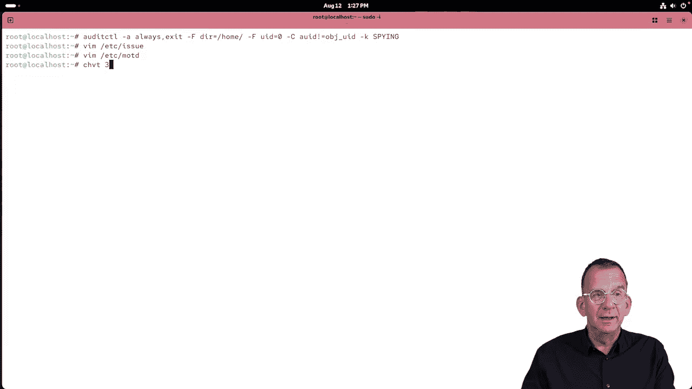
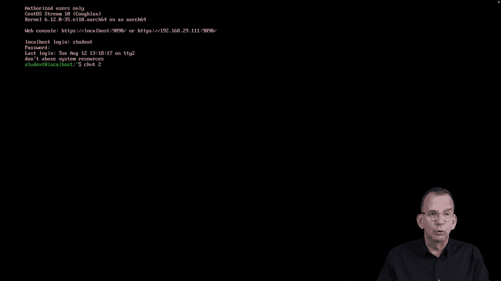

# CompTIA Linux+ V8：76：配置 MOTD 🖥️

在本节课中，我们将一起学习什么是 MOTD，以及如何在 Linux 系统中配置登录提示信息。你将了解到系统管理员为什么要在用户登录时显示合规性声明，还会看到两个常用配置文件的作用和区别。最后，我们会演示如何切换到虚拟终端来验证配置效果，并学习如何返回图形界面。

## 什么是 MOTD 📝

MOTD 是 Message of the Day 的缩写，对应的系统文件是 `/etc/motd`。这个文件的作用是在用户登录系统时，向用户展示一段固定的提示信息。

很多企业或机构对安全合规性有严格要求，必须在用户登录的一瞬间显示使用政策或免责声明。如果登录后才显示相关内容，可能无法有效约束用户行为，甚至导致安全违规无法追责。

配置方法非常简单，只需要在 `/etc/motd` 文件中写入你想要展示的文字即可。系统会在每次非图形化登录时，自动把文件内容显示给用户。

## /etc/issue 文件的作用 ❓

除了 `/etc/motd`，Linux 系统中还有一个常用的配置文件，叫做 `/etc/issue`。

这个文件的用途与 MOTD 类似，但显示时机不同。`/etc/issue` 的内容会在用户输入账号密码之前就显示出来，也就是在登录提示阶段就让用户看到相关声明。

以下是两个文件的主要区别：
- `/etc/motd`：用户成功登录后显示
- `/etc/issue`：用户登录之前显示

## 使用 Vim 编辑 /etc/issue ✏️

接下来我们来看实际操作，使用 Vim 编辑器打开 `/etc/issue` 文件。

默认情况下，这个文件里已经包含一些系统信息，比如内核版本或主机名之类的内容。我们可以在文件中追加一行自定义文字，例如 `authorized users only`，意思是仅允许授权用户使用。

## 配置 /etc/motd 合规性消息 ⚠️

编辑完 `/etc/issue` 之后，我们再处理 `/etc/motd` 文件。

在这里你可以放置任何希望用户登录后看到的合规性信息。比如管理员可以写入 `don't abuse system resources`，提醒用户不要滥用系统资源。你写什么内容完全取决于本机构的安全政策要求。

## 切换虚拟终端查看效果 🔄

为了验证配置是否生效，我们需要切换到虚拟终端，而不是直接在图形界面下操作。

使用 `chvt 3` 命令可以跳转到虚拟终端 3。切换过去之后，你会在屏幕最上方看到我们刚才写入的 `authorized users only`。接着用当前用户登录，登录后就会看到 `/etc/motd` 中的内容，比如 `don't abuse system resources`。

## 返回图形界面 🖥️

验证完成后，如果你想回到图形界面，在 CentOS 系统中图形界面通常运行在虚拟终端 2 上。

执行 `chvt 2` 命令即可切换回来。`chvt` 命令的作用就是切换虚拟终端，数字代表目标终端的编号。

## 本节总结 📚

本节课中，我们一起学习了 MOTD 的基本概念，了解了 `/etc/motd` 和 `/etc/issue` 两个文件的区别和作用，学习了使用 Vim 编辑配置文件，掌握了使用 `chvt` 命令切换虚拟终端来查看登录提示信息，也知道了如何返回图形界面。希望这些内容能帮助你更好地管理 Linux 系统的登录安全提示。

