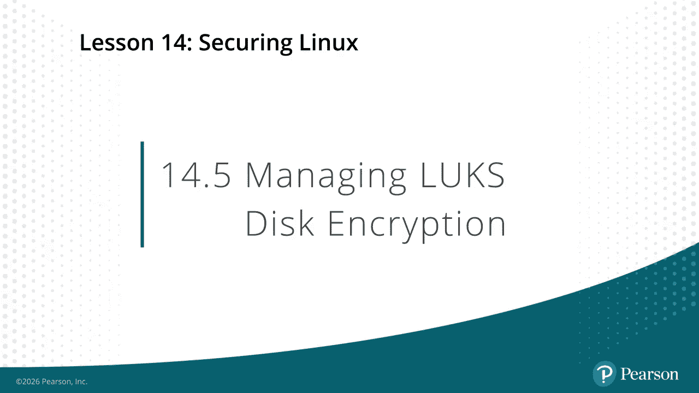
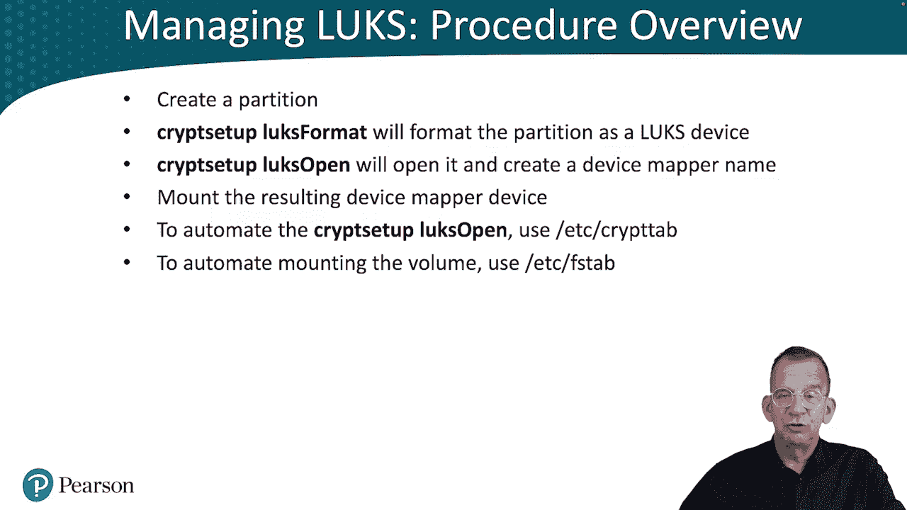
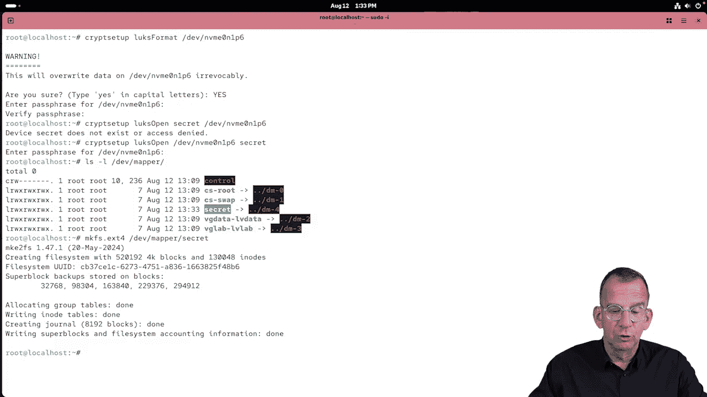

# 🔐 CompTIA Linux+ V8：14：LUKS 磁盘加密管理


在本节课中我们将要学习 LUKS 磁盘加密的基本概念，了解它到底是用来干什么的，以及如何一步步创建和打开一个加密分区。我们还会进行实际的命令行演示，把每一个步骤都讲清楚，让没有基础的初学者也能听得懂。



---

## 什么是 LUKS 磁盘加密

LUKS 是 Linux 系统中用于磁盘加密的标准方案。我们可以用下面这个公式来概括它的核心思想：

```text
LUKS 加密 = 磁盘分区 + 密码保护 + 加密数据存储
```

LUKS 的作用非常简单直接。如果你的笔记本电脑不小心被别人捡到了，而对方又不知道你的登录密码，那么他即使把你的笔记本电脑连接到自己的电脑上，也没法直接读取磁盘里的所有文件。加密分区就像是一个上了锁的保险柜，没有正确的密码，里面的数据对任何人都是不可见的。这就是 LUKS 磁盘加密存在的主要目的。

以下是 LUKS 磁盘加密的主要作用：
- 防止未授权人员通过物理途径读取磁盘数据
- 保护笔记本电脑丢失或被盗时的敏感信息
- 在分区级别提供透明的加密保护

---

## 创建 LUKS 加密分区的基本流程

上一节我们介绍了 LUKS 加密的目的和作用，本节中我们来看看如何实际创建一个加密分区。整个过程分为几个固定步骤，每一步都不能跳过，缺一不可。

你需要先准备一个空闲的磁盘分区，然后用加密工具对其进行格式化，接着打开它并生成设备映射名称，最后才能挂载使用。具体流程如下：

1. 使用分区工具创建新分区。
2. 运行 `cryptsetup luksFormat` 将分区格式化为 LUKS 设备。
3. 运行 `cryptsetup luksOpen` 打开设备并创建设备映射名称。
4. 挂载生成的设备映射名称，就可以正常使用了。

这个流程就像先盖房子，再装门锁，最后拿钥匙打开门住进去，每一环都很重要。

---

## 手动打开加密设备而不使用 /etc/crypttab

如果你希望自动化 `cryptsetup luksOpen` 的过程，可以在 `/etc/crypttab` 中指定相关参数，这样系统启动时会自动处理打开操作。不过如果不配置 `/etc/crypttab`，你就需要手动执行 `cryptsetup luksOpen`。

本节课中我会演示手动操作，因为如果配置了 `/etc/crypttab`，系统启动时会提示输入 LUKS 密码。除非你要设置 LUKS 认证服务器，但那已经超出了 Linux+ 认证的范围。我不想在每次开机都手动输入密码，所以这里选择不使用 `/etc/crypttab`。

以下是手动打开加密设备的关键命令：



```bash
cryptsetup luksOpen /dev/nvme0n1p6 secret
```

这条命令的意思是：打开 `/dev/nvme0n1p6` 这个 LUKS 分区，并将其映射名称为 `secret`。执行之后你需要输入之前设置的密码，密码正确后设备就会出现在 `/dev/mapper` 目录下，供系统使用。

---

## 实际演示：创建分区和格式化加密层

现在我们进入实际操作环节。首先需要一个新的分区，我打算使用 `lsblk` 查看当前磁盘情况。我在 `nvme0n1` 上发现还有逻辑分区空间，其中分区2是扩展分区，大小只有 1K，这是扩展分区的典型特征，里面目前只有 1GB 的可用空间。我决定使用 `fdisk` 对 `/dev/nvme0n1` 进行操作。

以下是创建分区的命令步骤：

```bash
fdisk /dev/nvme0n1
```

在 `fdisk` 交互界面中，我使用 `n` 创建一个新的逻辑分区，大小设为 2GB，然后使用 `w` 保存退出。完成后系统会出现一个新的分区设备 `/dev/nvme0n1p6`。

接下来我要在这个分区上创建加密层，使用 `cryptsetup luksFormat` 命令：

```bash
cryptsetup luksFormat /dev/nvme0n1p6
```

系统会询问你是否确定要执行此操作，确认之后需要输入一段密码。这个密码必须足够安全，否则会收到错误提示并要求重新输入。不要使用 `password` 这种过于简单或明显的密码。一旦格式化完成，加密层就已经建立好了。

---

## 打开设备并创建文件系统

加密层格式化完成后，下一步是打开这个设备。使用 `cryptsetup luksOpen` 命令，并为设备指定一个映射名称，这里我创建名为 `secret` 的设备：

```bash
cryptsetup luksOpen /dev/nvme0n1p6 secret
```

输入正确的密码后，设备就会被打开。你可以在 `/dev/mapper` 目录下看到新出现的设备文件：

```text
/dev/mapper/secret
```

这就是你的 LUKS 设备，接下来可以在它上面创建文件系统。我使用 `mkfs.ext4` 命令来格式化这个映射设备：

```bash
mkfs.ext4 /dev/mapper/secret
```

关于是否要把这个设备写入 `/etc/fstab`，有两种选择。如果你写入 `/etc/fstab`，通常也需要配合 `/etc/crypttab` 使用；但我不打算这么做，因为我不想在每次开机时都输入一次密码。因此我只创建文件系统，不配置自动挂载相关的引导项。

---

## 总结



本节课中我们一起学习了 LUKS 磁盘加密的基本用途，了解了创建加密分区的标准流程，并实际演示了使用 `fdisk` 创建分区、用 `cryptsetup luksFormat` 格式化加密层、用 `cryptsetup luksOpen` 打开设备，最后用 `mkfs.ext4` 创建文件系统的完整过程。我们也讨论了为什么在此演示中不使用 `/etc/crypttab`，以避免在每次开机时手动输入密码。希望这些内容能帮助你初步掌握 Linux 磁盘加密的核心操作。

