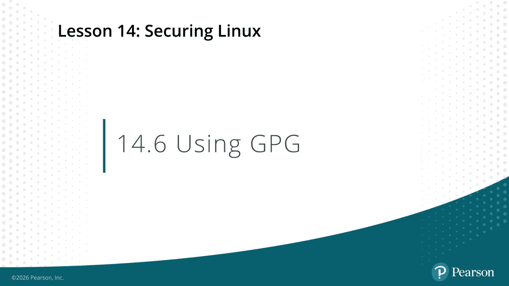
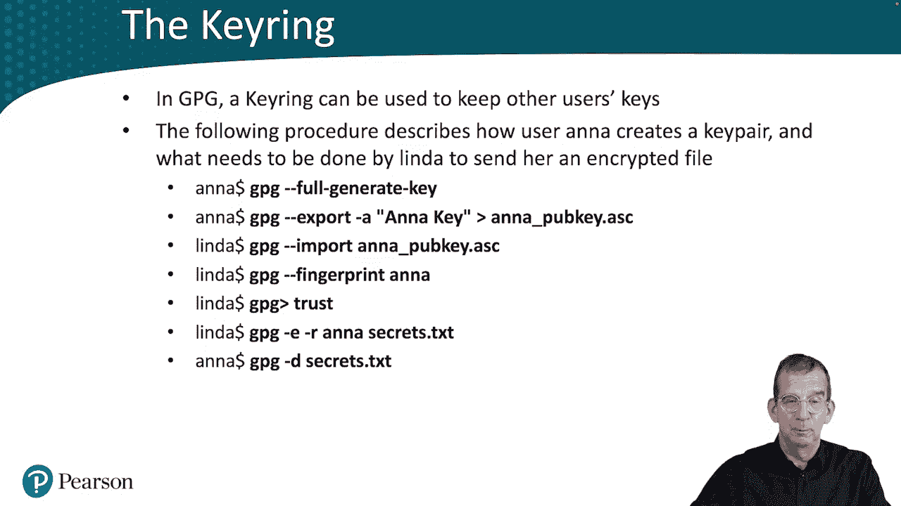
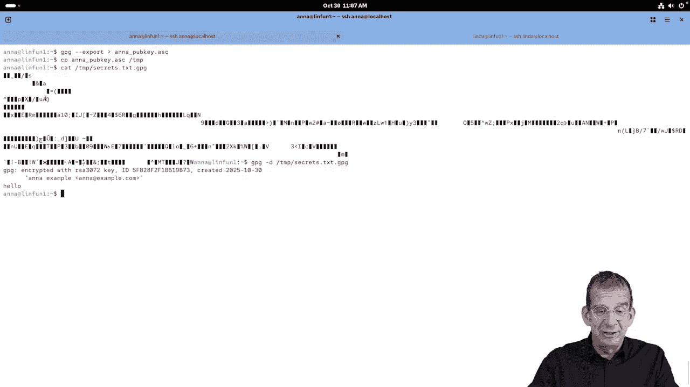
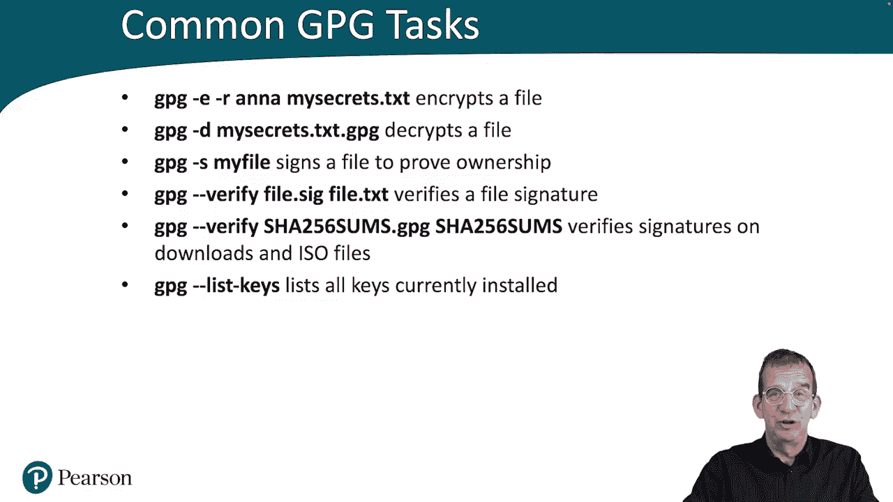

# CompTIA Linux+ V8：378.146：使用 GPG 🔐

在本节课中，我们将要学习 GPG 是什么，以及如何在 Linux 系统中使用它来进行文件加密、数字签名和签名验证。GPG 是一个非常实用的工具，即使你是初学者，也能通过这节课快速上手。我们会从 GPG 的基本概念讲起，然后逐步演示如何生成密钥对、如何交换公钥，最后演示如何加密和解密文件。整个过程不需要复杂的背景知识，跟着操作即可。

## 什么是 GPG 🔑

GPG 的全称是 Good Privacy Guard，也就是良好隐私保护工具。它是一款用于加密、签名和验证的软件工具，其底层基于公钥密码学技术。你在日常生活中接触到的 TLS 加密，其实也使用了类似的公钥密码学思想，所以 GPG 的工作原理与你可能已知的网络安全技术有相通之处。了解 GPG 之后，你可以在 Linux 命令行中直接保护敏感文件，防止未授权的人员查看内容。

上一节我们没有聊过加密工具，本节中我们来看看 GPG 是如何保护数据隐私的。

## 密钥对的基本概念 🔐

在 GPG 中，每个用户都拥有一对密钥，这对密钥可以用于不同的用途。公式化地表示，一个用户的身份可以表述为：

```text
用户身份 = 私钥 + 公钥
```

这里的私钥由用户自己保管，它是绝对的秘密，绝对不能分享给其他人。公钥则是用来分享给其他用户的，其他人可以用你的公钥来给你发送加密信息，或者验证你的签名。私钥和公钥是成对生成的，数学上相互关联，但从公钥推导出私钥在计算上是不可行的。

GPG 的工作机制依赖于密钥环（keyring），密钥环就是用来保存其他用户公钥的地方。简单来说，你的密钥环里存放着你信任的联系人的公钥信息。当你需要给某人发送加密文件时，GPG 会从你的密钥环中查找对方的公钥来完成加密操作。

了解了密钥对的概念后，本节中我们来看看如何实际创建密钥对。



## 创建 GPG 密钥对 🛠️

以下是创建密钥对的操作步骤介绍。

首先，需要以普通用户身份登录系统，这里以用户 Anna 为例。使用 SSH 连接到本地主机，打开一个交互式登录 shell，而不是子 shell，这样可以确保命令能够正常运行。有些情况下直接使用子 shell 可能会导致环境变量或终端设置出现问题，所以登录 shell 是更稳妥的选择。然后执行以下命令来生成密钥对：

```bash
gpg --full-generate-key
```

运行命令后，系统会询问一系列配置问题，对于初学者来说，直接一直按回车键使用默认设置即可。这些默认设置对于日常使用已经足够安全，如果你希望提高安全性，可以查看每个选项的含义并自行调整。不必过度纠结每一个参数，先让密钥生成出来是最重要的。

接着，系统会要求输入真实姓名，例如 "Anna example"。这个真实姓名很重要，因为其他用户需要通过它来识别密钥的持有者是谁。随后可以跳过注释字段，直接确定。之后，系统会提示输入短语密码（passphrase）。这个短语密码是用来保护私钥使用权限的，必须设置得足够安全。如果第一次输入的密码太简单，系统会拒绝，需要重新输入一个更复杂的密码。设置完成后，按回车确认即可。

在输入完密码后，GPG 会开始生成随机数据，这个过程依赖于熵（entropy），熵是用于生成随机数据的基础。系统会收集鼠标移动、键盘敲击等系统事件产生的随机性，直到生成足够的随机数据为止。等待熵生成完成后，密钥对就创建好了，GPG 会在屏幕上显示密钥相关的信息。

完成密钥对创建之后，本节中我们来看看如何导出和导入公钥。

## 导出与导入公钥 📤📥

以下是导出和导入公钥的操作步骤。

Anna 创建好密钥对之后，需要把自己的公钥导出，以便分享给其他人。使用以下命令将公钥导出为 ASCII 格式文件：

```bash
gpg --export -a anna_key > anna_key.asc
```

这里的 `anna_key` 是用户 ID，`anna_key.asc` 是保存公钥的文件名。导出完成后，Anna 通常会通过电子邮件发送这个公钥文件，或者将其复制到共享目录，例如 /tmp 目录，以便用户 Linda 获取。公钥文件本身不包含敏感信息，即使被他人看到也不会影响安全性。

接下来，用户 Linda 需要将 Anna 的公钥导入到自己的密钥环中。使用以下命令：

```bash
gpg --import /tmp/anna_key.asc
```

导入成功后，可以使用以下命令查看密钥列表，确认 Anna 的密钥已经可用：

```bash
gpg -k
```

或者使用以下命令查看指定用户的密钥指纹：

```bash
gpg --fingerprint Anna
```

密钥指纹是一串用于唯一标识公钥的字符，可以帮助确认公钥没有被篡改。在实际使用中，建议通过多种渠道核对指纹，以防止中间人攻击。

公钥交换完成之后，本节中我们来看看如何使用这些密钥来加密和解密文件。

## 加密与解密文件 🔒🔓

以下是加密和解密文件的操作步骤。

首先，用户 Linda 创建一个需要保密的文件，例如：

```bash
echo hello great > secrets.txt
```

然后，Linda 使用 Anna 的公钥对这个文件进行加密：

```bash
gpg --encrypt --recipient Anna secrets.txt
```

此时系统可能会提示密钥尚未被信任，但这是一个独立的流程，Linda 可以暂时忽略并继续使用该密钥。加密完成后，会生成一个名为 `secrets.txt.gpg` 的加密文件，这个文件的内容是不可读的，即使被截获也没有意义。

Linda 将这个加密文件复制到 /tmp 目录，以便 Anna 取用。Anna 使用 `cat` 命令查看该文件时，会看到一堆乱码，无法直接读取。这说明加密成功，文件内容已经被保护。

接着，Anna 使用解密命令来恢复原始文件：

```bash
gpg --decrypt secrets.txt.gpg
```

在解密过程中，Anna 需要输入之前设置的短语密码来授权使用私钥。输入正确后，Anna 就成功解密了 `secrets.txt` 文件，看到了原始内容。这就是 GPG 加密和解密文件的完整流程，发送方使用公钥加密，接收方使用私钥解密。

掌握了加密解密之后，本节中我们来看看 GPG 的其他常见操作。

## 常见 GPG 操作 📝

以下是几个常见的 GPG 命令用法介绍。

加密文件可以使用以下命令：

```bash
gpg -e -r 收件人ID mysecrets.txt
```

解密文件可以使用以下命令：

```bash
gpg -d 文件名.gpg
```

如果你想对文件进行数字签名，以证明文件的所有权或完整性，可以使用以下命令：

```bash
gpg -s 文件名
```

验证文件签名可以使用以下命令：

```bash
gpg --verify 文件名.sig
```

在验证 ISO 镜像或软件下载文件时，通常会配合 SHA256 校验和文件使用，命令形式如下：

```bash
gpg --verify sha256sums.gpg sha256sums
```

列出当前密钥环中所有公钥，可以使用以下命令：



```bash
gpg --list-keys
```

或者简写为：

```bash
gpg -k
```

这些命令覆盖了 GPG 最常见的日常使用场景，掌握它们后你就可以基本处理文件加密和签名验证的需求了。

## 总结



本节课中，我们一起学习了 GPG 是什么，掌握了公钥和私钥的基本概念，了解了如何生成密钥对、导出和导入公钥，以及如何使用 GPG 加密和解密文件。此外，我们还学习了数字签名、签名验证和列出密钥等常见操作。希望这些内容能帮助你初步掌握 GPG 的使用方法，并在实际工作中保护重要数据的安全。

