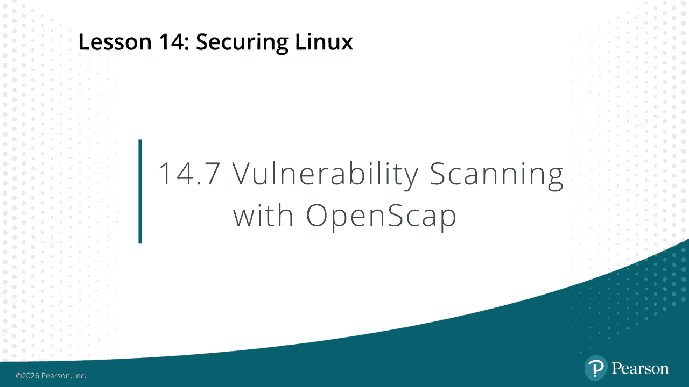
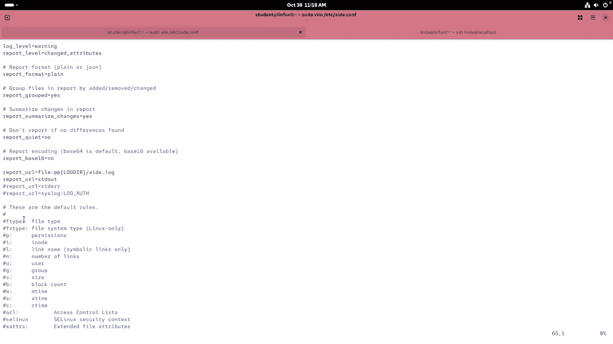
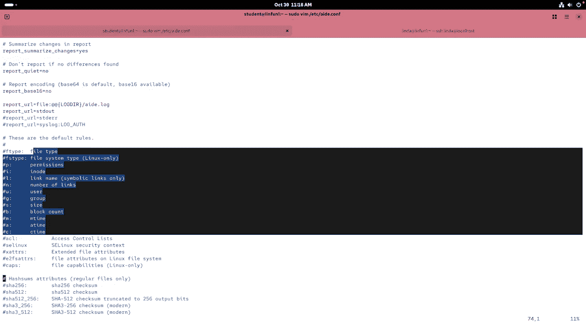
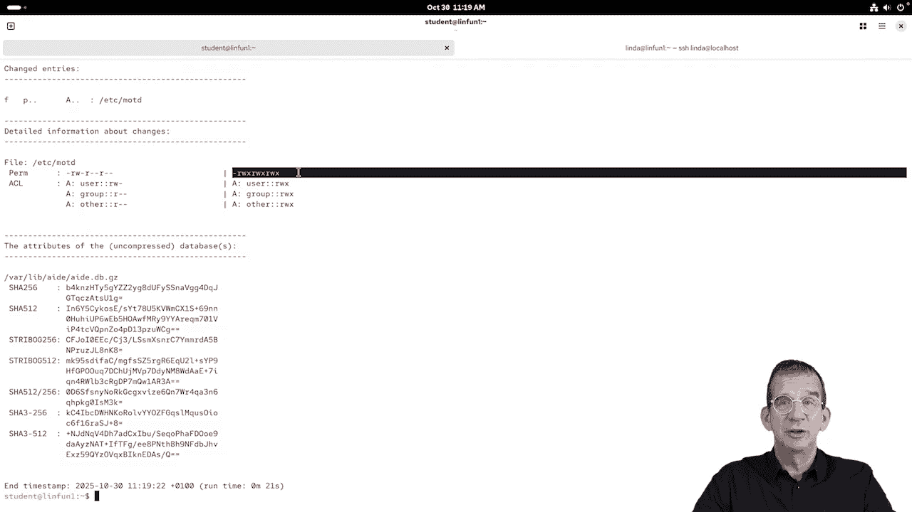

# CompTIA Linux+ V8：04：Linux 漏洞扫描与文件完整性检查 🔍



## 开篇概述

在本节课中我们将要学习 Linux 系统中的恶意软件检测与漏洞扫描。我们会先聊聊为什么 Linux 对病毒比较不敏感，接着了解 rootkit 是什么，最后重点学习如何用 AIDE 工具检测系统中意外的文件变化。无论你是刚接触 Linux 的新手，还是想准备 CompTIA Linux+ 考试的学员，这篇内容都会用大白话把原理讲清楚，让你在实践中掌握系统安全加固的基本思路。

## 一、为什么 Linux 不容易受到病毒感染

上一节我们可能介绍过 Linux 的基础用户权限概念，本节中我们来看看这些权限在实际安全防护中是如何发挥作用的。

Linux 操作系统的设计本身就让病毒很难大规模传播。这并不是因为 Linux 有什么神秘的杀毒软件，而是因为系统架构从根本上限制了恶意程序的行动空间。简单来说，病毒想在 Linux 上搞破坏，要跨过很多天然屏障。

以下是导致 Linux 对病毒不敏感的几个关键机制：

- **用户与 root 账户严格分离**：普通用户默认没有修改系统核心文件的权限，病毒即使进入系统，也很难获得 root 权限去破坏操作系统。
- **进程默认权限受限**：大多数程序运行时使用的是有限权限，潜在病毒对系统的访问范围因此被大幅限制。
- **文件所有权与权限严格**：不是所有用户都可以随意修改系统文件，病毒想要篡改操作系统上的文件几乎不可能。
- **开源代码“众目睽睽”效应**：Linux 的源代码是公开的，任何人都可以阅读代码，任何人都能发现源代码中是否存在根本性问题。想要在你运行的程序中偷偷植入病毒，在 Linux 上基本行不通。
- **软件包来自可信仓库**：你的发行版自带软件仓库，仓库使用 GPG 密钥进行签名。如果有人伪装成你的仓库，通常无法通过 GPG 密钥检查。

所有这些机制共同作用，让 Linux 成为一个相对可靠的平台。

## 二、零日漏洞与 rootkit 威胁

不过，没有任何系统是绝对安全的。零日漏洞依然可能存在，它们可能会让应用程序或 Linux 本身变得脆弱。这就是为什么我们需要定期检查系统是否出现异常，不能仅仅因为 Linux 比较安全就放松警惕。

在 Linux 中，你可能会遇到我们所谓的 rootkit。rootkit 的作用是为应用程序提供后门，允许 root 用户偷偷访问系统，攻击者可以借此长期潜伏而不被发现。为了扫描 rootkit，通常可以使用以下程序：

以下是常用的 rootkit 检测工具：

- RK Hunter
- chkrootkit

如果你想检测文件的意外变化，可以使用 AIDE 工具。AIDE 是一个常用的实用工具，它的核心工作流程可以用这个简单的逻辑来描述：

```
AIDE 工作流：
1. 生成当前文件系统的数据库快照（基准线）
2. 将数据库移动到安全位置
3. 定期对比当前文件系统与数据库快照
4. 如果发现差异，报告文件变更
```

用公式表达就是：`当前文件状态 ≠ 数据库快照`，就意味着可能发生了未授权的修改。

## 三、AIDE 的安装与初始化

有了理论基础后，我们现在进入实际操作环节。AIDE 在大多数系统中默认没有安装，所以我们需要先手动安装它，并生成第一个系统文件快照。

以下是安装和初始化 AIDE 的步骤：

1. 使用包管理器安装 AIDE：
   ```bash
   sudo dnf install -y aide
   ```
   安装包很小，完成速度很快，通常几秒钟就能搞定。

2. 初始化 AIDE 数据库：
   ```bash
   sudo aide --init
   ```
   这条命令会扫描你的文件系统，根据文件系统的大小，可能需要一点时间才能完成。它会把当前所有重要文件的状态记录下来。

3. 初始化完成后，会生成一个新的数据库文件，路径通常是 `/var/lib/aide/aide.db.new.gz`。你需要把这个文件移动到指定位置，作为后续对比的基准线（蓝图）：
   ```bash
   sudo mv /var/lib/aide/aide.db.new.gz /var/lib/aide/aide.db.gz
   ```
   这个文件就是你的“蓝图”，后续所有的检查都会以它为参照，任何偏离这个蓝图的变化都会被记录。

## 四、使用 AIDE 检测文件变化

基准线建立好之后，我们就可以开始检查系统中是否有文件发生了意外变化。AIDE 的核心价值就在于此：它能告诉你系统里哪些文件被动过手脚。

以下是检测文件变化的核心命令：

```bash
sudo aide --check
```

这条命令会将当前的文件系统状态，与之前生成的数据库进行对比。如果发现任何差异，AIDE 会在报告中列出变更项。

为了演示检测效果，我们可以刻意做一些改动。比如修改 `/etc/motd` 文件的权限：

```bash
sudo chmod 777 /etc/motd
```

虽然 `/etc/motd` 是一个没人特别在意的文件，但我们可以用它来验证 AIDE 是否能发现变化。修改完成后，再次运行检查命令：



```bash
sudo aide --check
```



此时查看生成的报告，你会看到一条“changed”条目。报告的左侧显示的是之前记录的状态，右侧显示的是被修改后的文件状态。通过这种方式，AIDE 就能非常方便地帮助你检测系统中的意外文件变化。

AIDE 的详细检查规则定义在配置文件中，通常位于 `/etc/aide.conf`。这个配置文件告诉系统到底要检查什么，也可以用来排除不需要监控的文件。如果你不仅想知道文件发生了变化，还想查明是谁或什么触发了变化，那么还需要创建审计监视规则，这个内容会在课程的其他部分详细讨论。

## 五、总结



本节课中我们一起学习了 Linux 为什么相对不容易受到病毒感染，了解了 rootkit 的威胁以及常用的检测工具。重点掌握了如何安装、初始化和使用 AIDE 工具来检测系统中的意外文件变化，包括生成数据库基准线、运行检查命令、查看变更报告，以及理解配置文件 `/etc/aide.conf` 的作用。希望这些内容能帮助你更好地保障 Linux 系统的安全，为后续的学习打下坚实基础。
