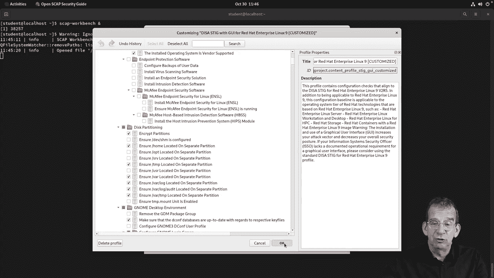
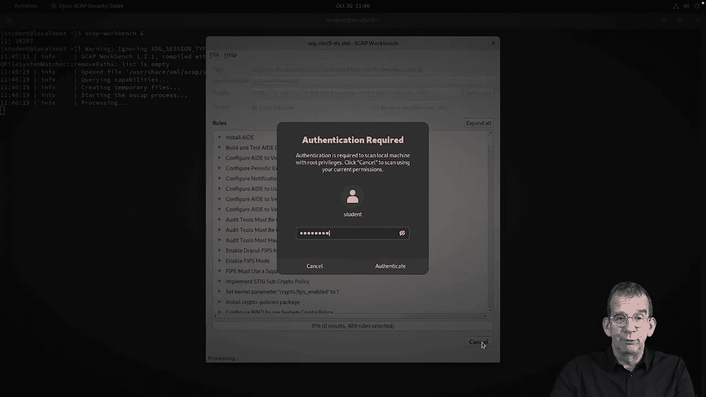
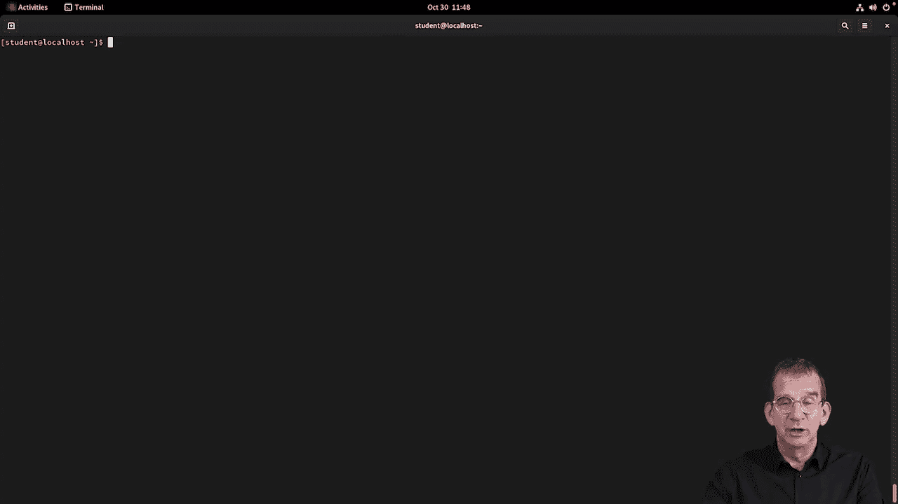

# CompTIA Linux+：14.8：OpenSCAP 漏洞扫描与合规修复 🛡️

在本节课中，我们将一起学习如何使用 OpenSCAP 工具对 Linux 系统进行漏洞扫描和安全合规检查。OpenSCAP 是一个能够把系统和安全基线进行对比的漏洞扫描工具，它能告诉你系统哪些地方不符合安全标准，并且还能生成修复脚本帮助你把问题解决掉。无论你是刚接触 Linux 安全的新手，还是想要了解如何给服务器做体检的学习者，这节课都会用简单的方式把整个流程讲清楚，让你学会在自己的机器上运行扫描、查看报告，并把系统调整到合规状态。


## 什么是 OpenSCAP 🔍

OpenSCAP 是一款开源的安全合规扫描工具。它的核心思想很简单，就是拿你的系统当前配置和预先定义的安全基线做对比，找出不符合的地方。你可以把它理解为一台“安全体检机”，体检完成后它会给出一份报告，告诉你哪些项目通过了，哪些项目失败了，甚至还能直接给你写好修复方案。

以下是 OpenSCAP 工作的基本逻辑：

```text
扫描结果 = 系统当前配置 对比 安全基线
```


如果扫描结果显示不合规，OpenSCAP 还能生成 Shell 脚本、Ansible Playbook 或 Puppet 清单，帮你自动完成修复操作。这样一来，你不需要手动去一个个改配置文件，而是直接运行生成的脚本，把系统拉回安全标准。


## 在 RHEL 9 上安装 OpenSCAP 工作台 📦

在 Red Hat Enterprise Linux 9 系统中，官方已经把图形界面版本的 OpenSCAP 工具从默认安装列表里移除了，因为 Red Hat 希望你使用不同的工具。不过在 RHEL 9 上依然可以手动安装，其中最方便的就是 scap-workbench 图形界面工具。

以下是安装所需的命令和步骤：

```bash
sudo dnf install scap-workbench
```

安装过程中，系统会自动把相关的依赖包一起装好，其中包括 SCAP 安全指南。这个安全指南里包含了一些外部的安全配置文件，你安装完之后就可以直接拿来扫描自己的系统，不需要自己从头写规则。


## 加载安全内容与选择配置文件 📄

安装完成之后，我们需要启动 scap-workbench 工具，开始准备扫描内容。

以下是启动和加载内容的操作：

```bash
scap-workbench
```

打开工具后，它会提示你加载内容。因为我们是在 RHEL 9 上操作，所以选择 RHEL 9 对应的内容源。加载完成后，你会看到一系列可用的安全配置文件，这些配置文件里面包含了大量不同的安全规则。

以下是常见的配置文件选择建议：

- 对于 Red Hat Enterprise Linux 系统，优先选择专门针对该发行版的基准配置文件。
- 如果你不确定用哪个，可以先使用默认配置文件，扫描完成后再根据报告决定是否需要自定义。
- 在自定义界面里，你会看到一个完整的选项树，可以开启或关闭具体的检查项，但初学者建议先用默认设置。

选好配置文件之后，系统就会列出所有需要检查的规则，整个扫描的目的就是看你的系统是否符合这些规则。


## 执行系统扫描 🕒

有了配置文件之后，下一步就是开始扫描了。扫描需要管理员权限，因为工具要读取系统的一些敏感配置信息。



以下是扫描时需要注意的点：

- 开始扫描前，系统会提示你输入 sudo 密码，确认管理员身份。
- 扫描过程会对当前系统进行全面检查，生成合规性报告。
- 根据系统大小和规则数量，扫描可能需要几分钟才能完成，请耐心等待。

扫描完成后，你就可以查看每一条规则的通过或失败情况，并查看具体的描述信息，了解系统在哪些地方没有达到安全基线的要求。




## 查看扫描结果与规则 📊

扫描结束后，报告里会显示所有检查项的状态。你可以点开任意一条规则，查看详细描述，知道具体检查了什么，以及当前系统为什么不合规。

OpenSCAP 的一个很好用的功能是生成修复规则。它可以把修复方案生成成 Shell 脚本、Ansible Playbook 或 Puppet 清单，你可以根据自己的运维习惯选择一种形式。

以下是可选的修复输出格式：

```text
Shell 脚本
Ansible Playbook
Puppet 清单
```

假设你选择 Shell 脚本，系统就会生成一个类似 remediation.sh 的文件，里面包含了把系统调整到合规状态所需的命令。查看完报告之后，你可以关闭工具的主窗口，准备运行生成的修复脚本。


## 生成并应用修复脚本 🛠️

拿到修复脚本之后，最后一步就是把它运行起来，让系统重新符合安全基线。

以下是应用修复的通用流程：

1. 检查生成的脚本内容，确认里面的操作是符合你预期的。
2. 使用管理员权限运行脚本，或者部署 Ansible Playbook / Puppet 清单。
3. 运行完成后，再次运行 OpenSCAP 扫描，确认所有规则都已通过。

通过这个流程，你就完成了从“发现安全问题”到“自动修复安全问题”的全过程，系统也就达到了合规状态。


## 本节课总结 📚



本节课中，我们一起学习了 OpenSCAP 漏洞扫描与合规修复的基本流程。我们了解了什么是 OpenSCAP，如何在 RHEL 9 上安装 scap-workbench，如何加载安全内容并选择合适的配置文件，如何执行系统扫描并查看报告，以及如何生成和应用修复脚本。希望这节课能帮你掌握使用 OpenSCAP 做系统安全体检的方法，让你的 Linux 系统更加安全可靠。
