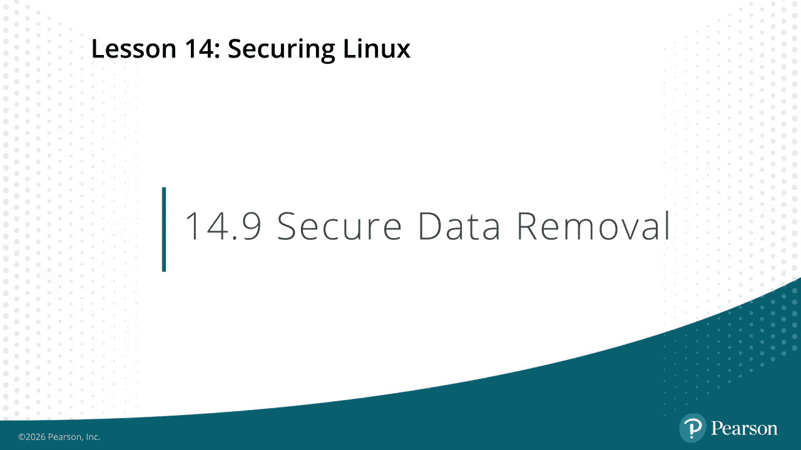
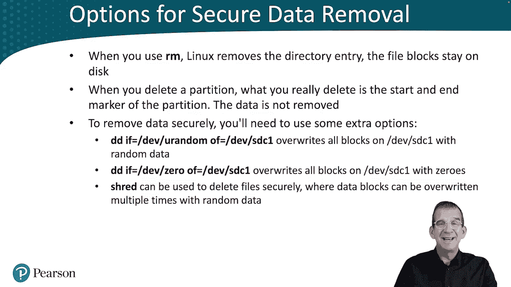

# CompTIA Linux+：04：安全数据删除 🔒




在本节课中我们将要学习安全数据删除的相关知识。当你在 Linux 系统里删除一个文件或者删除一个分区的时候，数据并不会立刻从硬盘上消失。本节课会告诉你删除操作到底发生了什么，以及如何使用正确的工具把数据彻底抹除，防止他人通过恢复工具找回敏感信息。我们会先分析普通删除的问题，然后介绍 DD 命令和 shred 命令的使用方法。


在日常使用 Linux 系统的时候，很多初学者会认为把文件扔进垃圾桶或者执行删除命令之后，文件就永远消失了。但实际上情况并非如此。以下是普通删除文件时系统内部发生的变化。

- 系统只会删除文件的目录项，也就是文件名和索引信息。
- 文件原本占用的磁盘块仍然保持原样，没有被擦除或修改。
- 只要使用合适的数据恢复工具，就可以扫描磁盘块并把文件内容找回来。

也就是说，删除文件只是把文件名从目录里去掉了，真正的数据内容还留在硬盘的某个位置上，直到新的数据覆盖那些磁盘块为止。如果你的电脑里存放过密码、身份证复印件或者公司机密文件，那么仅仅执行 rm 命令是不够的，必须采取更可靠的方法才能确保数据无法被恢复。


上一节我们介绍了删除文件后数据仍然保留在磁盘上的原因。本节中我们来看看删除分区时会发生什么情况。很多人误以为删除分区等同于格式化或者清空所有数据，事实并不是这样。

- 分区表只记录分区的起始标记和结束标记。
- 删除分区通常只是移除这两个标记，分区内部的实际数据块并不会被清除。
- 数据恢复工具仍然可以扫描整个磁盘，找到这些未被标记的数据块并把内容还原。

删除分区后，原本属于该分区的数据依然物理存在于磁盘介质中。除非你往这些区域写入新的数据，否则之前的文件、照片、文档都有可能被重新读取出来。因此，如果你打算出售旧硬盘或者处理废弃服务器，单纯删除分区并不能保证信息安全。


上一节我们分析了普通删除操作无法真正抹除数据的问题。本节中我们来看看如何使用 DD 实用工具来安全删除数据。DD 是 Linux 系统中一个非常强大的底层复制工具，它可以直接读写设备文件，从而实现对磁盘块的覆盖。

以下是使用 DD 安全删除数据的常见命令示例。

```bash
# 使用随机数据覆盖整个设备，这是更安全的选择
dd if=/dev/urandom of=/dev/s1

# 使用全零数据覆盖整个设备，速度稍快但安全性相对较低
dd if=/dev/zero of=/dev/s1
```

这里的 if 代表输入文件，of 代表输出文件。/dev/urandom 设备会不停地产生随机字符，/dev/zero 设备则不停地产生零字节。当你把 /dev/urandom 的输出写入到 /dev/s1 这样的块设备时，磁盘上的每一个区块都会被随机数据覆盖。这样一来，原来的文件内容就彻底消失了，没有任何恢复工具能够找回。

使用全零覆盖的方式虽然也能让大多数恢复工具失效，但在某些极端情况下，高端的数据恢复设备仍然有可能检测出之前的磁痕信息。因此，如果你希望达到最高安全等级，最好使用随机数据而不是全零数据来覆盖块设备或者具体的文件。随机数据覆盖虽然速度稍慢一些，但是安全性更高，能够确保没有人能够找回被删除的内容。


上一节我们介绍了如何手动使用 DD 命令进行安全删除。本节中我们来看看 shred 实用工具，它可以帮助你更方便地安全删除文件。shred 命令实际上是在自动化完成 DD 从 /dev/urandom 读取随机数据并覆盖数据块的工作，所以使用它可以节省手动输入命令的时间。

以下是使用 shred 安全删除文件的典型用法。

```bash
# 对指定文件进行多次随机数据覆盖，然后删除文件
shred -u 文件名
```

shred 默认会多次用随机数据覆盖目标文件占用的数据块，覆盖完成之后再删除文件本身。这意味着即使有人尝试用恢复软件扫描磁盘，也只会读到随机的噪声数据，而无法还原出原始内容。相比于手动编写 DD 命令，shred 的操作更加简单，而且它会自动处理覆盖次数和文件删除步骤，非常适合需要快速安全删除单个文件的场景。

在实际工作中，如果你只需要删除几个敏感文件，直接使用 shred 即可；如果你需要清空整块硬盘或者整个分区，那么使用 DD 配合 /dev/urandom 会更合适。无论选择哪种方式，核心思想都是一样的：用新的无意义数据把原来的数据块彻底覆盖，从根本上杜绝数据泄露的风险。




本节课中我们一起学习了安全数据删除的原理和方法。我们了解到，普通删除文件只会移除目录项，数据块仍然留在磁盘上；删除分区也只会去掉起始和结束标记，分区内的数据不会被真正擦除。为了彻底防止数据被恢复，可以使用 DD 工具配合 /dev/urandom 或 /dev/zero 来覆盖块设备，也可以使用 shred 工具来自动完成多次随机覆盖并删除文件。掌握这些方法后，你就可以在处理旧硬盘或删除敏感文件时，确保信息不会被不法分子找回。
