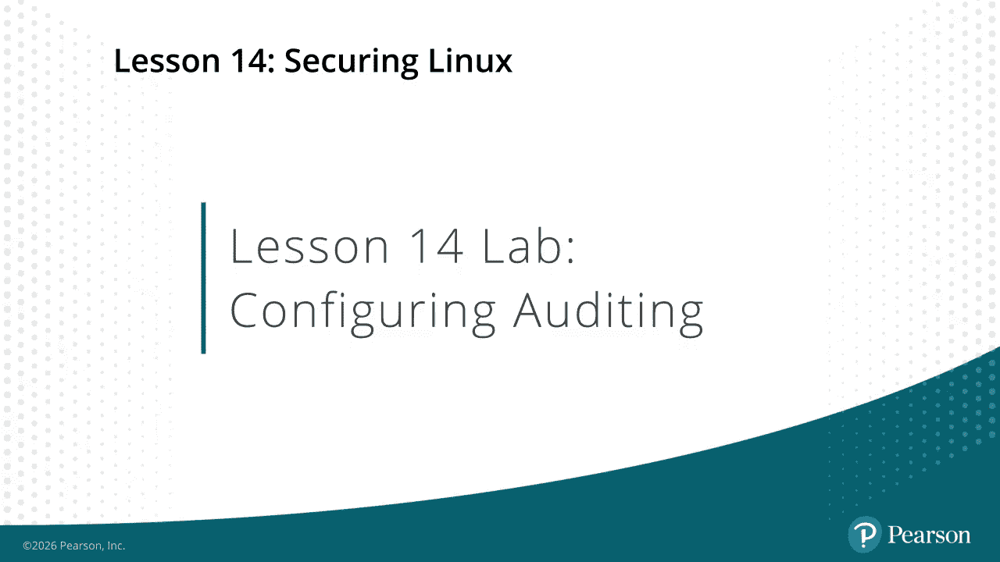
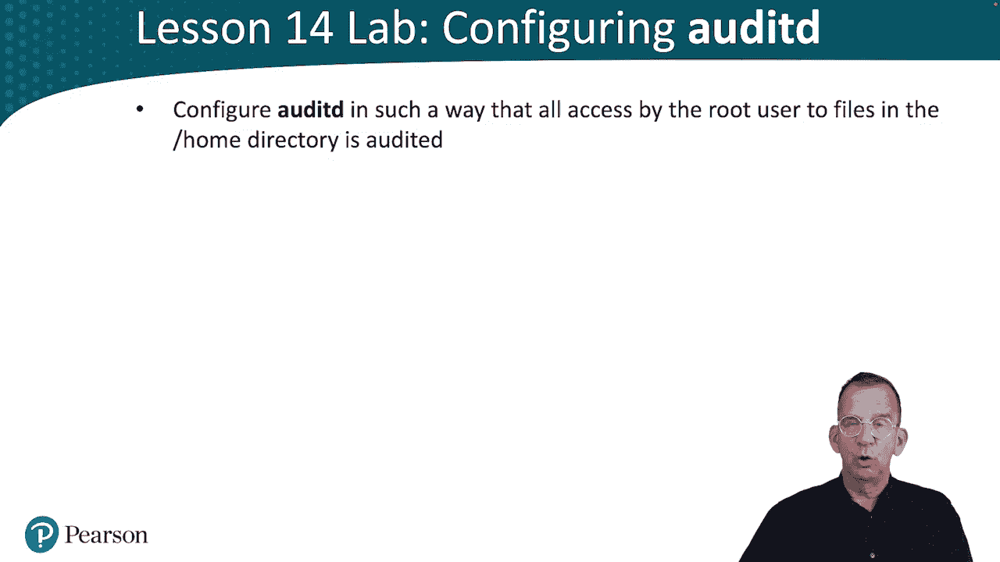

# Linux审计配置实验：Lesson 14：配置审计 🔍

在本节课中，我们将学习如何在 Linux 系统中配置审计功能，重点是记录特定用户对其家目录的所有访问行为。通过本节课的学习，你将了解审计规则的基本工作原理，掌握如何使用命令行工具添加监控规则，并学会检查生成的审计日志。这些技能是系统安全管理和合规审计的基础，对初学者来说也非常实用。

本节课的内容安排比较循序渐进，我们会先说明实验目标，再演示具体的配置命令，最后介绍验证方法。不需要你之前有审计方面的经验，只要懂一些基本的 Linux 命令就能跟上。请跟随我的讲解一步步完成整个配置过程。

刚才我们概述了本节课要学习的内容，接下来进入具体的实验要求和任务说明。

以下是本节课需要完成的核心配置任务：


- 配置系统审计机制，使得用户访问 Felcin 家目录的所有行为都被记录下来。
- 确保审计规则覆盖读取、写入、执行和属性变更等各类访问操作。

完成这两项任务后，系统就会开始对目标家目录的访问行为进行审计记录了。



在明确了配置要求之后，我们继续来看如何在系统中实现这个审计功能。Linux 的审计功能通常由 auditd 服务提供，核心配置依赖于 auditctl 命令和审计规则。要审计用户对家目录的访问，其核心逻辑可以用下面这个公式来描述：

审计规则 = 监控路径 + 访问权限 + 用户标识 + 操作类型

对应的实际配置命令如下所示：

```bash
auditctl -w /home/felcin -p rwxa -k felcin_home_access
```

命令中的各个参数含义解释如下：
- `-w` 表示监控指定的文件或目录路径。
- `/home/felcin` 是要审计的用户家目录路径。
- `-p rwxa` 表示监控读、写、执行和属性变更四种操作。
- `-k felcin_home_access` 为这条规则设置标签，方便日后在日志中检索。

执行这条命令后，系统内核会开始记录匹配的访问行为，并由 auditd 进程将相关信息写入审计日志文件中。

刚才我们完成了审计规则的配置，接下来需要验证这些规则是否已经生效。

以下是验证审计配置的操作步骤：

1. 使用 `auditctl -l` 命令列出当前系统中已经加载的所有审计规则。
2. 以相关用户身份访问 `/home/felcin` 目录，产生一些访问记录。
3. 使用 `ausearch -k felcin_home_access` 命令，或者直接查看 `/var/log/audit/audit.log` 文件，来确认是否有对应的审计日志生成。



每一步都很重要，尤其是最后一步，因为只有在日志中能够查到记录，才能证明审计配置真正起作用。如果没有看到预期的日志，需要检查 auditd 服务是否正在运行，以及规则语法是否正确。

在本节课中，我们一起学习了如何在 Linux 系统中配置审计功能，具体实现了对用户家目录访问行为的审计记录。我们了解了审计规则的基本组成，掌握了使用 auditctl 命令添加监控规则的方法，并且学会了如何验证配置是否生效以及如何查看审计日志。希望你能够通过本节课的学习，在实际系统中部署类似的审计策略，提升系统的安全可追溯性。

