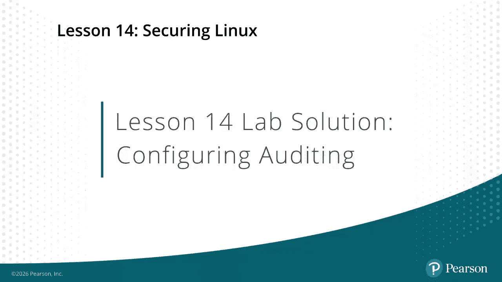
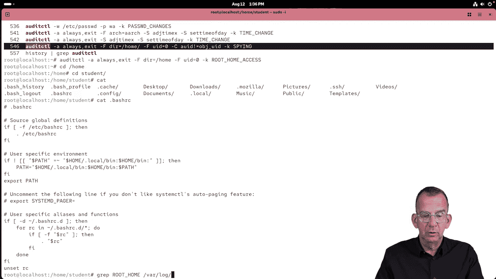

# 🐧 CompTIA Linux+ V8：14：配置审计

## 课程概述


在本节课中，我们将学习如何在 Linux 系统中配置审计功能，特别是监控 root 用户对主目录的访问行为。我们会沿用之前实验的基础，对审计规则做一点小调整，然后通过 history、管道、grep 和 auditctl 等工具来验证配置是否生效，最后查看 /var/log/audit/audit.log 中的记录，了解审计事件的时间戳和事件 ID 含义。



## 修改审计规则

上一节我们介绍了基本的审计规则配置方法，本节中我们来看看如何对已有规则进行微调，使其更精准地捕获 root 主目录下的访问事件。

首先，我们需要对之前做过的内容做一点小修改。我会向你展示 history、管道、grep 和 auditctl 这些工具的使用方法。整体思路是基于之前的命令，但稍微简化一些，只保留最核心的参数，避免设置过于复杂的条件。

以下是核心审计规则命令：

```bash
auditctl -a always,exit -F arch=b64 -F auid=0 -k root_home_access
```

这条命令的意思是：为所有退出事件添加审计规则，专门监控用户 ID 为 0（也就是 root 用户）的操作，并给这条规则打上 root_home_access 这个标签，这样我们在检索日志时就能快速定位相关记录。

## 进入目录并查看配置文件

现在我们需要进入指定目录，确认要监控的配置文件位置正确，这样后续审计才有意义。

我要进入 /home 目录，然后进入 student 子目录，接着查看 .bashrc 文件的内容。这一步主要是确认我们审计的目标文件确实存在于指定路径下，避免因为路径错误而导致审计规则不生效。

以下是常用的目录切换和文件查看命令：

```bash
cd /home/student
cat .bashrc
```



执行完这些操作后，我们就可以开始检查审计日志了，看看系统是否按预期记录了 root 用户的访问行为。

## 查看审计日志

接下来我们打开审计日志文件，验证所有 root 用户的访问行为是否已被记录下来。

查看 /var/log/audit/audit.log 文件，你会看到大量被记录下来的信息。其中最重要的是，所有针对 root 主目录的访问都已经被系统捕获并写入日志，这说明我们的审计规则已经成功生效。

以下是查看日志的示例命令：

```bash
grep "root_home_access" /var/log/audit/audit.log
```

## 解析审计日志中的关键字段

日志文件里记录的信息非常多，初学者可能会觉得眼花缭乱，不知道该关注哪一部分。这里我们重点解释两个容易混淆的字段：时间戳和审计事件 ID。

日志中每一行开头都有一串数字，格式类似于 1712345678.859:307。这串数字的第一部分是 Unix epoch 时间戳，也就是从 1970 年 1 月 1 日开始计算的秒数。你可以使用 date -d @时间戳 命令将其转换成人类可读的时间格式，方便理解事件发生的具体时间。

紧随其后的数字，例如 859，是审计事件 ID（audit event ID）。在同一个审计事件 ID 内部，你还会看到一个序列号，比如从 307 开始一直到 859312。这些序列号表示它们都属于同一连续的事件流，反映了一组相关操作的先后顺序。

如果你想逐步分析到底发生了什么，就需要把所有这些不同事件的相关行全部读取下来，才能还原完整的操作过程，找出问题的根源。

以下是时间戳转换的示例命令：

```bash
date -d @1712345678
```

## 课程总结

本节课中我们一起学习了如何修改审计规则来监控 root 主目录访问，使用了 history、管道、grep 和 auditctl 等工具，查看了 /var/log/audit/audit.log 中的记录，并解释了审计日志中 epoch 时间戳、审计事件 ID 和序列号的含义。希望这些内容能帮助你更好地理解 Linux 审计机制的工作原理。

